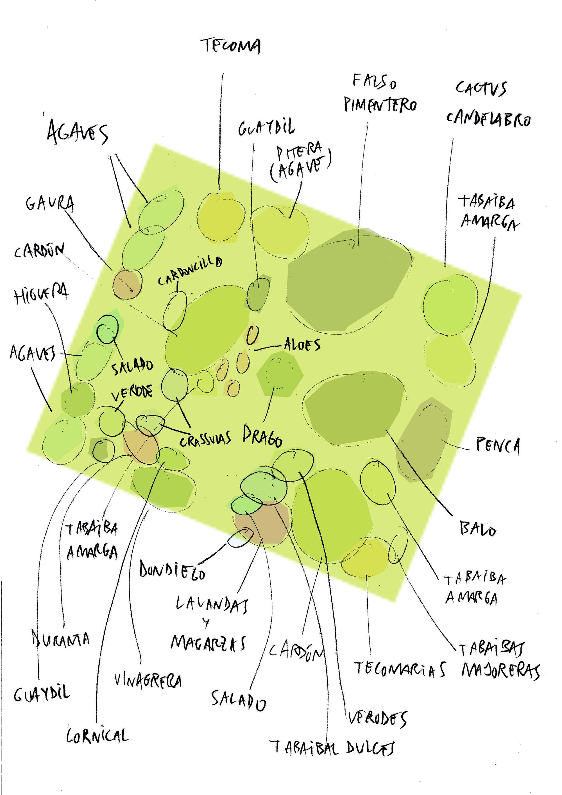

# 1. El primer jardín

Después del asunto del rabo de gato (que a fecha 2025 aún no se ha resuelto del todo) empecé a trabajar en este _primer jardín_, que estaba en estado de abandono.

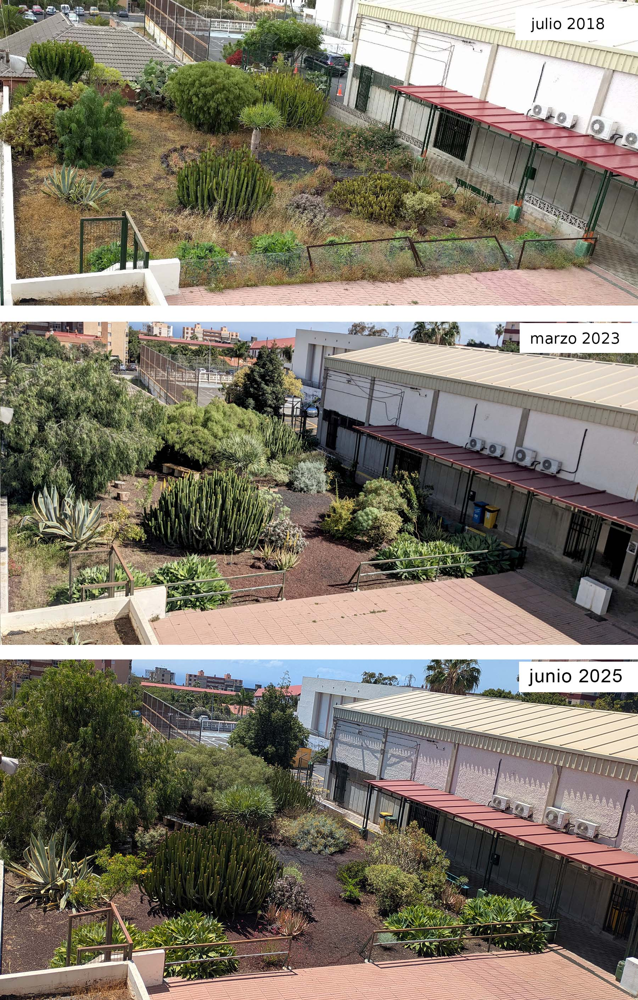

Mi teoría es que hacia la década de 1980, sobre una parcela donde previamente hubo un terrero de lucha, se intentó crear un jardín exclusivamente de especies nativas de las Islas Canarias (en un momento de búsqueda de elementos de identidad, esto llegó a ser común en muchos centros educativos) que luego fue incluyendo otras especies adaptadas a alta insolación y poco riego. De esa época tenemos dos excelentes ejemplares de cardón y un drago, pequeño de tamaño pero con más años de lo que parece, varias euforbias, un balo majestuoso, etc. El jardín fue mantenido por el personal del Centro y en una época se contó con una jardinera (compartida entre varios Institutos). Luego, en algún momento, se dejó de atender, fue siendo invadido por malas hierbas, algunas plantas sobrecrecieron ahogando a otras, aparecieron y tomaron fuerza malas hierbas, etc.
Lo fundamental fue poner en valor la flora canaria ya existente y acompañarla de especies adecuadas. 

A partir de 2018 reordené plantas, eliminé especies inadecuadas para un jardín transitable (algunas cactáceas realmente peligrosas) y fui introduciendo especies nuevas: magarzas, lavandas, cardoncillo, salado, etc. 
Instalé un primer banco fijo, y viendo que el alumnado lo usaba con regularidad, un segundo banco móvil. Dejé un paso transitable a lo largo del jardín y año a año el proyecto llega hasta hoy, siempre en proceso, y cada vez más equilibrado.

2026 
El alumnado del Centro usa a diario el espacio de los bancos para comer algo en los recreos, conversar o estudiar. Muy raramente hay quien no se lleva su basura, y también quien que cree que está bien comer pipas y tirar las cáscaras al suelo, pero son casos muy puntuales. En junio 2026 alguien se llevó el banco móvil a la parte trasera del Pabellón 3, dándome una clara señal de lo que quiere el alumnado: simplemente un espacio en sombra donde sentarse.

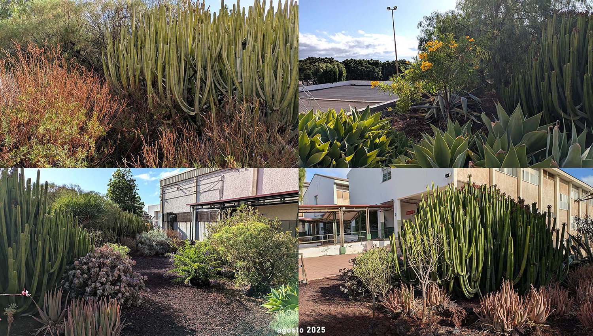

Actualmente (2025) hay aproximadamente un 50% de especies nativas de Canarias, unas 14 especies, junto a otras 14 exóticas en las Islas.

## ESPECIES NATIVAS DE CANARIAS

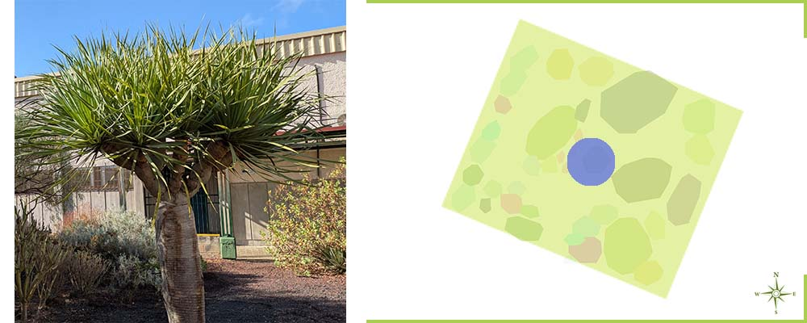

### Drago
_Dracaena draco_

En el centro del jardín tenemos un drago. 
Su nombre científico, _Dracaena draco_, proviene de la raíz latina _Draco_, dragón. En la Edad Media su savia de color rojizo se asociaba a la mítica sangre de dragón, de propiedades mágicas.

El drago no es realmente un árbol, su tronco no es de madera sino la acumulación de las cicatrices de sus antiguas hojas, más o menos como las palmeras (ambas son monocotiledóneas). Las estimaciones de edad de los dragos se han basado en el conteo de ramas, aunque es un método poco exacto. Aplicándolo a nuestro drago su edad aproximada (unos 15 años por cada vez que ha florecido y se ha ramificado) debe ser al menos 30 años.

Estas dataciones poco exactas pueden estar cambiando. Hay estudios recientes, además realizados en Canarias, que establecen nuevos métodos de datación de las monocotiledóneas. En equipo de Franco Biondi, de la Universidad de Nevada, Reno, USA, con un equipo que incluía investigadores de la ULPGC, llevó a cabo un estudio de dragos y palmeras en Canarias, publicado en 2023 en el boletín [Plants](https://www.mdpi.com/journal/plants) [Longevity Estimates of Canary Palms and Dragon Trees via Radiocarbon Dating: Initial Results](https://accedacris.ulpgc.es/bitstream/10553/128675/1/plants-13-00045.pdf).

> Estimar correctamente la esperanza de vida máxima de las especies vegetales es fundamental para los estudios demográficos y de historia de vida, necesarios para comprender los impactos climáticos. Las monocotiledóneas arbóreas, que pueden alcanzar más de 30 m de altura y más de 5 m de perímetro de tronco, son difíciles de datar debido a que no presentan dormancia estacional; por lo tanto, su longevidad se ha estimado mediante diversos métodos basados ​​en el tamaño. En este estudio, se evaluó la datación por radiocarbono (¹⁴C) con espectrometría de masas con acelerador (AMS) como herramienta complementaria para determinar la edad de dos monocotiledóneas emblemáticas: la palmera canaria y el drago ... Gracias a la constante mejora de las herramientas de espectrometría de masas con carbono 14 (14C-AMS), estas pueden contribuir a perfeccionar el conocimiento científico existente sobre la megaflora carismática de la Macaronesia.

&emsp;&emsp;_Dragos y palmeras de los que se tomaron muestras en el estudio del equipo de Biondi_

En las Islas Canarias encontramos al drago en la naturaleza en barrancos y medianías, aunque su hábitat favorito es -mala suerte- justo la zona dónde ahora están la mayoría de los pueblos: las medianías. Los indígenas y los primeros colonizadores europeos debieron poder pasar entre bosques de dragos, dragonales. Hoy quedan, en la naturaleza, unos pocos grupos de dragos salvajes, y ejemplares aislados en barrancos. Muchos topónimos nos hablan de dragos, algunos que servían precisamente como referencias geográficas: Barranco del Drago, Lomo del Drago, El Draguillo, etc. En Gran Canaria los topónimos Dragonal Bajo y Dragonal Alto recuerdan que por allí, en el Barranco de Guiniguada, muy cerca del Jardín Canario, debió haber un bosque de dragos.

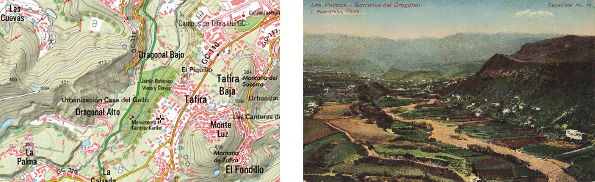
&emsp;&emsp;_Mapa de Dragonal y antigua postal de la zona: Barranco de Guiniguada_

Tenerife es la isla con un mayor número de poblaciones naturales que se encuentra sobre todo en las zonas geológicamente más antiguas de esta isla, destacando el Macizo de Anaga, Macizo de Teno y Adeje. En La Palma destacan los bosquetes de dragos de Las Tricias y Buracas. 
Primos del drago son los Troncos de Brasil, esa planta inmortal que siempre  has visto en la oficina donde vas a sacar un certificado. También son de la familia los preciosos árboles-drago de la isla de Socotra, en el este de África (y que quizá desaparezcan debido al calentamiento global).

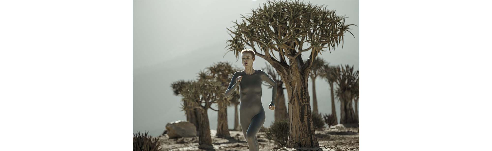
&emsp;&emsp;_Raised by wolves, 2020. Los dragos de Socotra como paisaje de ciencia-ficción_

El drago ha despertado mucho interés en científicos y viajeros a lo largo de la historia de Canarias, no sólo por ser especie emblemática de la Macaronesia y Canarias, sino por sus peculiaridades, como su longevidad o las propiedades curativas de su savia, alcanzando un estatus casi mítico.
El estudio [La ilustración científica de la Dracaena draco de Canarias (1576-1970)])(https://www.ull.es/revistas/index.php/artes/article/download/6593/4479/) recopila una historia gráfica de este interés.

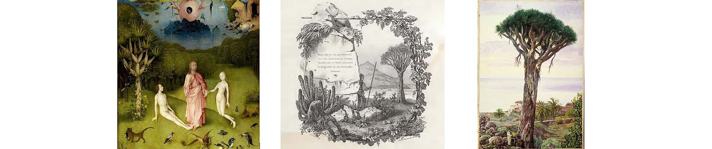
&emsp;&emsp;_El Bosco, El jardín de las delicias, 1500-1505. | Sergent-Marceau, 1832, para Histoire Naturelle des Îles Canaries. | Marianne North, Drago San Juan de la Rambla, 1875._

**Dragos de Gran Canaria**
En Gran Canaria hay algunos dragos silvestres. Después de tantos siglos, se identificó, en 1990, una nueva especie denomina drago de Gran Canaria _Dracaena tamaranae_. 
El hallazgo de esta especie es para mí una historia casi increíble: se cuenta [en este artículo](https://pellagofio.es/islas/naturaleza-y-territorio/flora-y-fauna/la-primera-floracion-veinte-anos-despues/). Actualmente deben quedar alrededor de 70-80 ejemplares silvestres en la isla, además de otros en el Jardín Canario, de semillas recolectadas. 

Un artículo interesante:  [Los dragos del archipiélago canario](https://www.rinconesdelatlantico.es/num6/lector.php?id=142) por Rafael S. Almeida, en la revista Rincones del Atlántico.

Oficialmente el drago es el símbolo vegetal oficial de la isla de Tenerife. Obviamente a la especie, que pudo llegar a las Islas hace 10 millones de años (en el Mioceno) esto poco le importa.

***

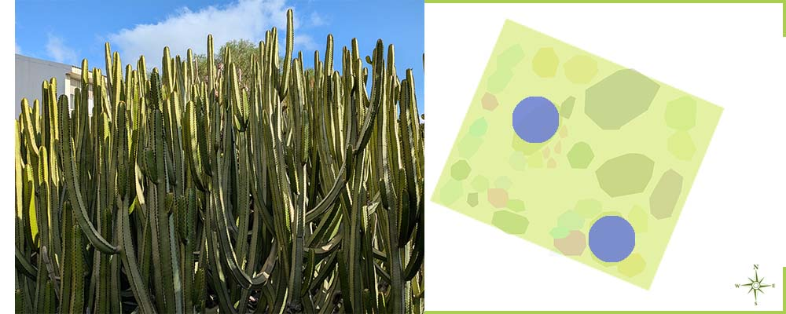

### Cardón
_Euphorbia canariensis_

Tenemos dos ejemplares de cardón, aproximadamente de unos 30 años de edad.
Aunque la primera impresión es que es un cactus, no es así, es de otro grupo de plantas, las euforbias. Las espinas que vemos en el cardón son en realidad hojas transformadas en defensas. Su savia es una especie de látex blanco, tóxico e irritante para la piel y -mucho cuidado- para los ojos.
Florece a principios de verano, con unas curiosas flores rojas, como cápsulas exóticas, que a finales del verano ya son frutos y los días de calor estallan para lanzar las semillas a distancia, un sistema de esparcir semillas muy singular (y con nombre también singular: autocoria).

Euphorbos era el nombre del médico del rey Juba II, que escribió sobre botánica y dio este nombre al género. 
La palabra deriva del griego _eu-_ ‘bueno’, y _-phorbe_ ‘pasto o forraje’, por lo que _Euphorbos_ tendría el significado de ‘bien alimentado’. _Canariensis_, por las Canarias, aunque hay más euforbias en las Islas.

Oficialmente es el símbolo vegetal oficial de la isla de Gran Canaria.

***

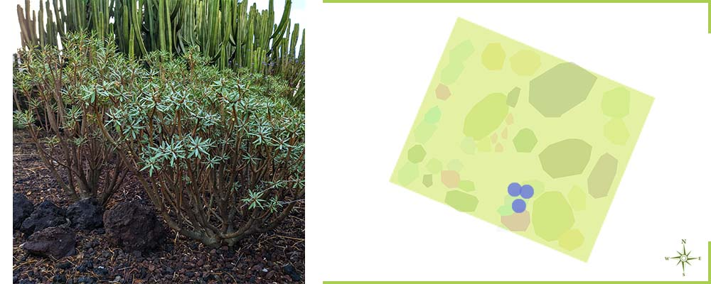

### Tabaiba dulce
_Euphorbia balsamifera_

Esta planta es de la familia de las euforbias, en Tenerife la podemos encontrar en toda la costa del sur, a veces en comunidades extensas, los tabaibales. 
Es fácil de distinguir por su forma redondeada, porte bajo, incluso se aplasta contra la tierra o la lava de los malpaíses, y color rojizo.
Se adapta muy bien a la falta de lluvia acumulando agua en sus ramas para la estación seca. En cuanto caen las primeras lluvias del invierno desarrolla rápidamente hojas, flores y frutos.
Su savia o látex no es tóxico (al contrario que la mayoría de plantas de su familia), y ha tenido diversos usos se cree que desde tiempos prehispánicos. incluso usos alimentarios, seguramente por eso se la conoce como tabaiba dulce. 

Una investigación reciente dirigida desde el Real Jardín Botánico (RJB) del Consejo Superior de Investigaciones Científicas (CSIC), con la participación de otras instituciones sobre las poblaciones canarias de la tabaiba dulce ha reconstruido las relaciones filogenéticas entre la _E. balsamifera_ y sus parientes _Euphorbia adenensis_ y _Euphorbia sepium_, presentes en varias zonas del continente africano, mediante estudios del genoma nuclear. Según sus conclusiones, lo más probable es que las balsamiferas se extinguieran en el continente, quedando algunas poblaciones residuales (las actuales _adenensis y sepium_), y también desaparecieran en Fuerteventura y Lanzarote, y en una etapa posterior se recolonizaran estas islas desde Tenerife y Gran Canaria y de ahí de nuevo las tabaibas llegaran a la costa oeste de África. Un viaje de ida y vuelta.
Esta investigación, que nos muestra qué direcciones pueden seguir las investigaciones actuales en botánica, se ha publicado en la revista [Annals of Botany de mayo/junio 2024](https://academic.oup.com/aob/article/133/5-6/883/7514051
https://pmc.ncbi.nlm.nih.gov/articles/PMC11082519/)

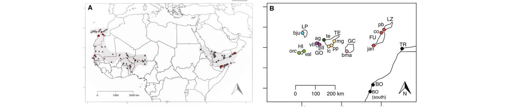
&emsp;&emsp;_E. balsamifera (círculos), E. adenensis_ (rombos) y E. sepium (triángulos) en África  | Poblaciones de E. balsamifera estudiadas en las Islas Canarias._

***

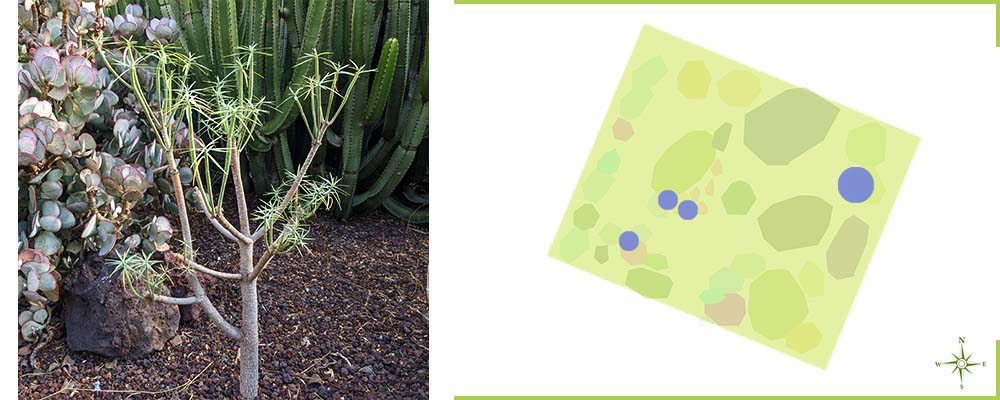

### Tabaiba amarga
_Euphorbia lamarckii_ 

Con bastantes similitudes con la tabaiba dulce, pero sus ramas son verdosas y de crecimiento vertical. En este jardín hay un ejemplar especialmente alto.
Cuidado con su látex, que es irritante para la piel y sobre todo ojos y mucosas.

Hasta hace pocos años se la llamaba _Euphorbia regis-jubae_, en honor al rey Juba de Mauritania, pero un estudio más detallado encontró algunas diferencias que hacen que la especie de Gran Canaria mantiene el nombre _regis-jubae_ y la que se encuentra en Tenerife se llame ahora _Euphorbia lamarckii_, nombre puesto en honor al naturalista francés de los siglos XVIII y XIX Jean-Baptiste Lamarck. 

Me permito incluir aquí un apunte para un desvío: Lamarck es quien estableció el término **biología**, y desarrolló la primera teoría sobre la evolución de la vida en su obra _Filosofía Zoológica_, publicada en 1809. La propuesta de Lamarck propició grandes debates, que hicieron posible las investigaciones de Darwin. Charles Darwin nació el mismo año de publicación de _Filosofía Zoológica_, y medio siglo después, en paralelo a Alfred Russel Wallace, desarrolló teorías que explicaban los mecanismos básicos de la evolución de las especies. Antes de eso Lamarck  ya había sido denostado y olvidado, terminando su vida en la miseria, dictando (estaba ciego) sus últimas obras a sus hijas. Sin embargo, a finales del siglo XX, científicas como Lynn Margulis han recuperado parte del pensamiento de Lamarck, por ejemplo en su obra _Planeta simbiótico_, de 1998, y con su hipótesis de la simbiogénesis como principal fuerza evolutiva. Esta hipótesis contradice el actual paradigma de la síntesis evolutiva moderna y los postulados de Darwin y por tanto del neodarwinismo. Vemos de nuevo cómo la Ciencia no trata de verdades absolutas, sino que propone teorías que más adelante serán extendidas o rebatidas. 

&emsp;&emsp;_Lamarck, Darwin y Margulis_

***

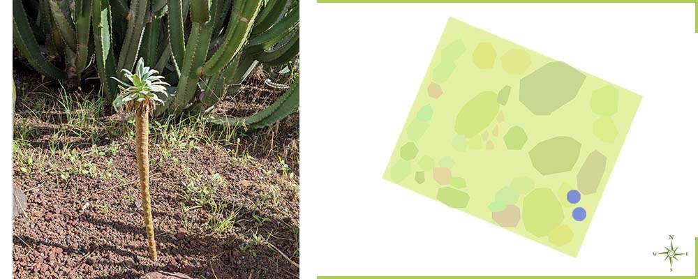

### Tabaiba roja o majorera
_Euphorbia atropurpurea_

Tabaiba roja, o tabaiba mejorera o más comúnmente tabaiba majorera. A pesar de su nombre vulgar tabaiba majorera, nada tiene que ver con la isla de Fuerteventura, y quizá proviene de una confusión con mejorera, que puede tener su origen en la creencia de mejoraba la leche de las cabras que la consumían. Es endémica de la isla de Tenerife. Se desarrolla entre los 300 a 1100 msnm en el sur y oeste de la isla, desde el valle de Güímar hasta el macizo de Teno, creciendo en barrancos y laderas. Sus flores son llamativas inflorescencias de color rojo-púrpura. En este jardín tiene un crecimiento muy lento.

Al igual que otras especies del género _Euphorbia_, toda la planta tiene un látex de color blanco, pegajoso y tóxico.

Ocasionalmente se hibrida con _Euphorbia lamarckii_, dando lugar a un híbrido denominado _Euphorbia x navae_, y con _Euphorbia aphylla_, generando el híbrido llamado _Euphorbia x petterssonii_. También se ha citado su hibridación con _Euphorbia bourgeana_ en la Ladera de Güímar.
Este caso es un buen ejemplo de por qué en jardinería con plantas nativas es recomendable usar especies que estén dentro de su área de distribución natural, dado el peligro de contaminación genética que supone el ponerlas en contacto con poblaciones de otras especies de su mismo género. Por ejemplo, ¿qué pasaría si usaras tajinaste rojo, especie de Tenerife, especialmente Las Cañadas del Teide y La Palma (_Echium Wildpretii_) en jardines en la zona del campus de Tafira, en Gran Canaria? ¿Afectaría a las poblaciones endémicas de tajinaste blanco (_Echium decaisnei_). De hecho, ya se considera una especie traslocada a la isla de Gran Canaria, escapada de su uso en jardinería, lo que quizá no haya sucedido aún es esa contaminación genética.

***

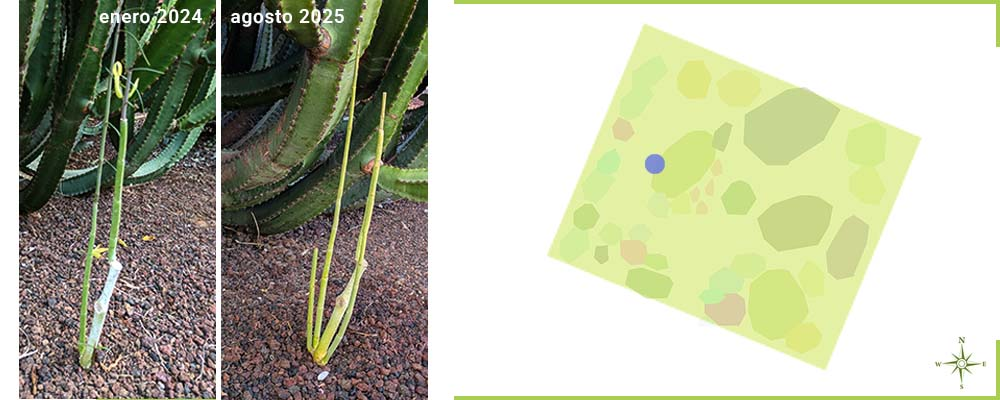
_18 meses de crecimiento_

### Cardoncillo
_Ceropegia dichotoma_

Aunque se llame cardoncillo es una especie totalmente diferente al cardón.
Después de varios intentos estoy teniendo la suerte de que arraigue una de las dos especies que existen en Tenerife de cardoncillo, la del norte de la isla (_dichotoma_). En los jardines del patio he introducido en marzo 2025 la especie del sur (_Ceropegia fusca_). 

***

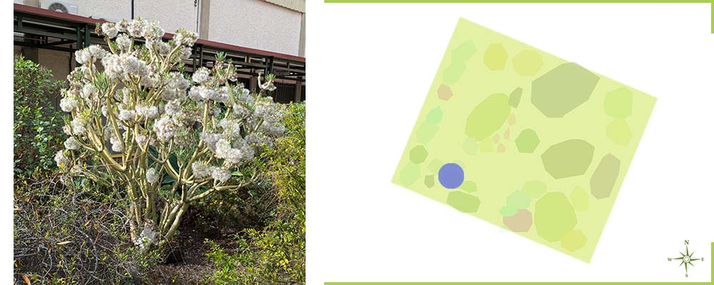
_El senecio más antiguo de estos jardines, en plena dispersión de semillas, un show veraniego_

### Senecio / Verode
_Kleinia neriifolia_

Se le suele llamar también verode, aunque el nombre, como muchos nombres comunes, va cambiando según las islas y las zonas. Esto es confuso ya que también se llama verodes a casi todo el género Aeonium.
Es una planta muy resistente, que aquí se reproduce por sí misma con las semillas transportadas por el viento. En verano pierde todas sus hojas y las recupera en invierno.

***

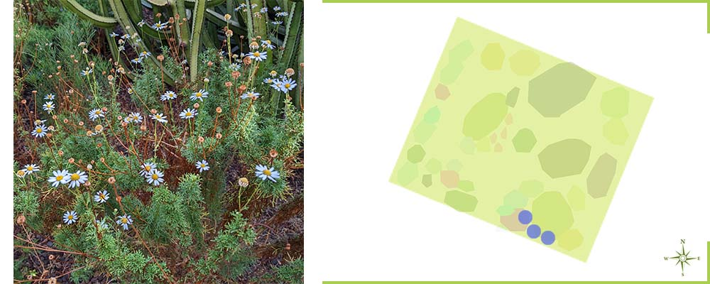

### Margarita / Magarza
_Argyranthemum frutescens_

Margarita nativa de las Islas Canarias que llegó a este jardín por sí misma, transportada por el viento o por los pájaros, y que llegó a Inglaterra, transportada por algún botánico para la colección de la reina Mary II en el [palacio de Hampton Court](https://www.hrp.org.uk/hampton-court-palace/whats-on/hampton-court-gardens/national-plant-collections/) ya en el siglo XVI, luego a Holanda, Francia etc, y desde entonces se han desarrollado (y siguen desarrollándose y patentándose) miles de cultivares con todo tipo de tamaños, colores y adaptaciones a otros climas. 
Su familia, las _Asteraceae_, está formada por unas 24 especies de Canarias y Madeira.

Su nombre _Argyranthemum_ procede del griego _argyros_, "plateado" y _anthemom_ "planta de flor", aludiendo a sus flores radiantes pálidas. _Frutescens_ del latín frutescere, que significa "echar o producir vástagos o renuevos" como referencia a su ramificación exuberante.

***

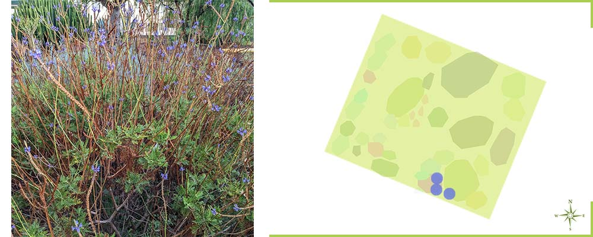

### Lavanda
_Lavandula canariensis_ 

También llamada matorrisco, lavanda, romanillo o yerba risco, es un endemismo canario, frecuente y hasta abundante en barrancos y laderas pedregosas del cardonal-tabaibal, formando parte de la vegetación típica de ese ecosistema. Aparece menos en áreas cálidas y soleadas de los bosques termófilos. 

Es resistente a la sequía y a la insolación y es de la misma familia que las lavandas que se utilizan comercialmente para fabricar perfumes, aunque con menos olor. Lavandula es un género de plantas aromáticas de unas 40 especies distribuidas desde las islas macaronésicas hasta la India. Cinco especies son nativas de las Islas Canarias (cuatro endémicas), conocidas como “matorriscos”: L. canariensis (presente en todas las islas principales), L. minutolii (Gran Canaria y Tenerife), L. buchii (Tenerife), L. bramwellii (Gran Canaria) y L. pinnata (Lanzarote, también presente en Madeira). 

En la conferencia de 2021 [La especiación de las lavandas en las Islas Canarias: cuándo, dónde y cómo](https://www.researchgate.net/publication/366153989_La_especiacion_de_las_lavandas_en_las_Islas_Canarias_cuando_donde_y_como), presentada en el Primer Congreso Español de Botánica se expuso este estudio sobre muestras de poblaciones de las cinco especies canarias. Sus conclusiones son que en las Islas Canarias ha habido por lo menos dos colonizaciones por parte del genero Lavándula. Las especies _L. buchii_, _L. minutolii_ y _L. bramwellii_ se han originado a partir de la especie de distribución mas amplia: _L. canariensis_. _L. Pinnata_ (presente en Lanzarote) aparece como un linaje independiente al resto de especies canarias.

Las lavandas de este jardín se trajeron de la zona costera del Valle de Güímar. Tras varios intentos una de ellas arraigó y ahora su propia semillas van haciendo que aparezcan nuevas plantas. También se han llevado plántulas al jardín del patio y allí se está multiplicando. 

***

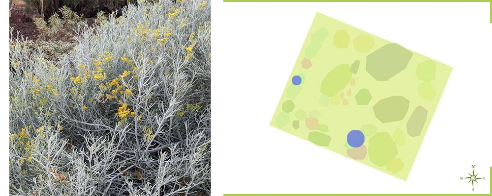
_Una de mis plantas nativas favoritas para jardinería sostenible: pocos cuidados, gran volumen, color y floración_ 

### Salado
_Schizogyne sericea_

El salado blanco, también conocido como dama en algunas islas es un endemismo macaronésico presente en el Archipiélago Canario y en las islas Salvajes, al norte de Canarias. En El Hierro la única voz que se usa es _irama_, que ha dado nombre incluso a una zona de la costa del Sur de la isla, cercana a La Restinga, en plural, Iramas. El nombre le viene, evidentemente, de la abundancia de estas plantas en el lugar.

Crece en la zona litoral de las islas, sobre sustratos de rocas, laderas y enclaves arenosos, donde la influencia de la maresía generalmente está presente. También es habitual encontrar el salado blanco colonizando los caminos y bordes de carreteras, así como aquellos terrenos alterados por la acción humana. Su área de distribución abarca desde las zonas costeras o litorales hasta altitudes de más de 400 metros. Se ha utilizado en la medicina popular canaria para el tratamiento de algunas dolencias.
Estos ejemplares se han recolectado recién nacidos en la zona costera del Valle de Güímar. Se ha adaptado muy bien, y aparte de sus pequeñas flores amarillas sus hojas tienen un color verde pálido que da una buena nota de contraste.

_Schizogyne_ procede del griego _schizein_, "partir o separar" y _gyne_, "hembra", refiriéndose al estigma partido de las flores. De la misma raíz viene la palabra “esquizofrenia” (esquizo: dividir, fren:mente). _Sericea_ procede del latín sericum, "seda", aludiendo a su textura sedosa al tacto.

***

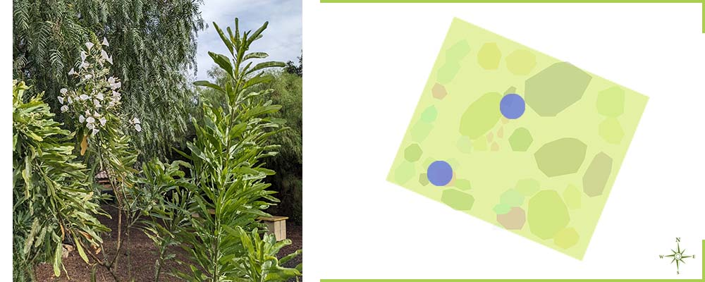

### Guaydil
_Convolvulus floridus_

Es una  planta presente en todas las islas del archipiélago canario (aunque rara en Lanzarote y Fuerteventura). Es una endémica de carácter heliófilo y xerófilo (o sea, le gusta el sol y está adaptada a medios secos), característica de los bosques termófilos y de las zonas altas del cardonal-tabaibal. Su hábitat está entre 200 y 700 metros de altitud en riscos, laderas y barrancos. 

Tenemos dos ejemplares de guaydil, una planta nativa de Canarias, a las que les ha costado adaptarse y han crecido muy lentamente, aunque en teoría aquí tiene buenas condiciones. En unos años, si siguen progresando, serán arbustos grandes con flores blancas muy vistosas. Por su floración y su resistencia a condiciones adversas es una planta que se usa frecuentemente en jardinería pública de carreteras en Canarias.

_Convolvulus_ viene del latín _convolvere_ (enredar). _Floridus_ por su abundante y llamativa floración. El nombre _guaydil_ se considera una palabra indígena, aunque no se ha podido precisar su significado. La especie fue descrita por Carlos Linneo el Joven (hijo de Linneo)

***

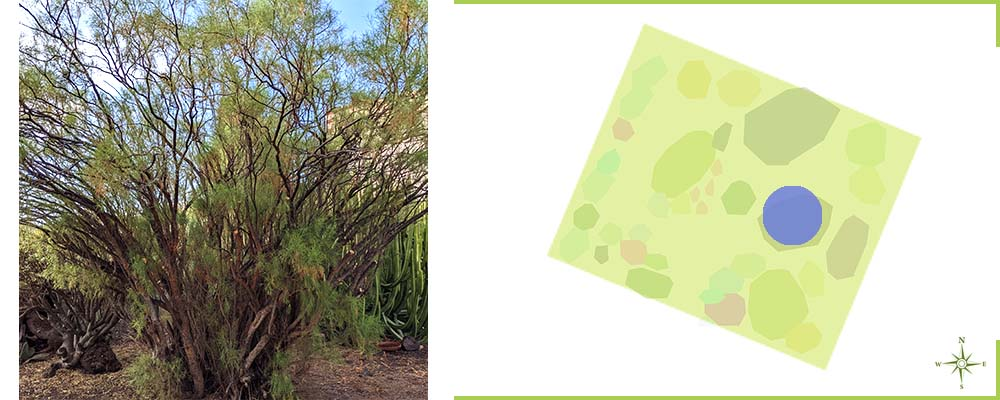

### Balo
_Plocama pendula_

El balo es un arbusto bastante denso, con ramas frágiles, colgantes y hojas filiformes que puede superar los 3 metros de altura. Cualquier parte de la planta al estrujarla desprende un olor bastante característico. Su fruto son racimos de pequeñas bayas redondas y de color blanco, que suelen comer los lagartos (dispersando luego la semilla con sus excrementos).
Es un endemismo canario abundante en las islas de Gran Canaria, Tenerife y La Gomera, siendo más raro en La Palma y El Hierro, mientras que en Fuerteventura solo se ha podido localizar poquísimos ejemplares. El balo nace de forma natural en las zonas de cardonal-tabaibal y sobre todo, en los tramos inferiores de algunos barrancos, donde forma a veces comunidades.
Las ramas del balo se han usado en el campo para cubrir las papas y así evitar la proliferación de plagas durante su almacenamiento. Asimismo se han utilizado las ramas, hojas y frutos para alimentar los conejos o cabras, aunque hay alguna referencia que afirma que le puede dar mal sabor a la leche. En apicultura, el balo es considerado una planta de interés melífero ya que produce una de las mieles más dulces y claras. Tiene unas espectaculares raíces que profundizan mucho, hasta 12 metros, en una estrategia para acceder al agua. Este dato lo escuché en una conferencia hace años, y no he podido encontrar la fuente ni estudio de referencia. 

La palabra _balo_ se considera prehispánica, se recoge en el [Diccionario histórico del español de Canarias](https://www.rae.es/tdhle/balo) con usos escritos desde el siglo XVI, y se encuentra en la toponimia de las islas dando nombre a lugares con variantes como balo, baliera, balillo.

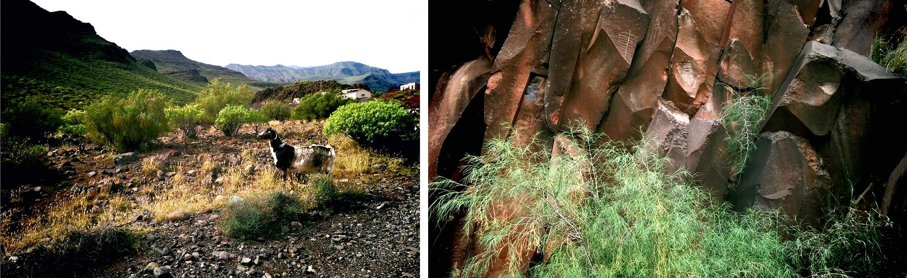
&emsp;&emsp;_Balos en el Barranco de Balos, Gran Canaria_ | _Balos junto a la estación de grabados indígenas [Los letreros de Balos](https://guanchismos.ulpgc.es/item/11613)_

_Plocama_ podría proceder del griego _plochamos_, que significa cestería, aludiendo a sus ramillas intrincadas. _Pendula_ del latín _pendulus_, colgante, en referencia a sus ramas, que tienen un aspecto similar al del sauce llorón.

Estos datos y más se recogen en la extensa [ficha sobre la _Plocama pendula_](https://www.conecte.es/media/com_concibe/files/Plocama%20pendula.pdf) dentro del [Inventario Español de los Conocimientos Tradicionales relativos a la Biodiversidad, IECTB](https://www.miteco.gob.es/es/biodiversidad/temas/inventarios-nacionales/inventario-espanol-de-los-conocimientos-tradicionales/inventario_esp_conocimientos_tradicionales.html), promovido por el Ministerio de Agricultura, Alimentación y Medio Ambiente. Otra forma de ver estos datos es en [su ficha](https://www.conecte.es/index.php/es/plantas/1710-plocama-pendula/usos-tradicionales).

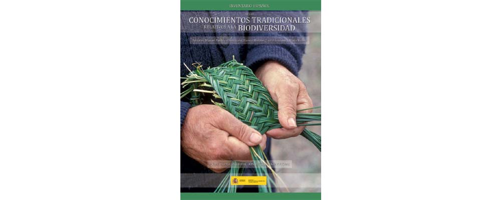

Algunas [directrices básicas de este inventario](https://www.revistaambienta.es/es/historico/2015/110/110-l1.html):

>La inclusión de los conocimientos tradicionales en el Convenio de Naciones Unidas sobre Diversidad Biológica (1992) constituyó un hito fundamental tanto para el reconocimiento de su valor e importancia como para explicitar su íntima relación con la conservación y uso de la biodiversidad. Este Convenio reconoce la estrecha dependencia que tienen las comunidades indígenas y locales con los sistemas de vida tradicionales basados en los recursos biológicos,
...
Los conocimientos tradicionales se consideran una fuente de información para el diseño de políticas ambientales relacionadas con la biodiversidad. 
...
El Inventario Español de los Conocimientos Tradicionales relativos a la Biodiversidad se centra en los conocimientos tradicionales relacionados con la biodiversidad silvestre de España –flora, fauna y ecosistemas.
...
Los conocimientos tradicionales se estudian desde diferentes ámbitos académicos, por lo que una comprensión completa de los mismos requiere una visión holística y multidisciplinar. La aproximación fundamental para la elaboración de este inventario parte de la etnobiología. 
...
El inventario recoge conocimientos tradicionales previamente publicados, habiéndose utilizado únicamente obras en las que los conocimientos han sido recopilados mediante técnicas directas de recogida de datos, es decir, a partir de entrevistas _in situ_ a informantes locales y observación participante (fuentes primarias).

***

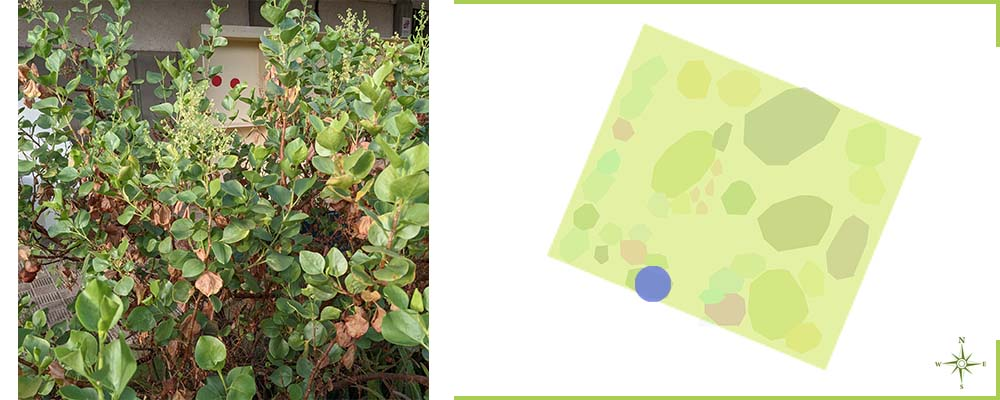

### Vinagrera
_Rumex lunaria_

La vinagrera o calcosa es un arbusto que puede alcanzar una altura entre 1-3 metros. Inflorescencias en racimos, compuestos de pequeñas flores de color verdoso. Está presente en todas las islas del archipiélago canario.
Es una especie bastante común en la comunidad del Tabaibal-Cardonal, aunque su hábitat se extiende hasta la zona de medianías y en los límites marginales de los bosques de monteverde y pinar. Es un arbusto muy extendido que crece tanto en terrenos pedregosos como en zonas de huertas abandonadas, terrenos removidos, bordes de pistas, caminos e incluso en los márgenes de las carreteras. También se le considera como una especie de las que primero colonizan las coladas de lava, conos volcánicos, laderas de lapilli más recientes.
Aseguran algunos campesinos que la mejor manera de cuidarse la garganta y tener una buena voz consiste en masticar de vez en cuando algunas hojas crudas de vinagrera, sin que deba importamos el sabor ácido (avinagrado) de las mismas, ni la sensación "rasposa" que dejan en el paladar. Aún se aprovecha como planta forrajera para las cabras.

_Rumex_ es el nombre que se le daba en latín a todo el género (hay unas 120 especies). _Lunaria_: procede del latín _luna_:, aludiendo a la similitud de las valvas de los frutos, más o menos orbiculares, con la luna llena.

***

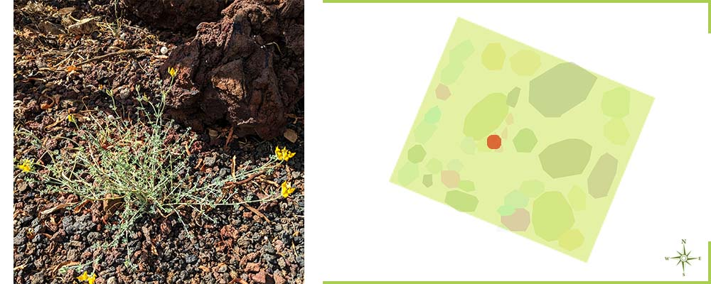

Corazoncillo
_Lotus sessilifolius_ - 💀 desaparecido

El corazoncillo, una planta rastrera que se recolectó muy joven de la zona costera del Valle de Güímar. De color verde pálido, con pequeñas hojas sin pedúnculo de aspecto delicado y unas flores de amarillo intenso.

Finalmente, después de una floración, al cabo del primer año desapareció. 

***

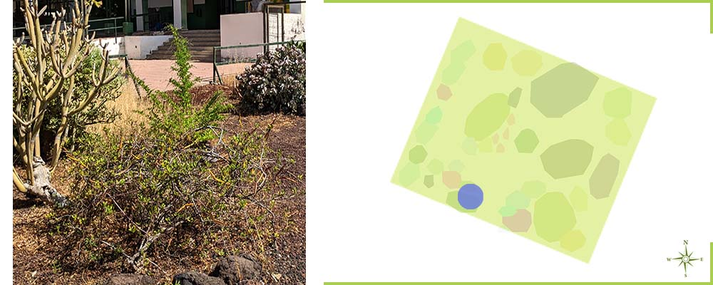

### Cornical
_Periploca laevigata_

Es un arbusto de tallos muy entrelazados unos con otros, de estrechas hojas lanceoladas y opuestas¡. El fruto de entre 5 y 10 cm de longitud tiene forma de cuernos opuestos, de ahí su nombre vulgar cornical. Las semillas son de color pardo con un penacho de pelos blancos que las hace volar en el viento. 
Crece en terrenos volcánicos o calizos, pedregosos  secos, próximos al mar, en comunidades de tabaibal-cardonal o matorral, entre 5 y los 50 msnm. de altitud. Suele buscar una planta cercana que utiliza como soporte para enredar sus ramas, por ejemplo lo puedes encontrar dentro de un cardón, enredado en sus brazos. Este ejemplar suele prolongar ramas hacia el senecio cercano, buscando soporte. Cuando despejé este cornical de un cactus que lo asfixiaba le construi un soporte triangular de hierros a unos 40cm. del suelo, que le ha permitido tener una forma casi arbustiva.

Además de en las Islas Canarias se distribuye por otras islas macaronésicas (Salvajes y Cabo Verde) el norte de África (Siria, Egipto, Libia, Túnez, Argelia y Marruecos) y sureste de España. En la península ibérica  está en la Región de Murcia, Almería y parte de Alicante. 

Para algunos autores existen tres especies de cornical en el área que comprende el Mediterráneo occidental y las islas macaronésicas. Las poblaciones del Mediterráneo y noroeste de África serían _Periploca angustifolia Labill._, diferente a la especie canaria _P. laevigata_ y a la de las islas de Cabo Verde._P. chevalieri_. Estudios más recientes, sin embargo, consideran una sola especie, _P. laevigata_ a pesar de la gran variación en algunos rasgos (por ejemplo, forma o tamaño de la hoja, etc.).

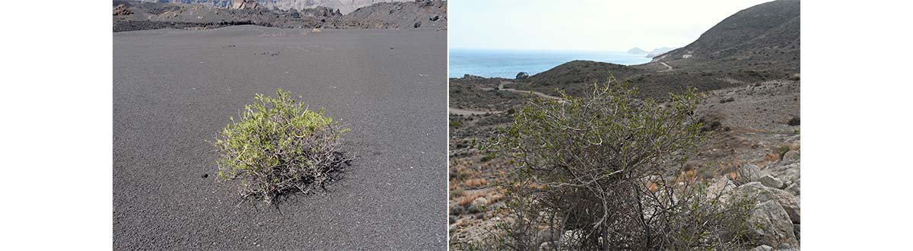
&emsp;&emsp;_Periplocas en Chã das Caldeiras, Isla de Fogo. Foto: Ji-Elle, y en Parque Natural Cabo de Gata, Andalucía. Foto: Krzysztof Ziarnek, Kenraiz. Ambas fotos bajo licencia CC:BySa._

_Periploca laevigata_ fue descrita por el botánico William Aiton y publicado en _Hortus Kewensis_. Este libro de 1789 era un catálogo de 1789 de todas las especies de plantas y luego en cultivo en el Royal Botanic Gardens, Kew, que eran la gran mayoría de las especies de plantas en el cultivo de toda Inglaterra.

Del griego _periploke_, abrazo, por cómo se enredan en sí mismo y también en plantas cercanas. De esa misma raiz viene la palabra periplo, un largo viaje, recorrido o circunnavegación que por lo general regresa al punto de partida.  _laevigata_ viene del latín liso.

***
***

## ESPECIES NO NATIVAS DE CANARIAS

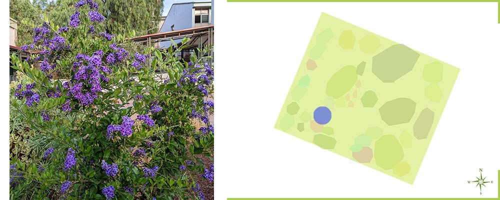

### Duranta
_Duranta erecta_

Es un arbusto distribuido desde México a América del Sur y las Antillas. Se usa como planta ornamental en jardines tropicales y subtropicales de todo el mundo, y se ha naturalizado en muchos lugares. En México, los originarios de habla náhuatl la nombraban _xcambocoché_. En nuestro entorno no tiene nombres comunes conocidos, pero los ingleses, en una demostración de su interés en identificar las plantas, y también de su cursilería, le dan varios nombres comunes, como: _golden dewdrop_, _pigeon berry_, o _skyflower_ (gota de rocío dorada, baya de paloma o flor de cielo).
Tiene flores muy vistosas color violeta y frutos amarillos lo convierten en un elemento destacado en los jardines. Las flores atraen a las mariposas.

Las hojas y bayas de la planta pueden ser tóxicas, así que no te las comas.

El nombre _Duranta_ le fue dado en honor de Castor Durantes, un botánico italiano del siglo XV.  
Este ejemplar fue una donación de un profesor.

***

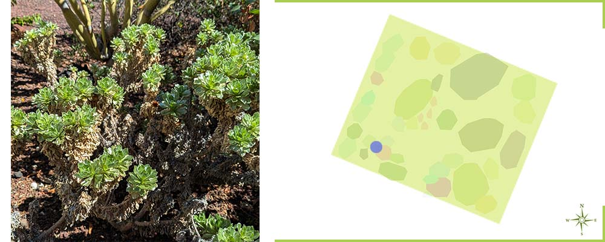

### Margarita de mar
_Pallenis maritima_

Esta es una de las primeras plantas que compré en vivero y traje al jardín, pensando que era el endemismo de Fuerteventura _jorao_ (me lo vendieron como "margarita majorera", pero nunca ha crecido más allá de unos 30 cm de alto, con lo cual ya sé que se trata de una especie muy cercana, la _Panellia maritima_, que últimamente se suele encontrar en algunos viveros. 

Es un arbusto de tamaño pequeño, hasta 30cm. de alto, de base leñosa con hojas vellosas y llamativas flores amarillas (en realidad son inflorescencias, o sea grupos de flores) semejantes a las margaritas. Florece casi todo el año, en especial desde la primavera hasta bien entrado el verano. Son sinónimos: _Asteriscus maritimus_ y _Odontospermum maritimum_. 

Soporta altos niveles de insolación, prolongadas sequías en verano y suelos salinos (halófila). Por esto es una planta ideal para xerojardinería. Es pionera en la colonización de suelos pobres, arenosos o rocosos, ayudando en la formación y estabilización de dunas costeras y previniendo la erosión. En el medio natural se la encuentra en acantilados, arenales costeros, de 0 a 200 msnm. 

Es originaria del Mediterráneo occidental y central hasta Grecia, norte de África e islas Canarias. Se la llama también margarita de mar, asterisco marítimo, estrella de mar, Mediterranean Beach Daisy o Gold Coin. En inglés se la nombra también como _Canary Island daisy_, lo que quizá explique que a veces en viveros se la llame _margarita majorera_, causando confusión con el _jorao_.

_Pálea_ (del Latín paja), es un término empleado por Carlos Linneo para las escamitas que existen en el receptáculo de numerosos miembros de la familia Asteraceae en la base de las flores, y se llama «receptáculo paleáceo» al que las tiene. _Maritima_, del mar.

**El [jorao](https://es.wikipedia.org/wiki/Asteriscus_sericeus)**

Por otra parte, el _Asteriscus sericeus_, comúnmente llamado jorao, jorjao, jorado o tojia, es un endemismo de la isla de Fuerteventura, aunque se ha introducido como ornamental en otras islas (sinónimo _Odontospermum sericeum_). Es un arbusto con aroma intenso, muy ramificado desde la base, de tallos ascendentes siendo los más viejos de color gris oscuro, de hasta 1m. de altura. En Fuerteventura se la encuentra a unos 400-800m de altitud en Betancuria, Jandía, montaña Cardón y Tindaya. 
En la actualidad la especie está amenazada por la presencia de herbívoros que si bien no  comen sus tallos si lo hacen con sus flores impidiendo así la regeneración, también el tránsito de estos rebaños rompe las ramas y desestabiliza el sustrato.

&emsp;&emsp;_Jorao en su medio natural en Fuerteventura. Foto: GH.Zell. CC-By_

_Histoire Naturelle des Îles Canaries_ (Webb et Berth. 1842.) en su Sección II: pag.237 recoge el _Odontospermum maritimum_ o _Asteriscus maritimus_ para Canarias, sin especificar localizaciones, y el Odontospermum sericeum, "Tojia en Fuerteventura", localizada "cerca del templo de Nuestra Señora de la Peña, en la isla Fuerteventura" pag.238

***

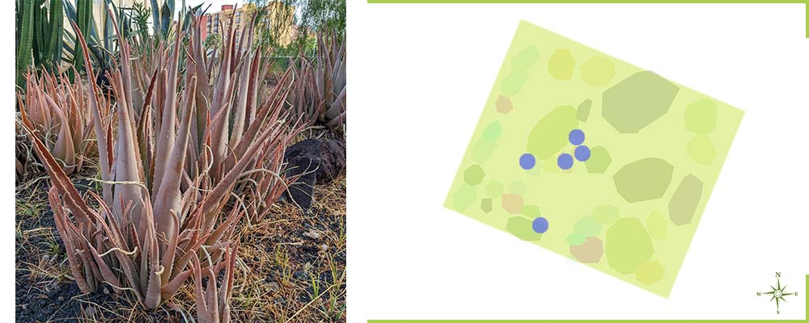
_Aloes a finales de verano_

### Aloe
_Aloe vera_

Hasta el siglo XIX, su nombre más popular era _acíbar_, también se le conoce como aloe, aloe vera, zábila, penca zábila o aloe de Barbados, entre otros, es una especie suculenta de la familia _Asphodelaceae_. Con unas quinientas especies, el aloe está muy distribuido y se considera una especie invasora en muchas regiones del mundo. 
Es una planta de hoja perenne, probablemente se originó en la Península Arábica, pero crece de forma silvestre en climas tropicales, subtropicales y áridos de todo el mundo. El aloe vera ha sido ampliamente cultivado como planta ornamental por sus llamativas flores amarillas y por su forma. Los pájaros silvestres beben el néctar de sus flores, los puedes ver por las tardes en este mismo jardín. Acumula agua en sus hojas, lo que le permite sobrevivir en áreas de poca lluvia, lo que la hace ideal para rocallas y jardines de bajo consumo de agua.

Se usa como planta medicinal para la piel, en muchos productos: lociones para la piel, cosméticos, pomadas o gel para quemaduras menores y quemaduras solares, incluso en bebidas, aunque hay evidencias contradictorias sobre si el _Aloe vera_ es tan efectivo.

El nombre botánico deriva del latín, _aloe_, del griego sal que designaba tanto a la planta como a su jugo, debido a su sabor, que recuerda al agua del mar. _Vera_ por verdadero en latín.

***

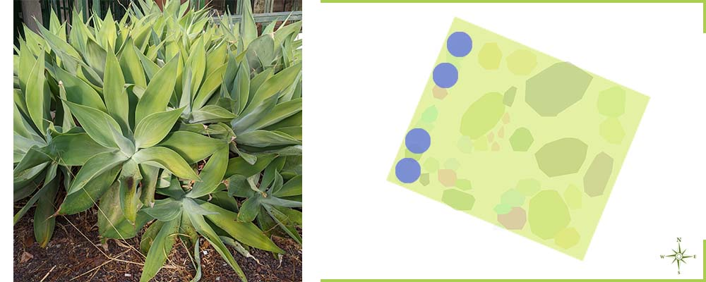

### Ágave
_Agave attenuata_

También llamado ágave atenuado, ágave del dragón o cuello de cisne, es una especie suculenta perteneciente a la familia de las agaváceas. Es originaria de México, raro en el medio natural pero muy popular en jardinería.
Es una planta monocárpica, es decir, que florece una sola vez en su vida y luego muere (muere esa planta pero siguen creciendo todos los brotes a su alrededor). La floración es espectacular, con flores amarillas verdosas agrupadas en una densa inflorescencia, que alcanza los 3 m de altura, en principio vertical, pero que después cuelga, de forma muy característica.

En este Centro también hay una gran colonia de ágaves en un parterre entre los pabellones 3 y 4. En diciembre 2025 han florecido algunos ejemplares por primera vez en muchos años.

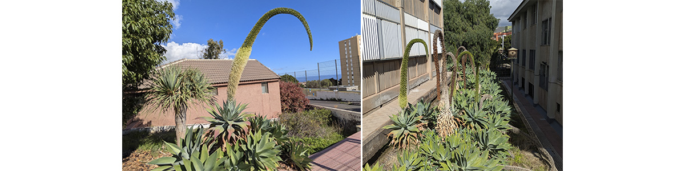
&emsp;&emsp;_Ágaves florecidos en diciembre 2025_

***

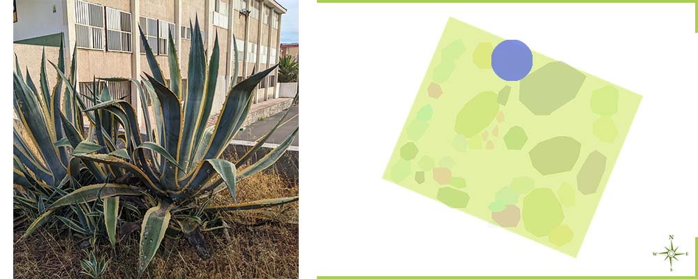

### Pitera 
_Agave americana_ - 💀 Exótica invasora

El ágave amarillo, pita o pitera (_henequén_ en Fuerteventura, a algunas variedades de pitera) es una planta originaria de México y el sur de Estados Unidos distribuida mundialmente. Cristóbal Colón describió en una ocasión que él había visto en el Caribe una planta que confundió con el aloe. Otros viajeros europeos la encontraron en zonas semidesérticas de Las Américas (razón de su nombre). En 1583 un aloe americano floreció por primera vez en Europa en el Jardín botánico de Pisa. Esta planta formó parte de las ilustraciones de la _Phytanthoza Iconografia_, un bonito libro de Johann W. Weinmann, primer ilustrador botánico.

&emsp;&emsp;_Agave americana según Weinmann_

_Phytanthoza Iconografia_ se puede descargar, junto con muchos otros materiales, de la [Biblioteca Digital del Real Jardín Botánico](https://bibdigital.rjb.csic.es/), un repositorio fabuloso.

**Pulque, mezcal y tequila**
Seguramente su uso más conocido es la producción de un licor destilado llamado mezcal, del que existen numerosas variedades, entre las que figura un mezcal conocido en todo el mundo, el tequila. El zumo azucarado extraído de la savia del tallo floral antes de la floración se fermenta para producir una bebida alcohólica, llamada pulque —una de las especies utilizada para elaborar la bebida—, que a su vez se destila para obtener el mezcal.

**Las piteras en Fuerteventura**
Desde los primeras años del siglo XX surgieron iniciativas proponiendo el cultivo de piteras en Fuerteventura para la fabricación de cuerdas, comparándose a la isla con Yucatán y sus condiciones climáticas, y realizándose algunos cultivos experimentales en Lanzarote. Entre los años 30 y 40 del siglo XX, en la zona central y norte de Fuerteventura, ya se cultivaba el henequén para producir fibras textiles, como sustituto del esparto, y para hacer cabos de barco, sacos, sogas y tejidos. En la década de 1950 el Ministerio de Agricultura compró parcelas en Fuerteventura, Lanzarote y Lobos para pruebas del rendimiento económico del cultivo. Se usó  _Agave sisalana_, _Agave fourcroydes_ y _Agave americana_. En Villaverde se estableció una _Fábrica de fibras duras_, dedicada al tratamiento y comercialización de las hojas de henequén dependiente del Servicio de fibras duras del Ministerio. Tuvo importancia económica desde la década de 1950 hasta mediados de la década de 1980, una industria única en el archipiélago. La planta, una vez cortada y limpia, se exportaba a mercados peninsulares, especialmente a Málaga, donde se usaba para la confección de cordelería. Las fibras artificiales terminaron con esta industria, y los cultivos se abandonaron,´aún se pueden ver los restos en los alrededores de La Oliva. 

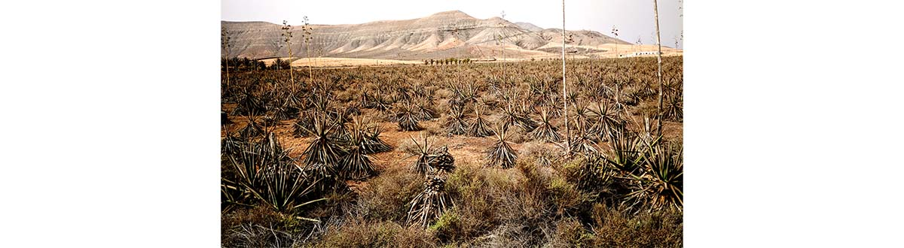
&emsp;&emsp;_Restos de cultivos de piteras cerca de La Oliva, Fuerteventura, 2020_

💀 Debido a su potencial colonizador y constituir una amenaza grave para las especies autóctonas, los hábitat o los ecosistemas, esta especie ha sido incluida en el [Catálogo Español de Especies Exóticas Invasoras](https://www.miteco.gob.es/es/biodiversidad/temas/conservacion-de-especies/especies-exoticas-invasoras/ce-eei-catalogo.html). Este ejemplar ya se encontraba en el jardín y está controlado pero no debería volverse a introducir. Parece un tanto inútil, ya que los agaves, aunque sin tener el potencial invasor de otras especies, como el rabo de gato, constituyen parte de lo que reconocemos como paisaje natural de nuestras islas.

***

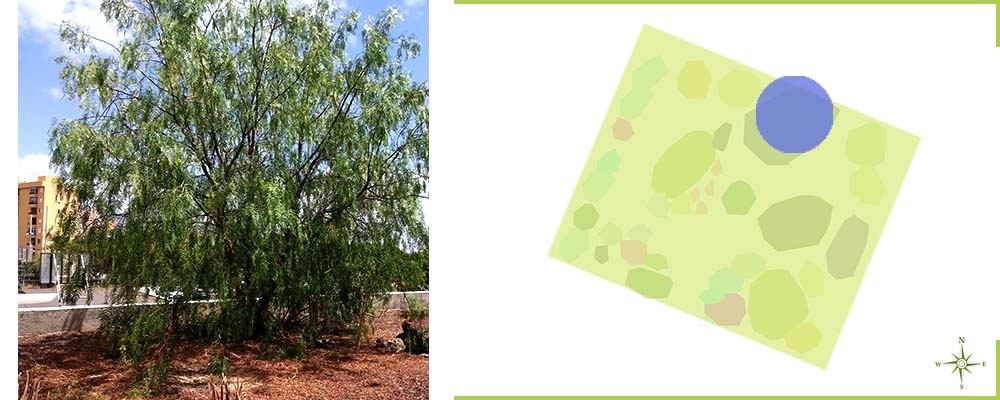

### Pimentero
_Schinus molle_

Falso pimentero, por sus pequeños frutos rojos, similares a los granos de pimienta, también se le llama _gualeguay_ o _aguaribay_ en Sudamérica. Es un árbol leñoso arborescente de hojas perennes originario de los Andes centrales. Es un árbol muy rústico que se adapta bien, prácticamente, a todo tipo de suelo. Resiste bien las sequías, sus hojas están recubiertas de una sustancia que evita la deshidratación. El tronco del falso pimentero exuda una resina muy aromática que tiene propiedades analgésicas, estimulantes, insecticidas, bactericidas, antifúngicas y antivirales, por lo que es una planta ampliamente utilizada por la medicina tradicional.

En el archipiélago canario está en casi todas las islas, inicialmente fue cultivado como planta ornamental, pero frecuentemente asilvestrado, incluso convertido en plaga en ciertos lugares. Aparece en el [Atlas de las plantas alóctonas invasoras en España](https://www.miteco.gob.es/es/biodiversidad/temas/inventarios-nacionales/inventario-especies-terrestres/inventario-nacional-de-biodiversidad/ieet_flora_vasc_aloct_invas.html). También es una especie invasora en Estados Unidos, Sudáfrica y Australia.

Considerado árbol sagrado, tuvo usos rituales en el imperio Wari (600 d. c. a 1000 d. c.) en los Andes centrales de Perú, usado para embalsamar a los muertos por los incas.

***

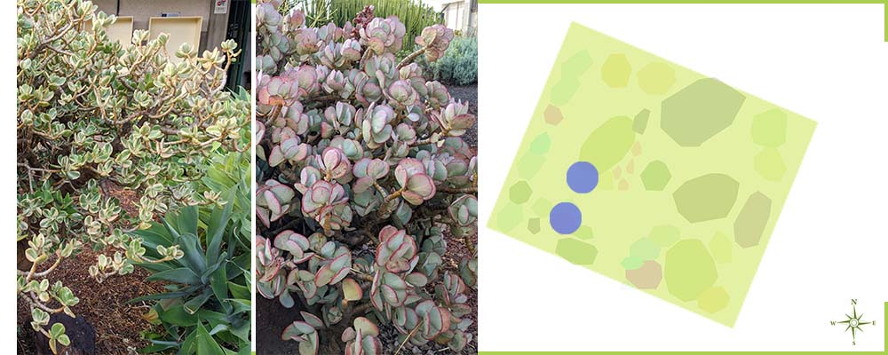

### Suculentas
_Crassula arborescens_ y _Crassula argentea_

El género _Crassula_ pertenece a la familia de las _Crassulaceas_ y engloba unas 200 especies. Las variedades más cultivadas y apreciadas por los amantes de las suculentas, provienen todas ellas de la Provincia Cabo Oriental en Sudáfrica. Además de las variedades naturales, existen numerosos híbridos.
Su nombre _Crassula_ proviene de la palabra latina _crassus_ que significa gruesa en referencia en abultadas hojas llenas de agua. Son plantas muy populares tanto para su cultivo en jardines como en macetas.
Muchas _Crassulas_ desarrollan bellos colores de tonos rojos, púrpuras, rosas, amarillos y naranjas como respuesta a una mayor exposición solar. En invierno y en condiciones de poca luz, todas las plantas volverán a su coloración verdosa.

La _Crassula arborescens_ es una de las más grandes del género, con una altura que va desde los 60 centímetros hasta el metro y medio. Es endémica de El Cabo, en Sudáfrica, y presenta hojas blanquecinas con el margen rojo.

***

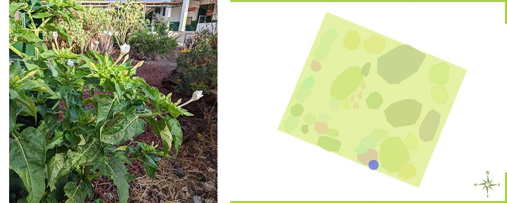

### Dondiego de noche
_Mirabilis jalapa_

Es originaria de Centro y Suramérica (Perú-México). A este jardín se trajo con semillas de un jardín particular en Tegueste y hasta ahora se ha ido multiplicando y tenemos ejemplares en por varios jardines.
Tiene varios nombres populares: Galán de noche, Bella de noche; en Canarias suele conocerse como Dondiego de noche porque sus flores se abren al atardecer y están abiertas por la noche. Se la conoce por muchos otros nombres: galán de noche, dama de noche, trompetillas, periquitos y un largo etc. Cuando las flores se abren, al atardecer, tienen un suave perfume. La polinizan polillas de esfíngidos. La mayoría de las esfinges tienen una probóscide muy larga y se alimentan de néctar mientras permanecen en vuelo frente a la flor, de forma similar a un colibrí. Al igual que los colibríes son buenos polinizadores. Las flores adaptadas a este tipo de polinización suelen ser tubulares, de colores pálidos o blancos, y se abren de noche.

El nombre _Mirabilis jalapa_ dado por Linneo en 1753 se forma a partir del latín científico _Mirabilis_ que significa "admirable" por alusión a los notables colores de sus flores y el nombre específico _jalapa_ que haría referencia a su origen en la Jalapa en Guatemala. Pero _jalapa_ también podría referirse a la ciudad de Xalapa en México de donde provenía un antiguo fármaco purgante, llamado _jalap_, tomado de los tubérculos de la planta.

**Los colores del dondiego y la genética**
Aunque los ejemplares de este jardín son de flor blanca, algunos de los colores sólidos de las flores de la _Mirabilis jalapa_ que se pueden encontrar son Rojo, Rosa, Amarillo, Blanco, y Naranja. Además de estos colores sólidos, algunas variedades pueden tener flores bicolor o multicolores, lo que hace que esta planta sea atractiva para jardines ornamentales y macetas. Otro de los fenómenos que presenta es el cambio de color. Por ejemplo, en la variedad amarilla, a medida que la planta madura, puede producir flores que cambien gradualmente al rosa oscuro. Del mismo modo, las flores blancas pueden cambiar al violeta claro.

Hacia 1900, Carl Correns utilizó _Mirabilis_ como organismo modelo para sus estudios sobre la herencia citoplasmática. Usó las hojas variegadas de la planta para demostrar que ciertos factores externos al núcleo afectaban al fenotipo de una manera que no explicaban las teorías de Mendel. Correns propuso que el color de las hojas en _Mirabilis_ se transmitía a través de un modo de herencia uniparental: Cuando se cruzan plantas con flores de color rosa oscuro con plantas de flores blancas, se producen descendientes con flores de color rosa claro. Esto se considera una excepción a la Ley de dominancia de Mendel porque, en este caso, los genes de color rosa oscuro y blanco parecen tener la misma fuerza, por lo que ninguno domina completamente al otro. El fenómeno se conoce como dominancia incompleta. Es, pues, una planta que tuvo un papel importante en la historia de la genética.

&emsp;&emsp;_Esquema de la transmisión de colores en Mirabilis_

***

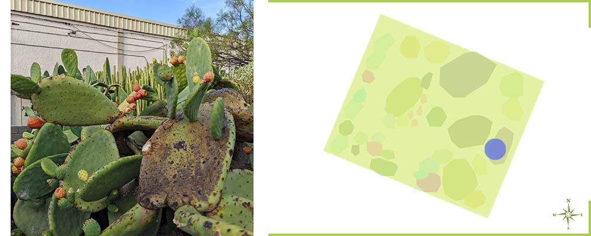

### Penca / Tunera 
_Opuntia ficus-indica_  - 💀 En desaparición

La penca o tunera, asociada al paisaje rural de Canarias. Sin embargo, es una planta introducida en el siglo XVII, habiendo pasado primero por la Península.
En Canarias fue la principal industria durante medio siglo. El cultivo de la cochinilla llegó a Canarias en el siglo XIX. Las pencas o tuneras se importaron de América para alojar al parásito (cochinilla, _Dactylopius coccus_) del que se obtenían tintes naturales en la gama de los malva. Pigmentos magníficos, muy estables. Primeras exportaciones: 1832, crisis total 1880. Un ciclo de tan solo 50 años. A la economía de la cochinilla canaria la enterró Sir William Henry Perkin, que sintetizó la malveína en el laboratorio de su casa en 1856, además ni siquiera estaba buscando eso, buscaba sintetizar quinina para la cura de la malaria. Pero la casualidad (serendipia) hizo que a los 18 años descubriera el primer tinte sintético, la malveína. El color púrpura, que desde tiempos antiguos simbolizaba la realeza, tuvo muy buena acogida, y a los veintiún años ya era millonario, mientras que en Canarias arruinó toda una economía, ayudado también por dos mujeres de la realeza: La demanda pública de malva se disparó cuando la emperatriz Eugenia de Francia y la reina Victoria de Gran Bretaña fueron vistas luciendo este color. Se dice que el malva se popularizó cuando la extravagante esposa de Napoleón III, la emperatriz Eugenia, declaró que el color combinaba con sus ojos. Cuando la propia reina Victoria lució un suntuoso vestido malva con ribete de encaje y enaguas a juego para la boda de su hija en 1858, este color, el más actual, se consolidó como la última moda.

&emsp;&emsp;_WH Perkin. | Frasco con malveína. | Chal, teñido con el tinte malva de Perkin, exhibido en la Exposición Internacional de 1862. | Traje de época teñido con malveína (las tres cosas, en el [Museo de la Ciencia de Londres](https://blog.sciencemuseum.org.uk/mauve-mania/))_

Más recientemente ha habido un resurgir para la fabricación de cosméticos con pigmentos naturales, además de que siempre se ha mantenido a su cultivo para producir higos picos o tunos. 

La abundancia de esta planta en las Islas Canarias durante siglos la convirtió casi en una seña de identidad paisajística desde mediados del siglo XIX.

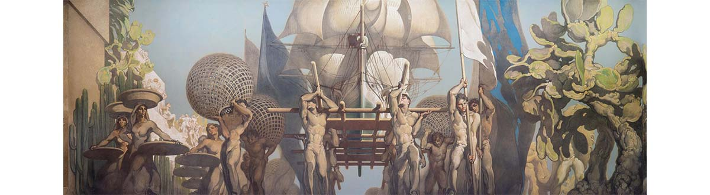
&emsp;&emsp;_Alegoría del mar. Néstor Martín Fernández de la Torre, 1935. Mural en el Casino de Tenerife. Las especies vegetales que pinta aquí Néstor son: Monstera deliciosa, Euphorbia canariensis y Opuntia ficus-indica_.

**LA PLAGA** 💀 
En los últimos años ha llegado a Canarias otro parásito, esta vez mortal, la cochinilla mexicana (_Dactilopyus opuntaie_), que pudre por completo la planta. Está empezando a afectar a los ejemplares de este jardín, y probablemente los matará a todos en uno o dos años. No se conocen tratamientos efectivos contra esta plaga. Se ha probado un tratamiento con extracto de neem (un remedio natural) pero no ha sido efectivo.
Es un síntoma más de cambios climáticos globales debido a causas humanas, y un aviso de los peligros de las especies invasoras, sobre todo en ecosistemas insulares.

&emsp;&emsp;_Plantas afectadas, en 2023._

***

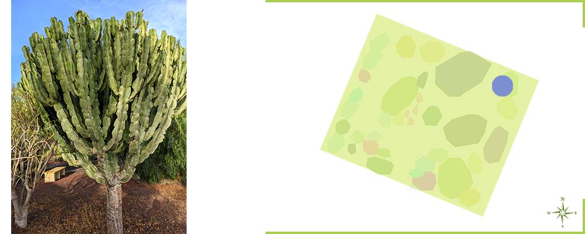

### Candelabro
_Euphorbia candelabrum_

Lleva ese nombre precisamente por tener la forma de un candelabro. A este espécimen se lo suele conocer cómo cactus candelabro y también se le puede encontrar con el nombre de _cactus mexicano_, aunque no se trata de un cactus, ni siquiera es oriundo de México. Es un árbol de la familia de las _euforbias_.

La _Euphorbia candelabrum_ tiene una forma de crecimiento muy especial y distinguible, ya que se parece precisamente a un candelabro. En su estructura es una planta de tipo columna que puede llegar a alcanzar grandes alturas, siendo sus especímenes más altos de unos 20 metros aproximadamente.

Es endémico del área del cuerno de África, también se extiende por toda la zona este del continente africano.

***

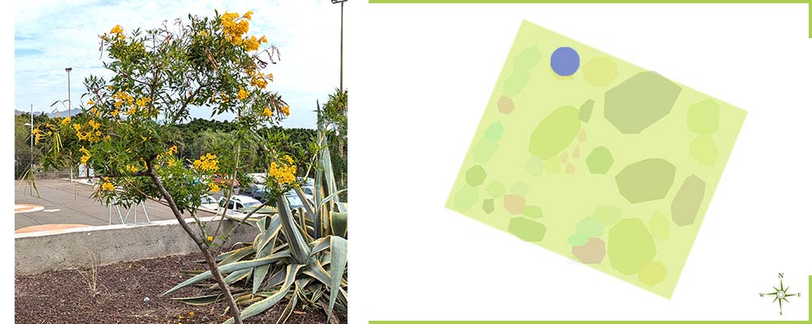

### Tecoma
_Tecoma stans_ 

Es una planta proveniente de América, también conocida como tecoma, tronadora o trompeta de oro.
Suele alcanzar unos 4 metros. Sus flores son muy llamativas por su color amarillo intenso. Se extiende desde el sur de Estados Unidos por México, Centroamérica y las Antillas hasta el norte de Venezuela, y por la cordillera de los Andes hasta el norte de la Argentina.

Nombres comunes en inglés son: yellow trumpetbush, yellow bells, yellow elder (arbusto trompeta amarillo, campanas amarillas, anciano amarillo). _Tecoma stans_ es la flor oficial de las Islas Vírgenes de los Estados Unidos y el emblema floral de las Bahamas. Se cultiva en numerosas partes del mundo por su floración, para adornar calles y jardines.

***

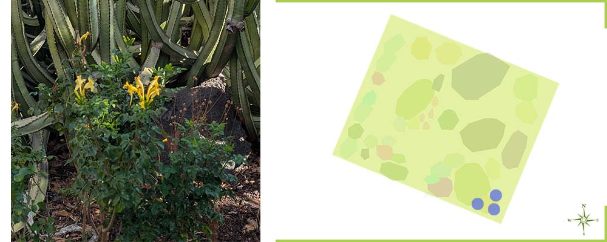

### Tecomaria
_Tecomaria capensis_

Tiene nombres comunes como Tecomaria o Bignonia de El Cabo. El género _Tecomaria_ se llama así por su parecido con el género _Tecoma_ de América. _Capensis_ significa “de El Cabo”
Es un arbusto de crecimiento rápido, revuelto, de tallos múltiples que puede crecer hasta 2-3 m de altura. Es una planta de hoja perenne en regiones cálidas. El tiempo de floración de este arbusto es muy errático y a menudo florece durante todo el año. Las flores son tubulares en vistosas cabezas de muchas flores y varían en color de rojo, naranja intenso, amarillo a salmón. En este jardín tenemos variedades rojas y amarillas.

Se cultiva en muchos países alrededor del mundo donde se ha naturalizado. Incluso en partes de Australia está catalogada como invasora.

***

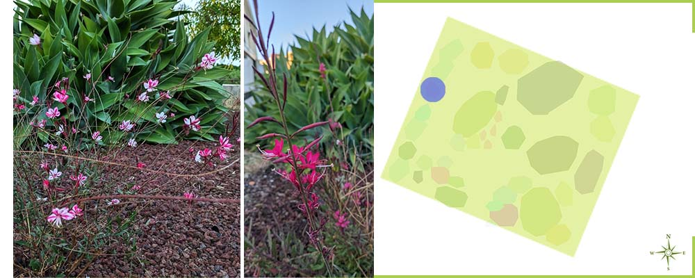

### Gaura 💀 
_Oenothera lindheimeri_

Tras dos años de floración desapareció de este jardín, quizá debido al invierno 2025-2026, muy prolongado y frío. Hay otros ejemplares en los jardines de Secretaría y del patio, allí hay una descripción más completa de esta planta.

***

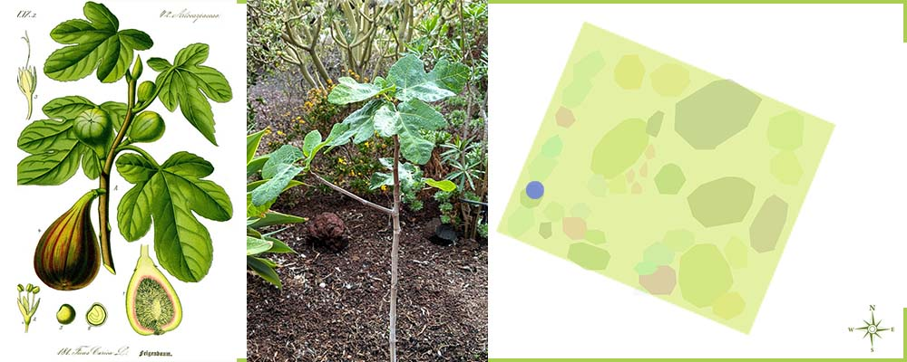

### Higuera
_Ficus carica_

La higuera es una de las numerosísimas especies del género _Ficus_, cuya infrutescencia es el higo. Originario de Asia sudoccidental, crece ahora espontáneamente en  muchas partes del mundo.

He plantado una higuera planeando orientar su crecimiento mediante podas para que en unos años dé sombra en los meses de más calor en una esquina del jardín, y en ese momento quitar uno de los agaves y parte del vallado para crear un espacio para estar, con un banco. Con suerte, además tendremos cosecha de higos.

[INICIO](https://jardinedu.github.io/cifpcm/inicio) | [ÍNDICE DE JARDINES](https://jardinedu.github.io/cifpcm/jardines) | [BIBLIOGRAFÍA-REFERENCIAS-APÉNDICES](https://jardinedu.github.io/cifpcm/biblio) | [PROYECTO2026](https://jardinedu.github.io/cifpcm/proyecto2026) | [VISUAL](https://jardinedu.github.io/cifpcm/visual) | [NOTAS](https://jardinedu.github.io/cifpcm/notas)

contacto: correoprofe@proton.me / [bio](https://jardinedu.github.io/cifpcm/about) 

