# 2. Jardines de los frangipanes

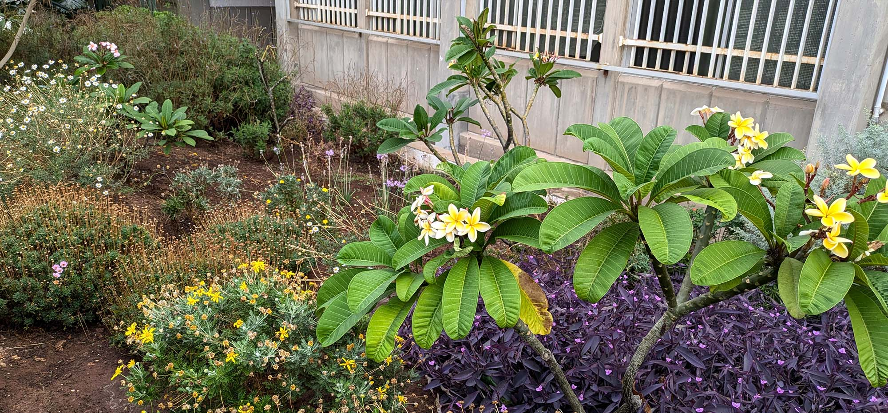
&emsp;&emsp;_Noviembre 2024_

Estos dos largos parterres, de unos 17 metros cada uno, estaban ocupados por cuatro árboles, ejemplares de flamboyán de más de 20 años de edad. Daban mucha sombra en verano y una floración espectacular hacia el mes de junio. Es una especie muy utilizada en Santa Cruz de Tenerife, y en general abundante en Canarias. En francés _flamboyant_ significa llamativo, vistoso.

Su nombre científico es _Delonix regia_, originaria de Madagascar, donde está en peligro de extinción, mientras que es muy abundante en todo el mundo, especialmente en climas subtropicales.

&emsp;&emsp;_Rambla de Santa Cruz, bordeada por ejemplares de flamboyán_

Por desgracia las raíces de esta especie son agresivas. Poco a poco fueron levantando el pavimento del patio, y en su búsqueda de agua, además de levantar el pavimento de la plaza central, llegaron subterráneamente hasta los baños del Pabellón 1, donde rompieron conducciones de agua y causaron varios problemas. Por esta razón se talaron en verano de 2022.

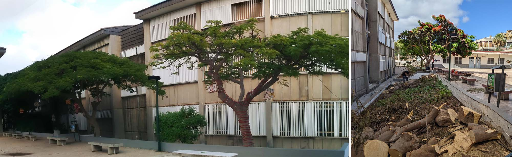
&emsp;&emsp;_Línea de flamboyanes, 2016 (y su diferencia de altura y volumen según nos alejamos de la orientación sur). | Tala en julio 2022._

En 2022 la Vicedirectora Laura me planteó la remodelación de estos dos jardines. Asesorado por un amigo jardinero, propusimos una línea principal de _plumeria_ (también conocido como frangipán), por varias razones: la poca agresividad de sus raíces, su porte mediano, resistencia a la escasez de riegos, la vistosidad de sus flores e incluso su perfume. Además de estos arbolitos, pensé en una organización inicial de plantas que los acompañaran, aunque la jardinería no es una ciencia exacta, y el propio jardín ha ido sugiriendo su forma.

&emsp;&emsp;_Proyecto original de remodelación, muy simple, 2022_

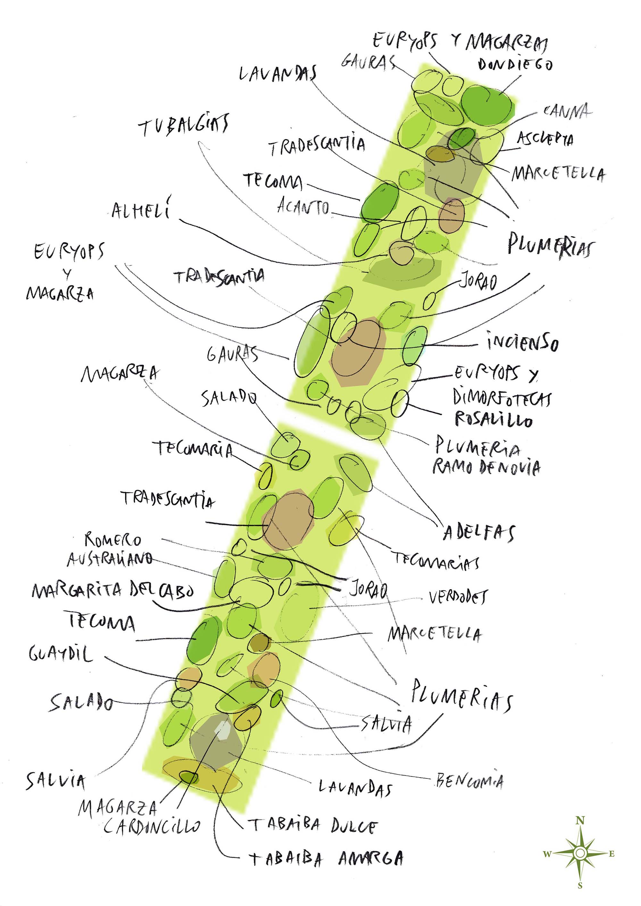
&emsp;&emsp;_El proyecto, modificado y enriquecindo por la propia dinámica del lugar, tres años después_

El parterre norte tiene menos insolación que el parterre sur. Conseguir una combinación de plantas adaptadas a cada lugar, con floración vistosa y unos mínimos de sostenibilidad ha sido proceso lento, de prueba y error.

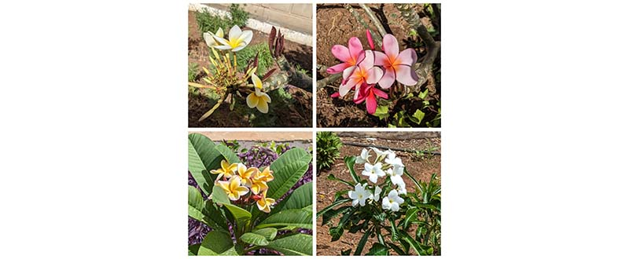
&emsp;&emsp;_Variedades de frangipán con sus primeras flores en el jardín, 2023._

## Los frangipanes o plumerias
Se hizo un esfuerzo por conseguir ejemplares de _plumeria_ con flores de colores diversos; las clásicas blancas de centro amarillo y también rosa, fucsia y naranja. Tardarán unos años en crecer pero le darán mucha personalidad al patio. En el futuro los frangipanes serán la especie visiblemente dominante pero también se está ajardinando con otras plantas. 

El frangipán es un árbol pequeño, de flores blancas o en tonos rosa o naranja, muy fragantes. Proviene de México, América central y Venezuela. 
Muy habitual en la jardinería tradicional de los patios y casas canarias. En Canarias se le suele llamar _árbol de sebo_. En este jardín hay ejemplares de _Plumeria rubra_, la más habitual en las islas.

Su nombre científico es _Plumeria_, y hay mucha historia detrás: _Plumeria_ fue acuñado en 1700 en honor a Charles Plumier, el “Padre de la Flora de las Indias Occidentales”. Plumier fue un monje, botánico y dibujante muy conocido por sus numerosos dibujos y documentación de sus expediciones a las Indias Occidentales y América Central. Estas fueron encargadas por la corona francesa y fueron parte de un patrón más amplio de imperialismo botánico que vinculó el estudio de la naturaleza al poder político y la expansión territorial. El movimiento de plantas y conocimiento botánico estuvo estrechamente vinculado a las potencias coloniales y sirvió para sostenerlas y enriquecerlas económicamente.

En el siglo XVII el botánico Ignacio de Mercado Morales escribe que el _Frangipani_ (aunque bajo el nombre _Calachuche_, una variante de la lenga náhuatl _kalachuchl_) provenía de “la Neuva Espalia” o “la Nueva España” (actual México). Esta hipótesis está respaldada por la propia familiaridad de Morales con la flora de la región, y fue reforzada por botánicos como el jesuita Georg Josef Camel SJ, quien nombra a la planta _Cacaloxochitl mexicana_ en sus _Descriptiones Fruticum et Arborum Luzonis_ (1704). Además, basándose en la filología, el botánico E. D. Merrill examinó los nombres utilizados para las especies de _Plumeria_ en todo el mundo y concluyó que muchos de ellos eran, en muchos casos, derivados de variantes mexicanas. 

Se conmocía como Sak-Nikté, por los mayas y Cacaloxóchitl -flor del cuervo- por los nahuas, y de ahí a su vez deriva el nombre Kalachuchi o kalatsutsi, como se le conoce en Filipinas. Las plumerias pasaron de América Central al Sudeste asiático, probablemente como resultado colateral del comercio durante el imperio español, y se convirtió en una planta valiosa y simbólica. El frangipani es el árbol nacional de Laos —llamado _dak lampa_—, donde se le considera un árbol sagrado. La fragancia de la plumeria se asocia con la kuntilanak, un espíritu vampírico maligno —el de una madre fallecida— presente en el folclore malasio-indonesio.

En Filipinas, el kalachuchi o kalatsutsi (_Plumeria rubra_ o _acuminata_) crece en abundancia, tanto en cementerios —donde se utiliza como árbol— como en forma de setos. Es tan común que uno simplemente lo pasa por alto. 

Para muchos filipinos el kalachuchi tiene la reputación de ser la "flor de los muertos" (_bulaklak ng patay_. El kalachuchi es un árbol extremadamente resistente. Puede sobrevivir a sequías, suelos pobres y largos periodos de abandono, lo que lo hace ideal para cementerios y los terrenos que rodean las iglesias. Con el paso de las generaciones, los filipinos se acostumbraron a ver sus flores blancas y amarillas cerca de las tumbas, lo que forjó una fuerte asociación entre la flor y la muerte. En el folclore filipino, percibir de repente el olor a kalachuchi durante la noche solía interpretarse como una señal de que un espíritu o un ser querido fallecido se encontraba cerca. Las historias sobre fantasmas, apariciones y parientes que "se hacen sentir" (_nagpaparamdam_) contribuyeron a consolidar la reputación sobrenatural de esta flor.

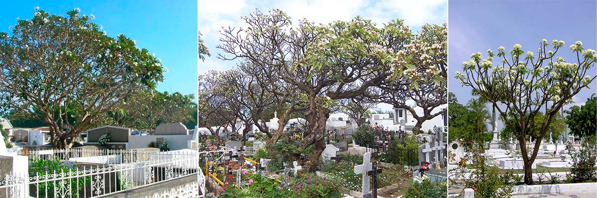
&emsp;&emsp;_Cementerio Imus en Cavite Filipinas por micah r.c. en Flickr | Cementerio de Saint-Leu (isla de la Reunión) B.Navez en Wikimedia Commons | Cementerio de Santa Ifigenia en Santiago de Cuba por BluesyPete en Wikimedia Commons_

> Pero aquellas flores eran blancas, no rosas. Sus pétalos eran gruesos y firmes, no frágiles ni inquietantes como los de las rosas o las gardenias. Desprendían un aroma dulce y tenue que, al haber muchas flores juntas, se tornaba rápidamente penetrante. Bajo un árbol especialmente vigoroso, las flores marchitas se acumulaban en el suelo, dotando a los cementerios de ese olor característico a descomposición floral que, para los niños del barrio, era sinónimo de los muertos. No es exactamente un hedor, sino una especie de sensación olfativa ambigua que oscila entre la melaza, la gangrena y un pedo. Al pasar junto al cementerio público cuando el kalachuchi estaba en plena floración, el aroma resultaba incluso agradable desde lejos. Pero, a medida que uno se acercaba, ese mismo aroma suave te asaltaba de repente, provocándote arcadas y obligándote a salir corriendo. Cualquier niño de diez años sabía que ese era el olor de los muertos; y los muertos, como es lógico, siempre se levantaban e intentaban comerte.
> _Leído en un blog filipino_

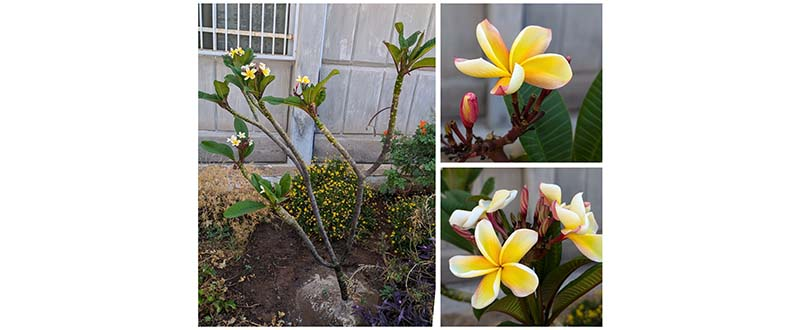
&emsp;&emsp;_Ejemplar plantado a comienzos de 2024_

El nombre común inglés _Frangipani_ también tiene un sabor misterioso, aunque es producido artificialmente por el comercio y la publicidad. Se cree que proviene de la palabra francesa _frangipanier_. Los botánicos franceses relacionaron su aroma con el _frangipane_, un popular perfume de almendras para guantes fabricado por el noble marqués Muzio de Frangipani en el siglo XVII. 

Fascinante también esta otra historia: En el siglo XIX, un grupo de perfumistas de Londres contribuyó aún más a esta confusión: para promocionar sus fragancias, crearon el mito de _Mercutio Frangipane_, un botánico ficticio asociado con los viajes de Colón al Nuevo Mundo que hizo descubrimientos sensacionales a través de su sentido del olfato. Con el objetivo de aumentar las ganancias, esta estrategia de marketing se basó en nociones de orientalismo con carga racial, vinculando el hábitat tropical nativo de la planta con la idea de un “Otro” distante para otorgarle a la fragancia un sentido de aventura y exotismo.

La relación entre las flores y el orientalismo se extiende también a las fragancias. Los escritores franceses del siglo XIX identificaban a la mujer _oriental_ estereotipada por su aroma sensual, y las flores se asociaban con la feminidad. Este legado ha llegado hasta el siglo XXI, cuando las supuestas imágenes orientales en los anuncios de perfumes transmiten una sensación de erotismo, misterio y sumisión. 

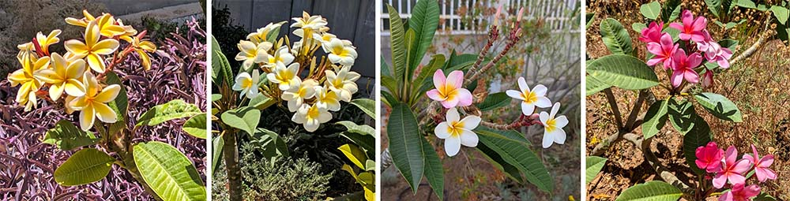
&emsp;&emsp;_Floraciones en junio 2025_

En perfumería moderna, del aceite de sus flores se extrae uno de los aromas básicos, y se puede encontrar en perfumes tan conocidos como _Coco Chanel, Versace Women, Jo Malone Frangipani Flower Cologne, Michael Kors Sparkling Blush_ o _Chanel Beige Eau de Parfum_.

Además de _Plumeria rubra_ de diferentes colores, hay un ejemplar de _Plumeria pudica_: es la variedad  “ramo de novia”, de flor totalmente blanca y diferente forma de la hoja, originaria de Panamá, Colombia y Venezuela.

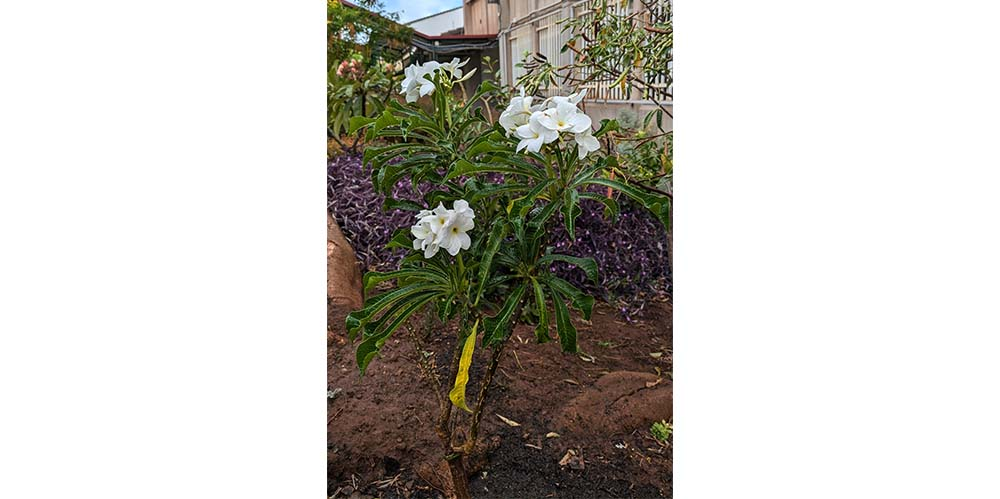
&emsp;&emsp;_Plumeria “ramo de novia”_

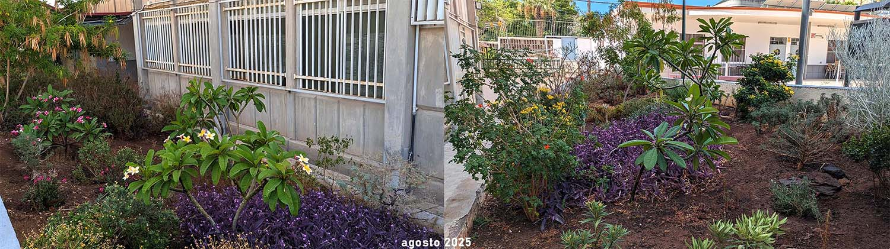

### Además de los frangipanes: Las otras especies no nativas de Canarias

En estos parterres también se ha intentado combinar plantas nativas de Canarias con otras exóticas. La proporción actual es aproximadamente 15 exóticas/13 nativas.

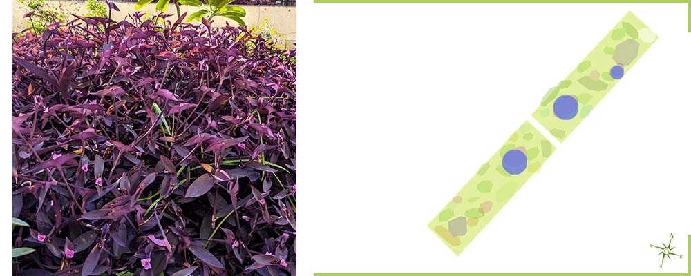

### Tradescantia
_Tradescantia pallida_

Una planta que ya estaba en el jardín, y con los cuidados se ha ido extendiendo. La idea es tener una o dos manchas ovaladas. Es una tapìzante de flores color rosa, pero lo más interesante son sus hojas moradas, que crean una masa que contrasta mucho con el verde de las otras plantas. 

Tiene como nombres comunes _amor de hombre_ o _purpurina_. Es originaria de México, y su nombre científico _Tradescantia pallida_ es un homenaje a Sir John Tradescant (hijo), botánico inglés, quien trajo a Europa, entre otras especies, las magnolias.

Los primeros ejemplares de _Tradescantia pallida_ identificados. Fueron recogidos por el explorador, botánico y arqueólogo Edward Palmer mientras trabajaba para el Smithsonian, en el estado de Tamaulipas, México, en 1907 y descritos por el botánico Joseph Nelson Rose en 1911. Se pueden ver en las [Colecciones Botánicas del Museo Nacional de Historia Natural](https://collections.nmnh.si.edu/search/botany/), perteneciente al Smithsonian. 

***

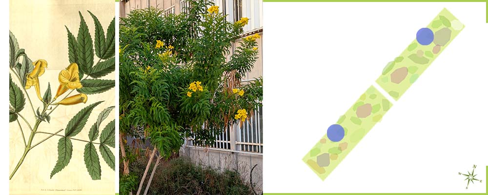

### Tecoma
_Tecoma stans_ 

Es una planta proveniente de América, también conocida como tecoma, tronadora o trompeta de oro.
Suele alcanzar unos 4 metros. Sus flores son muy llamativas por su color amarillo intenso. Se extiende desde el sur de Estados Unidos por México, Centroamérica y las Antillas hasta el norte de Venezuela, y por la cordillera de los Andes hasta el norte de la Argentina.

Nombres comunes en inglés son: yellow trumpetbush, yellow bells, yellow elder (arbusto trompeta amarillo, campanas amarillas, anciano amarillo). _Tecoma stans_ es la flor oficial de las Islas Vírgenes de los Estados Unidos y el emblema floral de las Bahamas. Se cultiva en numerosas partes del mundo por su floración, para adornar calles y jardines.

Los dos arbolitos de _Tecoma_ ya estaban en el jardín, podados como arbustos pequeños, pero con la desaparición de los flamboyanes han empezado a crecer de nuevo, y aportan un elemento más alto, de flores amarillas muy vistosas.

***

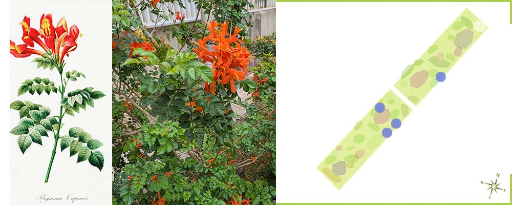

### Tecomaria
_Tecomaria capensis_
Tiene nombres comunes como Tecomaria o Bignonia de El Cabo. El género _Tecomaria_ se llama así por su parecido con el género _Tecoma de América_. _Capensis_ significa “de El Cabo”
Es un arbusto de crecimiento rápido, revuelto, de tallos múltiples que puede crecer hasta 2-3 m de altura. Es una planta de hoja perenne en regiones cálidas. El tiempo de floración de este arbusto es muy errático y a menudo florece durante todo el año. Las flores son tubulares en vistosas cabezas de muchas flores y varían en color de rojo, naranja intenso, amarillo a salmón. En este jardín tenemos variedades rojas y amarillas.

Se cultiva en muchos países alrededor del mundo donde se ha naturalizado. Incluso en partes de Australia está catalogada como invasora.

&emsp;&emsp;_Los dos colores de las tecomarias del jardín_

***

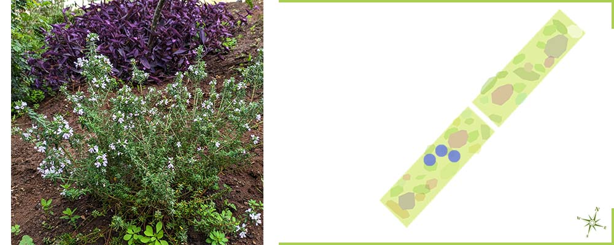
_Westringias recién plantadas, noviembre 2023 y primeras floraciones mayo 2024_

### Romero australiano
_Westringia fruticosa_

Son pequeños arbustos, de alrededor de 1m. de altura, de color verde oscuro, resistentes a la sequía, longevos y que además de su volumen tienen una floración larga, en estos ejemplares, en la gama de los colores lila.

***

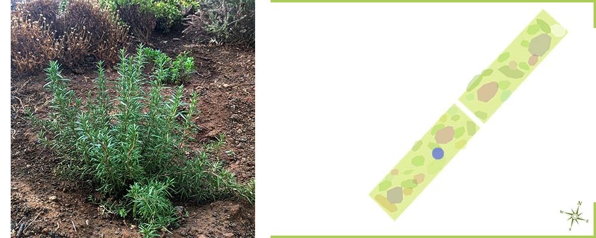
_Romero recién plantado, verano 2025_

### Romero
_Salvia rosmarinus_ (hasta hace pocos años se llamaba _Rosmarinus officinalis_)

El romero es un arbusto aromático, leñoso, de hoja perenne, muy ramificado y ocasionalmente achaparrado y que puede llegar a medir hasta 2 m de altura. Es una planta con una larga historia cultural y de usos. Muy adecuada para jardines de bajo mantenimiento.

Romero viene del nombre latino de la planta _ros maris_ o _ros marinus_ (rocio del mar), empleado por Ovidio, Virgilio, Plinio, Horacio. _Ros maris_ se contrajo en las formas vulgares tardías como romaris, y luego mutó en romarum, romarius y romarium, que da lugar a romero. En ingles es rosemary. En francés (romarin) o italiano (rosmarino) se forma el nombre del romero a partir de la otra variante ros marinus. 

&emsp;&emsp;_Romero en Köhler's Medicinal Plants, 1887. Tomo 2, pg. 589_

_Köhler's Medizinal-Pflanzen_ (_Köhler's Medicinal Plants_) es una rara guía medicinal alemana publicada originalmente en 3 volúmenes (vol.I, 1887; vol.II, 1890; vol.III, 1897). Fue obra de Hermann Adolph Koehler (1834-1879), editada después de su muerte por Gustav Pabst, y contiene 283 láminas de los ilustradores Walther Müller, C.F.Schmidt, y K.Gunther. Se puede descargar en PDF desde [Archive.org](https://archive.org/search?query=K%C3%B6hler+Medicinal+Plants)

***

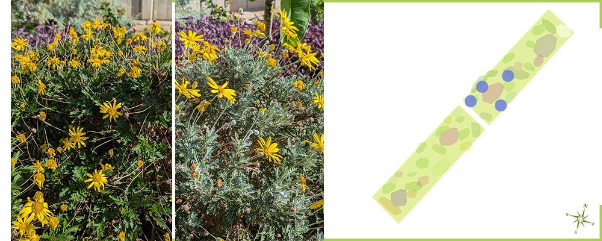

### Margarita amarilla
_Euryops pectinatum_

Pequeños arbustos con flores amarillas muy vistosas. En este jardín estoy probando dos variedades: unas con hojas verde oscuro y otras de hoja plateada.
_Euryops_ es un género de plantas con flores de la familia de los girasoles. Son originarias principalmente de zonas rocosas del sur de África, con algunas especies presentes en otras partes de África y en la Península Arábiga.

***

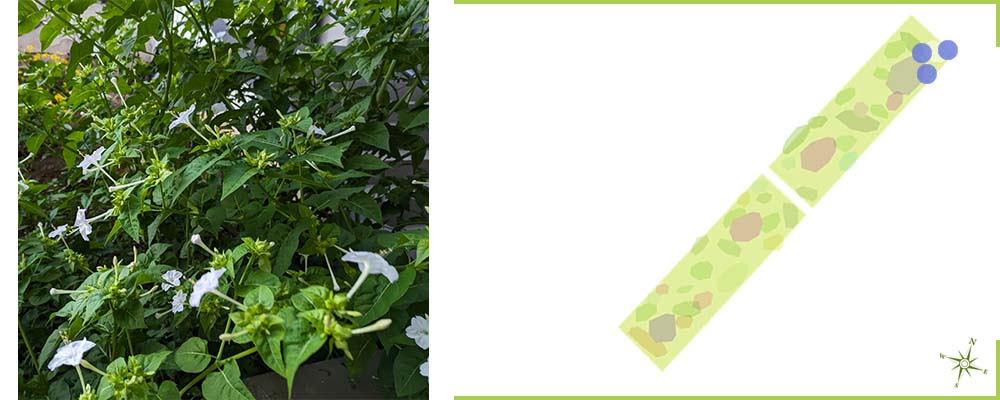

### Dondiego de noche
_Mirabilis jalapa_

Es originaria de Centro y Suramérica (Perú-México). A este jardín se trajo con semillas de un jardín particular en Tegueste y hasta ahora se ha ido multiplicando y tenemos ejemplares en por varios jardines.
Tiene varios nombres populares: Galán de noche, Bella de noche; en Canarias suele conocerse como Dondiego de noche porque sus flores se abren al atardecer y están abiertas por la noche. Se la conoce por muchos otros nombres: galán de noche, dama de noche, trompetillas, periquitos y un largo etc. Cuando las flores se abren, al atardecer, tienen un suave perfume. La polinizan polillas de esfíngidos. La mayoría de las esfinges tienen una probóscide muy larga y se alimentan de néctar mientras permanecen en vuelo frente a la flor, de forma similar a un colibrí. Al igual que los colibríes son buenos polinizadores. Las flores adaptadas a este tipo de polinización suelen ser tubulares, de colores pálidos o blancos, y se abren de noche.

El nombre _Mirabilis jalapa_ dado por Linneo en 1753 se forma a partir del latín científico _Mirabilis_ que significa "admirable" por alusión a los notables colores de sus flores y el nombre específico _jalapa_ que haría referencia a su origen en la Jalapa en Guatemala. Pero _jalapa_ también podría referirse a la ciudad de Xalapa en México de donde provenía un antiguo fármaco purgante, llamado _jalap_, tomado de los tubérculos de la planta.

**Los colores del dondiego y la genética**
Aunque los ejemplares de este jardín son de flor blanca, algunos de los colores sólidos de las flores de la _Mirabilis jalapa_ que se pueden encontrar son Rojo, Rosa, Amarillo, Blanco, y Naranja. Además de estos colores sólidos, algunas variedades pueden tener flores bicolor o multicolores, lo que hace que esta planta sea atractiva para jardines ornamentales y macetas. Otro de los fenómenos que presenta es el cambio de color. Por ejemplo, en la variedad amarilla, a medida que la planta madura, puede producir flores que cambien gradualmente al rosa oscuro. Del mismo modo, las flores blancas pueden cambiar al violeta claro.

Hacia 1900, Carl Correns utilizó _Mirabilis_ como organismo modelo para sus estudios sobre la herencia citoplasmática. Usó las hojas variegadas de la planta para demostrar que ciertos factores externos al núcleo afectaban al fenotipo de una manera que no explicaban las teorías de Mendel. Correns propuso que el color de las hojas en _Mirabilis_ se transmitía a través de un modo de herencia uniparental: Cuando se cruzan plantas con flores de color rosa oscuro con plantas de flores blancas, se producen descendientes con flores de color rosa claro. Esto se considera una excepción a la Ley de dominancia de Mendel porque, en este caso, los genes de color rosa oscuro y blanco parecen tener la misma fuerza, por lo que ninguno domina completamente al otro. El fenómeno se conoce como dominancia incompleta. Es, pues, una planta que tuvo un papel importante en la historia de la genética.

&emsp;&emsp;_Esquema de la transmisión de colores en Mirabilis_

***

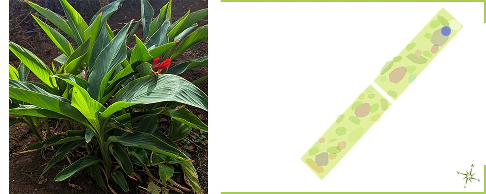

### Platanillo
_Canna indica_

Es originaria de América del Sur: Colombia, Venezuela, Ecuador, Perú, Brasil, Uruguay y Argentina, así como de las Indias Occidentales y América Central. En Canarias se usa en jardinería popular de manera habitual, estando muy bien adaptada a la climatología de las islas En América del Sur su nombre más común es _achira_, y se cultiva como alimento: los rizomas se comen crudos u horneados y sobre todo se usa como materia prima para harinas.

Unos ejemplares de platanillo, de flor roja, se trasladaron y agruparon de otros parterres donde estaban en mal estado. Aquí han tenido mejores condiciones de humedad y en grupo son más visibles. A lo largo de 2026 he añadido otros dos pequeños grupos: uno de ellos de planta herborizada en la zona de Pedro Álvarez, con hoja rojiza y flor naranja pequeña, y el otro de hoja verde pálido, aún no ha florecido.

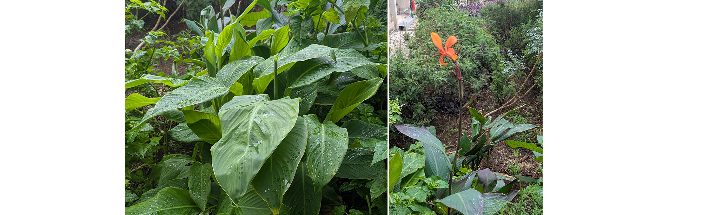
&emsp;&emsp;_Dos nuevas variedades de platanillo, noviembre 0226_

***

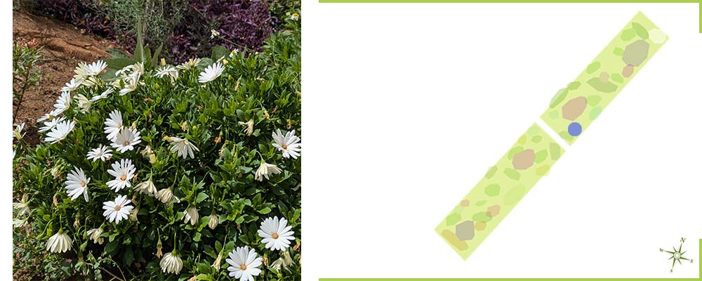

### Margarita del Cabo
_Dimorphoteca Ecklonis_

Las _dimorphothecas_ se parecen a las margaritas, pero no lo son. Vienen de Sudáfrica y tienen una floración con colores más variados que van desde el blanco, al morado, el naranja y el amarillo. Incluso los morados pueden incluir distintas gamas entre rojo y violeta. Esta planta herbácea, vivaz y rústica, se autorreproduce con facilidad y se adapta a climas secos y soleados.
Su nombre viene del griego _dis_ _morphe_ y _theka_, que significa _la fruta en forma de dos_, refiriéndose al dimorfismo de las _asteráceas_. _ecklonis_ por el botánico danés Christian Friedrich Ecklon. 

Ecklon nació en 1795 y realizó expediciones de recolectas en Sudáfrica, siendo su primer viaje en 1823, primero como aprendiz de botica y luego farmacéutico, tratando a la flora con fines medicinales. Sin fondos y con su salud deteriorada se ve forzado a vivir en la pobreza, vendiendo bulbos o preparando remedios herbales. Así todo, regresa a Europa en 1828, llevando una importante cantidad de especímenes de herbario.  Este herbario es la base de la [Flora Capensis](https://www.biodiversitylibrary.org/bibliography/821), escrito por su amigo, el farmacéutico hamburgués Otto W. Sonder en colaboración con su colega irlandés William H. Harvey, profesor de botánica, publicado en Londres en 7 volúmenes desde el año 1860 al 1933.
La historia de botánicos como Ecklon nos da idea del gigantesco esfuerzo humano por conocer las especies de plantas del planeta.

&emsp;&emsp;_Christian Ecklon_

***
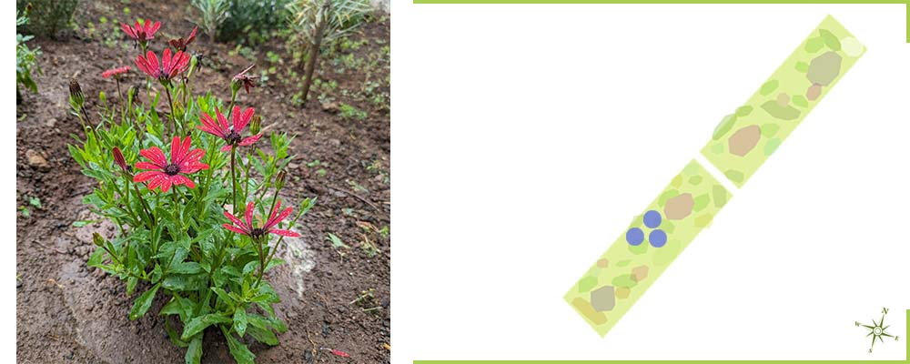

### Margarita del Cabo
💀 _Osteospermium fruticans_

Esta especie está muy cercana a las _Dimorphotecas_, en teoría es perenne mientras que las otras son anuales. Sin embargo, habrá que ver cómo se adaptan y se comportan en este jardín.
_Actualización_: Probé varios ejemplares de colores diversos, que florecieron un año para después perderse.
Por razones de sostenibilidad, finalmente no los volví a sembrar sino que he recurrido a otra especie: _Asteriscus maritimus_ 

&emsp;&emsp;

***

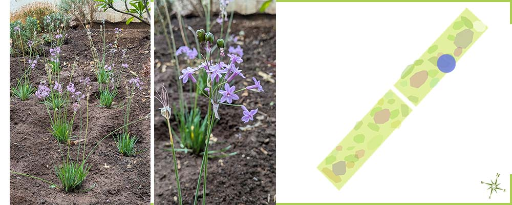
_Tulbaghias recién plantadas, octubre 2024_

### Tulbaghia
_Tulbaghia violacea_

Una planta rizomatosa, de flores violeta, de la familia de las _amarilidáceas_, que incluyen plantas comestibles como cebolla, ajo, puerro, etc y muchas plantas ornamentales como los amarilis, agapantos o narcisos.
La _Tulbaghia_ proviene de África del Sur y se recomienda para jardinería sostenible por su resistencia a la sequía.

Esta planta fue nombrada en honor de Ryk Tulbagh (1699-1771), gobernador en el Cabo Buena Esperanza cuando perteneció a los Países Bajos. Tulbagh fue un intelectual que tuvo contacto con los astrónomos Nicolas Louis de Lacaille, Charles Mason y Jeremiah Dixon y se carteó con varios botánicos incluyendo Carlos Linneo, al envió más de 200 especímenes de plantas locales. Linneo nombró la planta _Tulbaghia_ en su honor.

Se ha plantado un grupo en una mancha de flores violeta, que esperemos que mantengan floración todo el año.

***

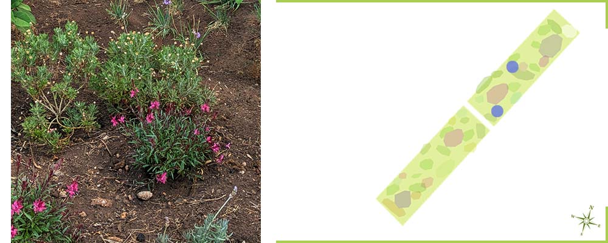

### Gaura
_Oenothera lindheimeri_

Es una planta perenne de bajo mantenimiento de aspecto delicado, pero muy resistente. Originaria del sur de Luisiana y Texas. En 2007 se cambió su nombre a _Oenothera lindheimeri_, antes se la conocía como *gaura*, y así se sigue llamanado en muchos viveros.

_Oenothera_ proviene de la formación de dos palabras griegas: “oinos” y “thêr“. Significan respectivamente “vino” y “animales salvajes”. Según la leyenda, las raíces de las onagra  (oenotheras) remojadas en vino permitirían domar fácilmente a las bestias salvajes. Tournefort creó el género Onagra para las plantas americanas y Linneo cambió dicho nombre por el de Oenother. En castellano, la onagra (_Oenothera biennis_) se conoce también como enotera, hierba del asno o hierba del vino.
_Gaura_ deriva del griego _gaûros_, "soberbio" por el tamaño y floración de algunas especies de este género. 
_Lindheimeri_ por Ferdinand Lindheimer (1801-1879), botánico de origen alemán que en el siglo XIX recolectó extensamente en Texas para Asa Gray, el botánico estadounidense más importante del siglo XIX, profesor de botánica en Harvard y gran amigo de Darwin, con quien colaboró y a quien apoyó con sus teorías en EE.UU.

Los cuidados de la gaura son mínimos si se planta en el lugar adecuado. En un par de años se ha adaptado bastante bien y da una nota de color y de flores en movimiento muy interesante. 

La especie fue recolectada y descrita por primera vez por Lindheimer en la decada de 1830 en Texas y Luisiana, durante sus extensas exploraciones botanicas por la frontera de Texas. Lindheimer, llamado a veces el padre de la botanica texana, recogio miles de especimenes vegetales de la región que fueron formalmente descritos mas tarde por George Engelmann y Asa Gray.

_Dibujo de Gaura por Edward Step, 1896 ([Favourite flowers of garden and greenhouse](https://archive.org/details/favouriteflowers03steprich/favouriteflowers03steprich/))_

En su hábitat natural, la gaura crece en suelos arenosos o derivados de caliza junto a orillas de arroyos, praderas abiertas y bordes de caminos alterados, a menudo en asociación con gramíneas nativas y otras flores silvestres. La planta evolucionó para adaptarse al calor extremo, la sequía y los suelos pobres caracteristicos del paisaje texano, desarrollando su profunda raiz pivotante y sus eficientes estrategias de uso del agua.

La gaura fue relativamente desconocida en horticultura hasta la década de 1990, con el renovado interés por las vivaces tolerantes a la sequía y de bajo mantenimiento, con el desarrollo de la *xerojardinería*.
El cultivar 'Siskiyou Pink' fue introducido en 1991 por el Siskiyou Rare Plant Nursery de Oregón y se hizo muy popular, valorada por sus flores rosa intenso y porte compacto. Desde entonces, se han desarrollado numerosos cultivares, incluidas formas enanas aptas para macetas, colores más intensos y variedades con mayor resistencia al frío. Hoy  la gaura se cultiva en todo el mundo en climas templados y mediterráneos como pieza fundamental de los jardines de uso eficiente del agua y plantaciones de pradera naturalista, apreciada por su porte grácil, su extraordinariamente larga temporada de floración y sus mínimas necesidades de cuidado.

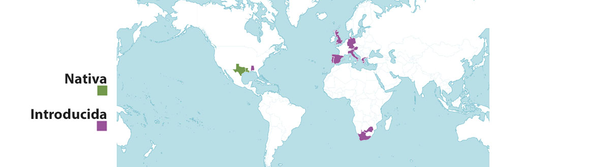
&emsp;&emsp;_Distribución de la gaura._

***

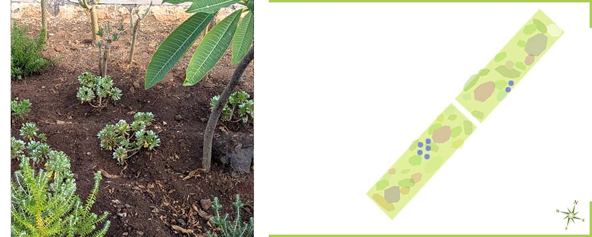

### Margarita de mar
_Pallenis maritima_

Esta es una de las primeras plantas que compré en vivero y traje al jardín, pensando que era el endemismo de Fuerteventura _jorao_. Me lo vendieron como "margarita majorera" y pensaba que era muy poco probable que fuera el auténtico endemismo de Fuerteventura, aunque por otra parte había leído sobre su introducción en jardinería en otras islas. Por su porte creo que es una especie muy cercana, la _Panellia maritima_, que últimamente se suele encontrar en algunos viveros. 

Es un arbusto de tamaño pequeño, hasta 30cm. de alto, de base leñosa con hojas vellosas y llamativas flores amarillas (en realidad son inflorescencias, o sea grupos de flores) semejantes a las margaritas. Florece casi todo el año, en especial desde la primavera hasta bien entrado el verano. Son sinónimos: _Asteriscus maritimus_ y _Odontospermum maritimum_. 

Soporta altos niveles de insolación, prolongadas sequías estivales y suelos salinos (halófila). Por esto es una planta ideal para xerojardinería. Es pionera en la colonización de suelos pobres, arenosos o rocosos, ayudando en la formación y estabilización de dunas costeras y previniendo la erosión. En el medio natural se la encuentra en acantilados, arenales costeros, de 0 a 200 msnm. 
Es originaria del Mediterráneo occidental y central hasta Grecia, norte de África e islas Canarias. Se la llama también margarita de mar, asterisco marítimo, estrella de mar, Mediterranean Beach Daisy o Gold Coin. En inglés se la nombra también como _Canary Island daisy_, lo que quizá explique que a veces en viveros se la llame _margarita majorera_, causando confusión con el _jorao_.

_Pálea_ (del Latín paja), es un término empleado por Carlos Linneo para las escamitas que existen en el receptáculo de numerosos miembros de la familia Asteraceae en la base de las flores, y se llama «receptáculo paleáceo» al que las tiene. _Maritima_, del mar.

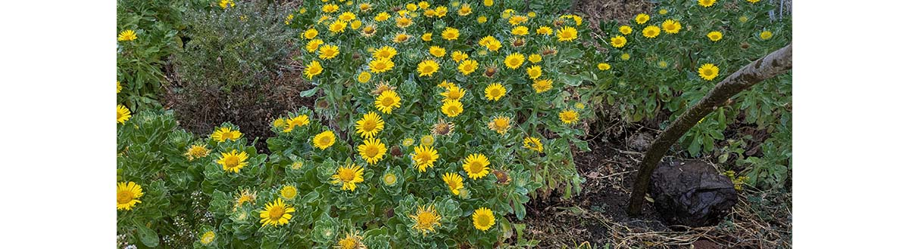
&emsp;&emsp;_Grupo de margaritas en mayo 2026_.

***

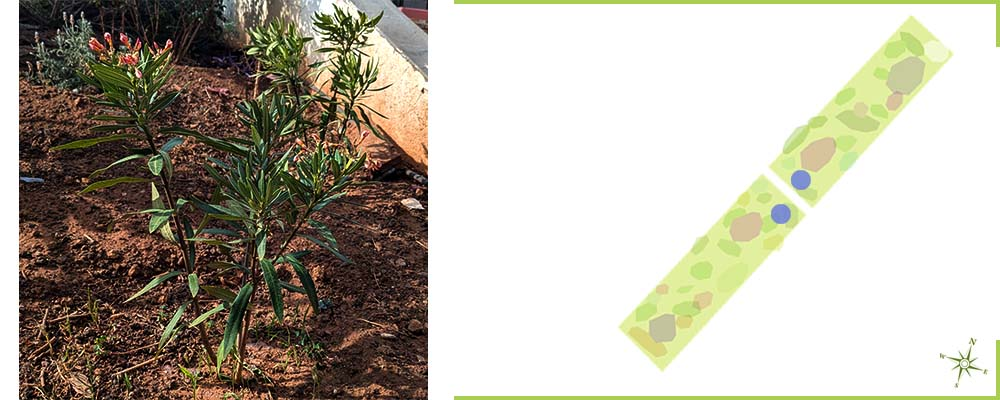

### Adelfa enana
_Nerium oleander_

Adelfa o baladre. Originariamente se encontraba como planta nativa en una amplia zona desde el Mediterráneo hasta China y Vietnam, y se ha difundido ampliamente por todas las zonas con clima propicio como planta ornamental, en jardines, medianeras de carretera. Hay numerosas variedades de jardinería, con flores con un número variable de pétalos y diferentes coloraciones que incluyen el rojo, fucsia, carmín, rosa, blanco y, más recientemente, el salmón y el amarillo pálido. También existe una forma con hojas variegadas verde-amarillas y una subespecie enana. Al tratarse de una planta de origen mediterráneo, es muy resistente a la sequía.
He sembrado la variedad enana, ocupando unas esquinas difíciles, por su robustez, pequeño tamaño y abundante floración. A pesar de ello, he perdido un ejemplar, quedando tres, que también están teniendo un desarrollo muy lento.

_Nerium_ deriva del vocablo griego _nerión_ "agua" o "húmedo", y se puede referir a que crece naturalmente cerca de corrientes de agua (como ríos), o al dios griego Nereo, dios del Mar y padre de las Nereidas. _Oleander_ por la semejanza superficial de sus hojas con el olivo (_Olea europea_)

**La toxicidad de la adelfa**. _Nerium_ contiene varios compuestos tóxicos, e históricamente se ha considerado una planta venenosa. Sin embargo, su amargura lo hace desagradable para los humanos y la mayoría de los animales, por lo que los casos de intoxicación son muy raros, además de que en caso de ingestión causa náuseas y vómitos. El contacto prolongado con la savia puede causar irritación de la piel o los ojos.
Muchas (muchísimas) plantas del planeta, y por extensión utilizadas en jardinería, son tóxicas, venenosas o irritantes.

Un artículo de 2014 en la revista médica _Perspectives in Biology and Medicine_ proponía que la adelfa era la sustancia utilizada para inducir alucinaciones en la Pitia, la sacerdotisa de Apolo, también conocida como el Oráculo de Delfos en la Antigua Grecia. Según esta teoría, los síntomas de los trances de la Pitia (_enthusiasmos_) corresponden a la inhalación del humo o la masticación de pequeñas cantidades de hojas de adelfa, a menudo llamadas con el término genérico laurel en la Antigua Grecia, lo que llevó a confusión con el laurel que citan los autores antiguos.

Existe una persistente leyenda en la que unos lugareños españoles, durante la guerra de Independencia a comienzos del siglo XIX, aniquilan a todo un batallón del ejército francés, envenenándolos con carne de conejo asados en una hoguera ensartados en palos de adelfa. La misma leyenda aparece con varias ubicaciones diferentes, y adecuadamente ignora que los propios vapores tóxicos hubiera alertado a los soldados, que además hubieran tenido episodios de vómitos, mareos, etc. Añadiendo que en el ejército francés había médicos y científicos, como por ejemplo Apollinaire Fée, farmacéutico militar que en 1809 participó de la campaña de España y elaboró una tratado de las plantas que se iba encontrando en su avance junto al ejército y entre las que describió a la adelfa.
En [Espores](https://espores.org/es/), una publicación del Jardín Botánico de la Universidad de Valencia, se recoge esta leyenda en el artículo [Adelfa, tan bella como tóxica](https://espores.org/es/etnobotanica-es/adelfa-tan-bella-como-toxica/), con mucha otra información interesante.

En el mundo real, los estudios de toxicidad en animales han concluído que las aves y los roedores son relativamente insensibles a los glucósidos cardíacos de adelfa. Sin embargo, otros mamíferos, como los perros y los humanos, sí que pueden ser afectados. Es peligrosa para animales como ganado, ovejas, caballos. Los recortes de plantas son especialmente peligrosos para los caballos, ya que son dulces. Esto se refleja acertadamente en el nombre sánscrito de la planta, _aśvamāra_, un compuesto de _aśva_ "caballo" y _māra_ "matar".
La mortalidad humana por ingestión de adelfa es muy baja o inexistente. Un dato muy singular (y triste) que encontré en la red: en 2000 se produjo un caso raro y bastante triste de muerte por envenenamiento con adelfa en Estados Unidos: dos niños pequeños adoptados de un orfanato comieron las hojas del arbusto de un vecino en El Segundo, California. Debido a que la adelfa es extremadamente amarga, se cree que los niños pequeños habían desarrollado una condición causada por la desnutrición (llamada _pica_), que hace que las personas coman cosas que de otro modo no serían comestibles. Cómo decía, una triste curiosidad.

Una última fantasía cinematográfica: en la película _La flor del mal (White oleander, 2003)_ basada en un libro de Janet Fitch y dirigida por Peter Kosminsky, Ingrid (Michelle Pfeiffer) decide envenenar a su amante Barry (Billy Connolly) con un veneno hecho de adelfa blanca.

&emsp;&emsp;_Michelle Pfeiffer recogiendo ramas de adelfa (La flor del mal, 2002). (En el cine no te lo creas todo, y con las plantas suele haber más agujeros de guion y fallos de raccord: ¿recuerdas aquella escena de Gladiator donde Máximo recordaba los jazmines de su villa en Hispania? Estas plantas llegaron a la Península Ibérica con los árabes, que las extendieron desde Oriente Medio, varios siglos después de que Hispania dejara de ser romana)_

***

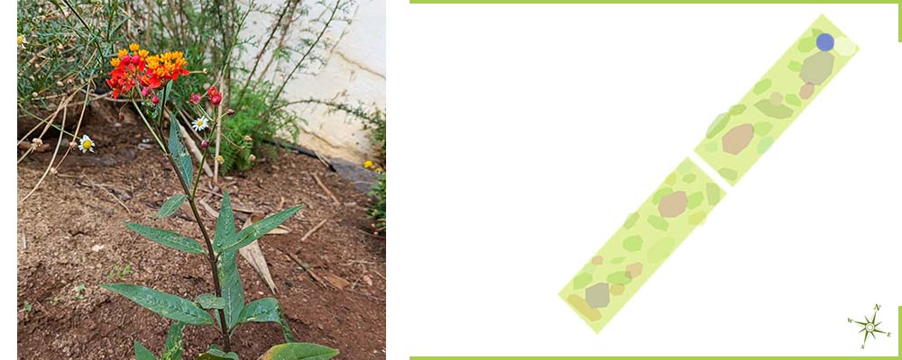

### Asclepias
💀 _Asclepias curassavica_

Las _Asclepias_ de este parterre han terminado desapareciendo. Sin embargo, las que trasladé a la zona más sombría crecen sin problema, más allá del ataque ocasional de las orugas de la mariposa monarca.

***

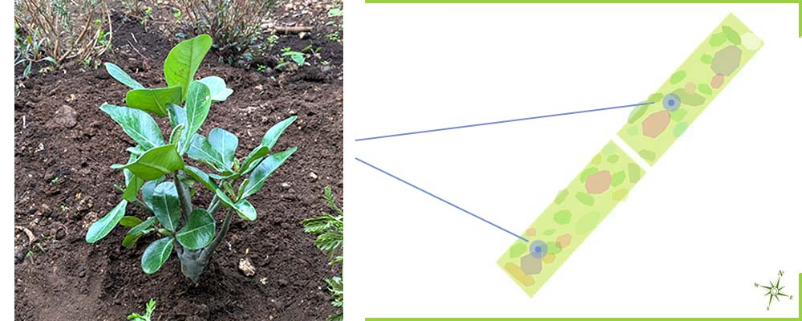

### Rosa del desierto
_Adenium obesum_

_Adenium_ es un género de arbustos perteneciente a la familia _Apocynaceae_. Es originaria de  África y de la península arábiga. El género fue descrito por Roem & Schult. y publicado en _Systema Vegetabilium_, en 1819. Actualmente se reconocen cinco especies: _Adenium boehmianum_ Namibia, Angola. _Adenium multiflorum_ África austral, desde Zambia hacia el sur. _Adenium obesum_ desde Senegal hasta Somalia, además de en la península arábiga. _Adenium oleifolium_ Sudáfrica, Botsuana, Namibia. _Adenium swazicum_ (Este de Sudáfrica.

&emsp;&emsp;_Distribución de Adenium_

Son arbustos perennes suculentos de climas tropicales y semi-caducos a caducos en los climas más fríos, también depende de la especie. Alcanzan a 1-3 m de altura. Las hojas están dispuestas en espiral, agrupadas hacia las puntas de los brotes, las flores son tubulares con cinco pétalos, semejantes a géneros como _Plumeria_ y _Nerium_. Las flores tienden a rojo y rosa, a menudo con una vista hacia el exterior blanquecino en la garganta. Se cultiva como planta de interior en regiones templadas y tropicales. Se han desarrollado numerosos híbrido, ya que son muy apreciados por sus flores coloridas y sus inusuales caudices (tallos engrosados).
La savia de _Adenium boehmianum_, _A. multiflorum_ y _A. obesum_ contiene glucósidos cardíacos tóxicos; en diversas regiones de África se emplea como veneno para flechas destinado a la caza de animales de gran tamaño. De hecho al _A. boehmianum_ se llama así por los bosquimanos (Bushman), y su nombre común en inglés es _Bushman poison_ (veneno del bosquimano). Ahora llamados preferentemente [San](https://es.wikipedia.org/wiki/San), son pueblos africanos, tradicionalmente cazadores-recolectores.

Los introduzco en octubre noviembre 2026 buscando su juego de espejo con las plumerias. Cómo crecerán, cuándo florecerán exactamente, etc. son aún preguntas cuya respuesta iré aprendiendo con el tiempo.

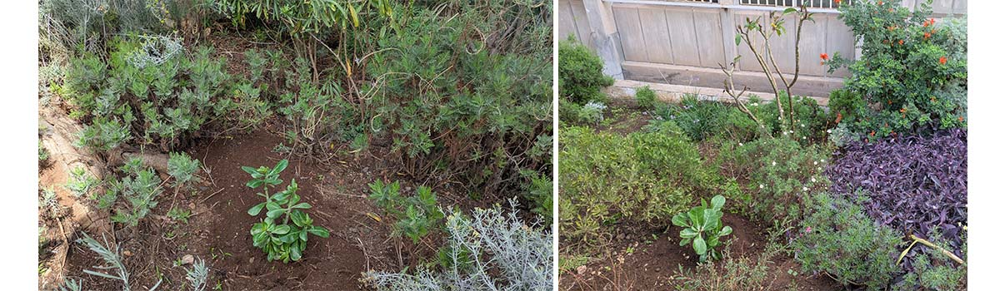
&emsp;&emsp;_Adenium obesum recien plantados, noviembre 2026_.

**Etimología**: _adenium_ de Aden, la localidad donde fue recogida originariamente la especie. _obesum_ por su caudex engrosado.

**Nombres comunes**: rosa del deserto (italiano); desert rose, mock azalea, impala lily  Sabi star, kudu (inglés); rose du desert (francés); Wüstenrose (alemán); adenio, rosa del desierto, adeno (español); rosa do deserto (portugués).

Combina dos atributos rara vez unidos en el mismo género: un caudex robusto, propio de plantas adaptadas a la sequía severa, y una floración con flores grandes y vistosas, propia de plantas tropicales con polinizadores activos. Esa combinación la convierte en un caso atípico dentro de las suculentas. La mayoría de las plantas con caudex producen flores discretas. La mayoría de las plantas con floración espectacular requieren riego frecuente. _Adenium obesum_ es la excepción que combina ambos rasgos.

En los últimos decenios ha crecido enormemente su popularidad en lugares lejanos a su origen, en particular en el mundo asiático, donde han sido secleccionadas innumerables variedades por la forma y color de sus flores. En Filipinas, debido a su parecido con el género emparentado _Plumeria_ y al hecho de que fue introducida en el país desde Bangkok, se la denomina "kalachuchi de Bangkok". Debido a su semejanza con la Plumeria en miniatura y a su popularidad en el cultivo de bonsáis, a veces también se la conoce como "frangipani japonés".

##### _Systema Vegetabilium_
La referencia de la primera descripción científica de _Adenium_ en _Systema Vegetabilium_, (Ed. 16) de por Johann Jacob Roemer, Josef August Schultes y Julius Hermann Schultes me lleva a buscar el libro, y lo encuentro, como casi siempre, en un sitio web fundamental: [Archive](http://archive.org). Casi todos los tomos (7 volúmenes publicado entre 1817-1830) los ha proporcionado el Missouri Botanical Garden  [Tomo 1](https://archive.org/details/mobot31753000802527).

El Jardín Botánico de Missouri fue fundado por Henry Shaw en el siglo XIX (abrió en 1859). Su herbario, con más de 7,5 millones de especímenes, es el segundo más grande de Norteamérica. Su biblioteca, denominada Peter H. Raven Library, alberga el 85 % de toda la bibliografía publicada sobre botánica sistemática y taxonomía vegetal. 

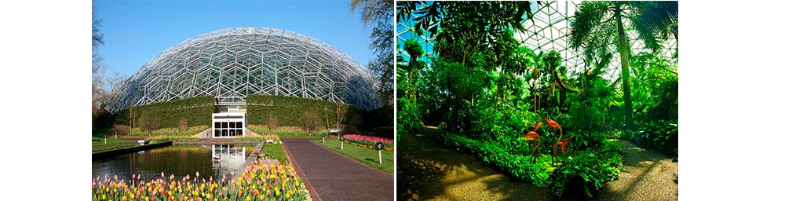
&emsp;&emsp;_Climatrón: exterior e interior_

En 1959, el conservatorio inició la construcción del [Climatron](https://en.wikipedia.org/wiki/Climatron), un invernadero geodésico diseñado para simular el clima de una selva tropical. Se inauguró en 1960, convirtiéndose en uno de los primeros invernaderos con cúpula geodésica. Con el paso del tiempo, el edificio sufrió el deterioro de los paneles de plexiglás originales, así como los efectos de la humedad en algunos elementos metálicos, por lo que después de una renovación integral volvió a abrir en 1990. El acristalamiento original de plexiglás fue sustituido por paneles de vidrio termorresistente con una capa de plástico  Saflex y recubiertos con una película de baja emisividad. 

##### Los fitotrones
El Climatron es uno más de los llamados "fitotrones", enormes laboratorios con control climático para la investigación de investigar las causas ambientales que determinan el crecimiento y el desarrollo de los organismos vivos. 

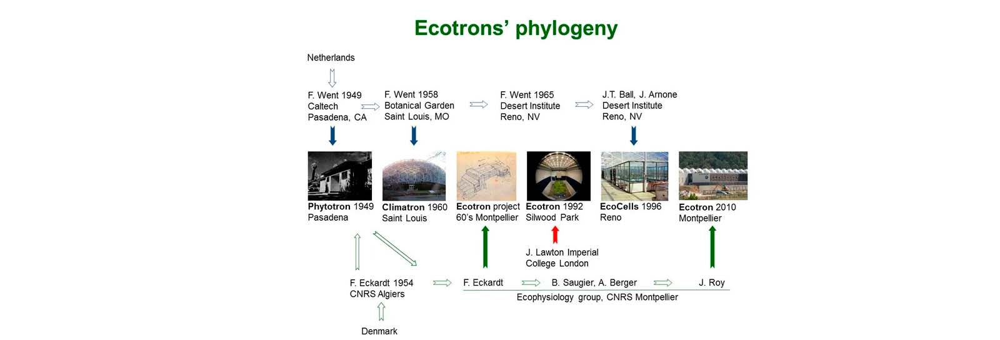
&emsp;&emsp;_Gráfico tomado de [World of trons](https://www.worldoftrons.com/)_

El primer fitotrón fue construido en CalTech en 1949. Entre 1945 y la actualidad, los fitotrones se extendieron por todo el mundo, llegando a Australia, Francia, Hungría, la Unión Soviética, Inglaterra y Estados Unidos. Además, han dado lugar a variantes como el Biotron en la Universidad de Wisconsin-Madison; el Brisatron en el Laboratorio de Ecología del río Savannah; en Francia el [Ecotron Europeo de Montpellier](https://ecotron.cnrs.fr/) (2007) y el [Ecotron Ile-de-France](https://www.foljuif.ens.fr/) (2008) o el Ecotron en el Imperial College de Londres: 

> El Silwood Park Ecotron es una instalación científica de investigación ecológica ubicada en el Centre for Population Biology de Imperial College London (en Silwood Park, Ascot, Reino Unido). Está compuesto por 16 cámaras ambientales físicas y electrónicas interconectadas y transitables (walk-in chambers) que permiten simular y controlar condiciones climáticas como temperatura, humedad e iluminación (incluso emitiendo datos meteorológicos reales). El Ecotron de Silwood Park está actualmente parcialmente cerrado.

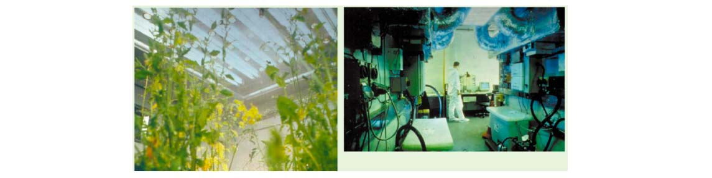
&emsp;&emsp;_El Ecotrón británico_

Encontré un curioso libro: **Engineering the Environment: Phytotrons and the Quest to Control Climate in the Cold War** (Ingeniería del medio ambiente: los fitotrones y la búsqueda del control climático durante la Guerra Fría) de David P. D. Munns, que además relaciona los fitotrones de mediados del siglo XX con la Guerra Fría. Tiene sentido que empezaran a aparecer estas ideas en un mundo que en ese momento fue amedrentado con los peligros de la Era Atómica.

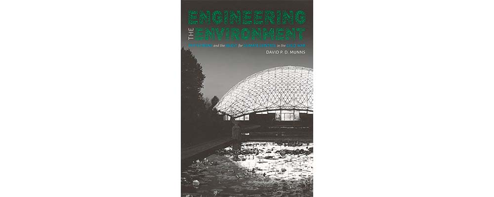

Por último, relacionado con esto está **Biosfera 2**, una estructura construida originalmente para formar un ecosistema artificial cerrado en Arizona (EE.UU.) por Space Biosphere Ventures. Construida entre 1987 y 1991, fue diseñada para comprender el complejo entramado de interacciones en un ecosistema, así como para estudiar la viabilidad de biosferas cerradas en la colonización espacial y permitir el estudio y manipulación de una biosfera sin dañar la Tierra. Entre 1991 y 1993 ocho personas (cuatro hombres y cuatro mujeres) vivieron selladas dentro de la estructura durante dos años. Sin embargo, los niveles de dióxido de carbono (CO₂) se dispararon, el oxígeno cayó drásticamente (obligando a bombear oxígeno desde el exterior), los cultivos fueron insuficientes y los árboles crecieron débiles por la falta de viento. Surgieron divisiones interna. Se intentó un segundo experimento en 1994, pero fue cancelado a los pocos meses. Un alucinante documental de 2020 que tuve oportunidad de ver: **Spaceship Earth**, contó la historia del primer aislamiento.

***

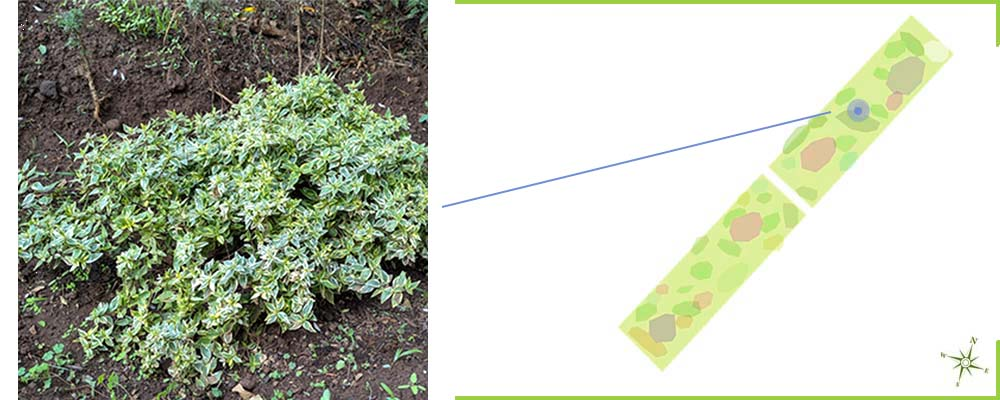

### Abelia
_Abelia grandiflora_

Abelia es un género de arbustos que actualmente incluye 6 especies. Originarios del este de Asia, en particular de China, Taiwan y Vietnam se distribuyen por Afganistán y desde el Himalaya hasta el este de Asia, con 2 especies en México.

Son populares como arbustos de jardines y adornos urbanos, por su floración y su perfume. la variedad más extendida es _Abelia × grandiflora_ (_Abelia chinensis_ × _Abelia uniflora_). En general vivir en condiciones adversas. 

El género fue descrito por Robert Brown y publicado en [Narrative of a Journey in the Interior of China](https://dn720309.ca.archive.org/0/items/narrativeofjourn00abel/narrativeofjourn00abel.pdf), 1818. 

&emsp;&emsp;_Ilustración final de Narrative of a journey... ¿un naufragio?_.

> El género _Abelia_ recibe su nombre en honor a su descubridor, Clarke Abel, Esq., quien formó parte de la embajada enviada a China como médico jefe en el séquito de Lord Amherst. Lamentablemente para la ciencia, casi la totalidad de las extensas colecciones reunidas en China por este entusiasta naturalista se perdieron en el naufragio del *Alceste*; lo único que se salvó fue una pequeña selección de especímenes vegetales que él mismo había regalado, durante su estancia en China, a Sir George Staunton, quien, con gran generosidad, se los devolvió a su llegada a Inglaterra.
> 
> de: Narrative of a Journey in the Interior of China.

No fue hasta 1844 cuando Robert Fortune importó a Inglaterra los primeros ejemplares vivos de _Abelia chinensis_.

***

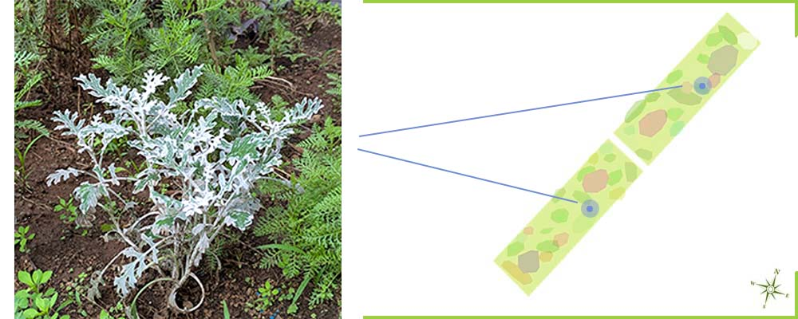

### Cineraria
_Jacobaea maritima_

Anteriormente conocida como _Cineraria maritima_, _Senecio cineraria_, _Senecio bicolor subsp. cineraria_. Nombres comunes: Cineraria, silver ragwort (literalmente Hierba cana de plata), dusty miller (literalmente: molinero polvoriento)

Son plantas perennes nativas de la región mediterránea. Muy cultivadas como ornamental por el color grisáceo de sus hojas aterciopeladas. Como en otras plantas grises, este color es una adaptación a la alta insolación, combinada con texturas sedosas, pelillos, etc en la superficie de las hojas.

**Etimología**: _Jacobaea_ podría provenir de San Jacob o San Jacobo, uno de los 12 apóstoles o (en referencia a la isla de Santiago (Cabo Verde). El nombre científico aceptado actualmente (Jacobaea) fue propuesta por el botánico escocés Philip Miller en la publicación ”The Gardeners dictionary, containing the methods of cultivating and improving the kitchen, fruit and flower garden, as also the physick garden, wilderness, conservatory and vineyard” de 1754. _maritima_ por su preferencia de habitats cercanos al mar.

&emsp;&emsp;_Ilustración de cineraria en "Flora de bolsillo ilustrada del litoral mediterráneo, de Génova a Barcelona, incluida Córcega. Ottone Penzig, 1902_

En BHL se puede encontrar la digitalización de [Flore coloriée de poche du littoral méditerranéen de Gênes à Barcelone y compris la Corse](https://www.biodiversitylibrary.org/bibliography/9960), 1902, de Ottone Penzig, **Biodiversity Heritage Library (BHL)** es la "biblioteca digital de acceso abierto más grande del mundo dedicada a la literatura y los archivos sobre biodiversidad". Comenzó en 2006, y con 20 años de recorrido, ofrece acceso gratuito a más de 64 millones de páginas y atiende a más de 16 millones de usuarios en más de 240 países y territorios. En 2026, la BHL inició una nueva etapa como una organización totalmente distribuida y gobernada por su propia comunidad, manteniendo su compromiso de larga data con el acceso abierto, la colaboración y la gestión compartida del conocimiento sobre la biodiversidad. Fue fundada inicialmente por 10 instituciones, entre otras: American Museum of Natural History; Harvard University, Botany Libraries; Missouri Botanical Garden; Natural History Museum, London; The New York Botanical Garden; Royal Botanic Gardens, Kew.

***
***

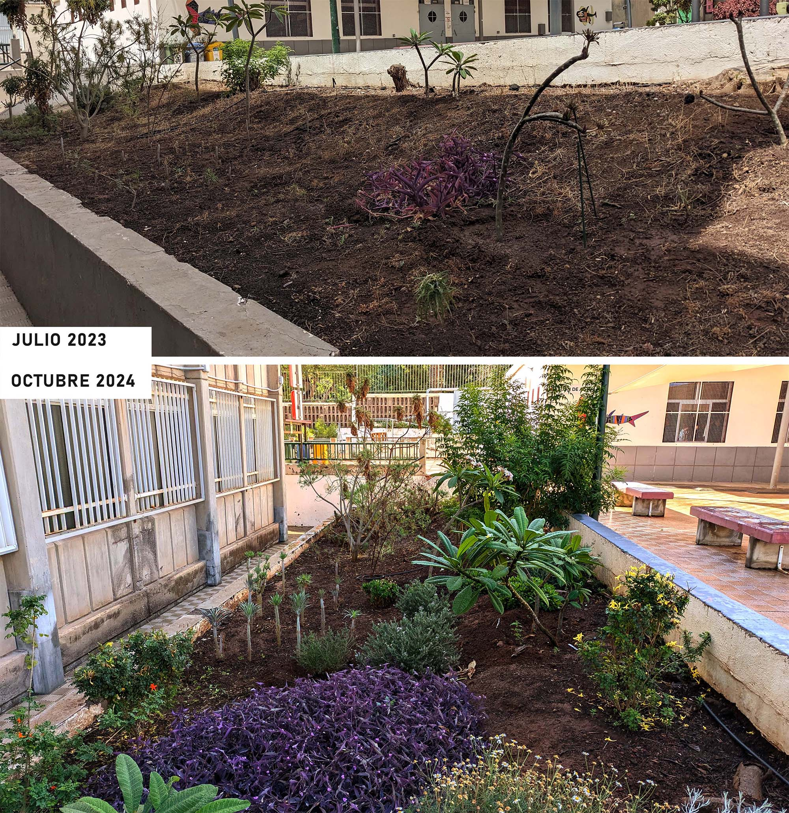
&emsp;&emsp;_Evolución de uno de los parterres en unos 15 meses_

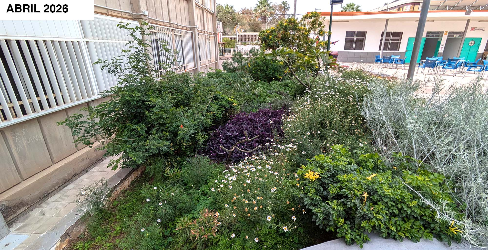
&emsp;&emsp;_Un invierno muy lluvioso y la propia evolución del jardín: primavera 2026_

***
***

## PLANTAS NATIVAS DE CANARIAS

Algunas de estas plantas han sido cedidas por el  **Vivero Insular de Flora Autóctona** del Cabildo de Tenerife (rosalito, alhelí, guaydil, salvia). Otras (lavanda, senecio) han nacido espontáneamente o se han recolectado en sus hábitat (magarza, salado).

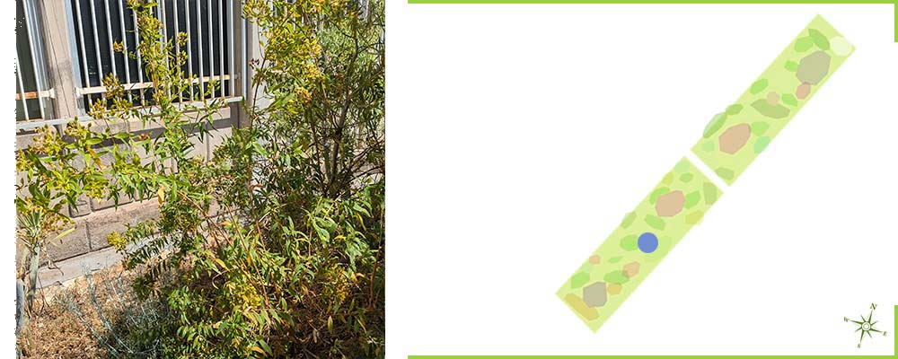

### Granadillo 
_Hypericum canariense_

Se conoce como: granadillo, sanjuanero, malfurada, flor de cruz, espantademonios. En inglés, _Canary Islands St. John'swort_ (hierba de San Juan). Granadillo se explicaría por parecerse en tamaño y forma al granado (_Punica granatum_), prescindiendo de las flores.

En este parterre estaba este granadillo plantado por las profesoras que tuvieron una iniciativa de introducir plantas nativas, hace años. Pensaba que había muerto, pero lentamente ha resurgido y en 2026 ha tenido una floración importante. 

Llega a ser un arbusto ramificado, de forma muy variable y hasta 3 m de alto, con tallos leñosos y quebradizos, recubiertos con una corteza de color marrón claro, y que pierde parte del follaje en verano, recuperándolo con las primeras lluvias. Florece en primavera, hacia junio, con flores pequeñas, amarillas, en inflorescencias muy densas y olorosas. 

&emsp;&emsp;_Mayo 2026: floración del granadillo_.

Endemismo de Canarias y Madeira. Frecuente en la zona de bosques termófilos y en los márgenes de la laurisilva y fayal-brezal. Prefiere lugares rocosos algo húmedos y soleados, y en ocasiones baja hasta cerca de la costa, o sube hasta zonas dominadas por el pinar. 
De esta especie se distinguen tres variedades, atendiendo a sus diferencias en la forma de las hojas, y la forma y tamaño de los pétalos y los frutos. La var. _canariense_, la var. _platysepalum_, ambas exclusivas de las Islas Canarias, y la var. _floribundum_, que además también crece en la isla de Madeira.

Puede usarse como ornamental en zonas bajas y de medianías. Su cultivo es muy fácil, pues se adapta a casi todo tipo de suelos y sólo necesita riego moderado en verano.

El nombre del género _Hypericum_ deriva del griego _hyper_, "sobre", y eikon, "icono" o "aparición". Se creía que las plantas de este nombre tenían la capacidad de proteger contra los espíritus malignos.
Nombres que quizá se relacionan con esta planta son: Granadilla: pueblo en el Sur de Tenerife, Granadillos; un caserío de Betancuria en Fuerteventura. 

**El granadillo como exótica invasora**:
Como algo bastante peculiar en una especie proveniente de unas pequeñas islas en el Atlántico, esta especie se encuentra asilvestrada, y se ha convertido en exótica invasora en varios lugares del planeta, lugares tan lejanos como [a lo largo de la costa de California y en Hawaii](https://www.invasiveplantatlas.org/subject.html?sub=5734#maps); el sur y suroeste de Australia; Nueva Zelanda; [Sudáfrica](https://www.sciencedirect.com/science/article/pii/S0254629921004786) (Ciudad del Cabo, Hermanus y Gqeberha).

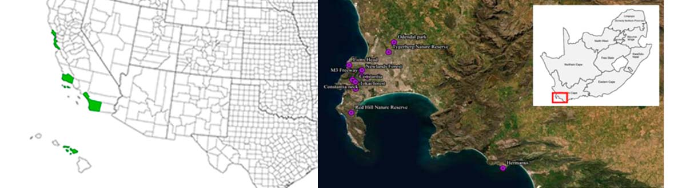
&emsp;&emsp;_El granadillo como invasora en la costa de California/Hawaii y en Sudáfrica_.

Este es un resumen de uno de los casos, Sudáfrica:

> "_Hypericum canariense_ se introdujo a través de la industria de la horticultura ornamental, registrándose las primeras poblaciones en 1950. Tiene el potencial de convertirse en una especie invasora de amplia distribución. Esto se ve favorecido por la abundante producción de semillas y un banco de semillas grande y persistente. Además de beneficiarse de los esfuerzos de introducción y de ser cultivada en la Ciudad del Cabo, _H. canariense_ posee una serie de características que podrían favorecer la invasión: largo periodo de floración, una corta etapa prereproductiva, acumulación de un banco de semillas en el suelo, su polinización generalista y la dispersión de sus semillas por el viento y el agua. La proximidad de todas las poblaciones naturalizadas a carreteras y cursos de agua indica que las vías de movimiento pueden facilitar la dispersión a larga distancia. Su erradicación llevaría unos 10 años con unas acción más intensa el primer año y control durante los 9 años siguientes".
> <cite>― [La especie exótica invasora Hypericum canariense en Sudáfrica: manejo, costo y viabilidad de erradicación](https://www.sciencedirect.com/science/article/pii/S0254629921004786)</cite>

***

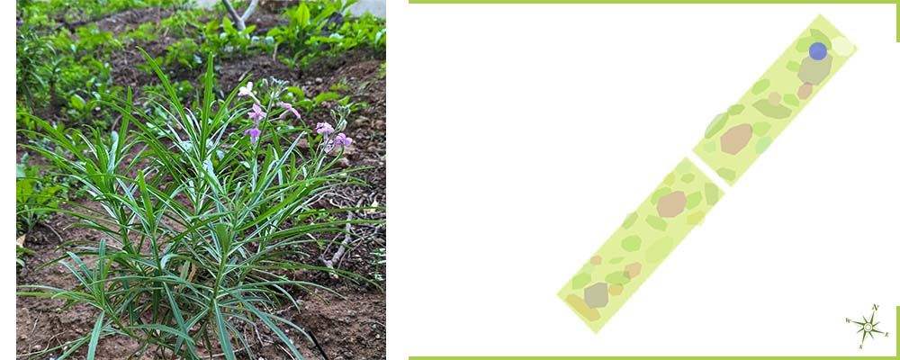

### Alhelí 
_Erysimum bicolor_

Es un pequeño arbusto, con hojas estrechas y lanceoladas, de flores violetas y blancas. Endemismo macaronésico que se encuentra en Canarias y Madeira.

Ya se ha intentado tener alhelíes en tres ocasiones. El primer año los ejemplares tuvieron un buen desarrollo, florecieron, pero en verano 2024 tuvieron un importante retroceso. Se plantaron nuevos ejemplares en otoño de 2024, que desaparecieron de nuevo en verano de 2025. 
Se está haciendo un último intento de adaptarlos desde otoño 2025, cambiando el lugar a un sitio con menos insolación. Un año después (noviembre 2026) la planta original se secó casi totalmente, pero en otoño está rebrotando y ha dejado varios hijos alrededor.

***

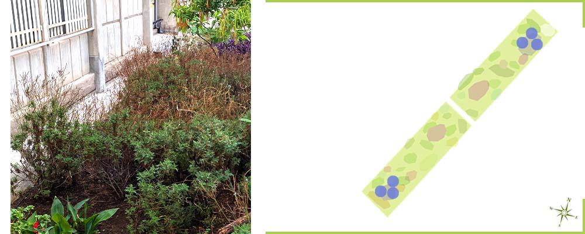

### Lavanda
_Lavandula canariensis_ 

También llamada mato risco, lavanda, romanillo o yerba risco, es un endemismo canario, frecuente y hasta abundante en barrancos y laderas pedregosas del Cardonal-tabaibal, formando parte de la vegetación típica de ese ecosistema. Aparece menos en áreas cálidas y soleadas de los bosques termófilos.
En el año 2004 se publicó una revisión del género _Lavandula_ que determinó que hay hasta siete subespecies de esta planta, una por cada una de las islas de nuestro archipiélago
Las lavandas de este jardín se trajeron de la zona costera del Valle de Güímar. Tras varios intentos una de ellas arraigó y ahora su propia semillas van haciendo que aparezcan nuevas plantas.
Es resistente a la sequía y a la insolación y es de la misma familia que las lavandas que se utilizan comercialmente para fabricar perfumes, aunque con menos olor. También se han llevado semillas al jardín del patio y allí se está multiplicando.

Desde la primera retirada de malas hierbas nacieron numerosos ejemplares en los dos parterres largos, aunque su desarrollo es muy diferente según la insolación y humedad.

***

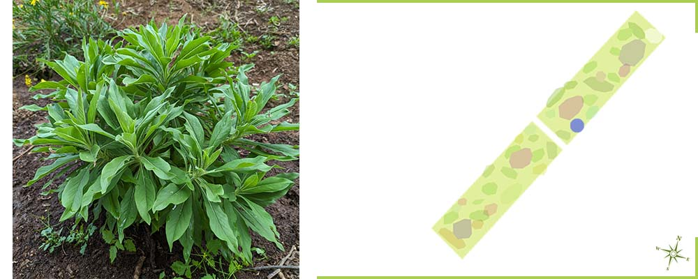

### Rosalito
_Pterocephalus dumetorus_

El rosalito salvaje es un arbusto de porte redondeada, de hasta 1,5 metros de alto con vistosas flores de color rosado. 
Endémica de Canarias crece en barrancos, laderas y riscos de la zona central de la isla de Gran Canaria, llegando a ser abundante en algunas localidades de dicha área. En Tenerife tiene su hábitat en la zona del valle de Güímar entre Igueste de Candelaria (barranco de Chacorche) y la Ladera de Güímar y algunos barrancos del sur llegando hasta el municipio de Arico. 

_Pterocephalus_ del griego _pteron_, "ala o pluma", y _kephale_ "cabeza", en referencia a la forma plumosa de las flores. _dumetorus_ del latín _dumetum_ "matorral".

Tiene un uso importante como planta ornamental debido a sus vistosas flores y su fácil cultivo. Aunque en este jardín tres años después de su plantación sigue creciendo, pero aún no ha tenido su primera floración. 

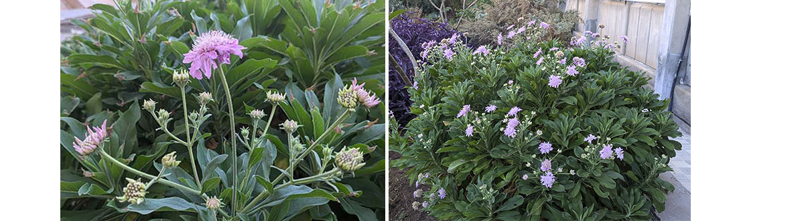
&emsp;&emsp;_Actualización mayo 2026: primera floración del rosalito_.

***

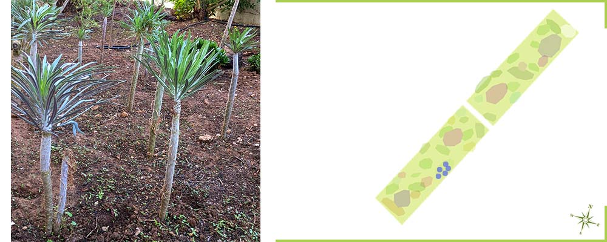

### Senecio / Verode
_Kleinia neriifolia_

Se le suele llamar también verode, aunque el nombre, como muchos nombres comunes, va cambiando según las islas y las zonas. Esto es confuso ya que también se llama verodes a casi todo el género Aeonium.
Es una planta muy resistente, que aquí se reproduce por sí misma con las semillas transportadas por el viento. En verano pierde todas sus hojas y las recupera en invierno.

Se ha plantado un grupo de senecios, trasladando ejemplares de otras zonas del Instituto que habían nacido espontáneamente.
Es una planta muy resistente, casi indestructible. Desde el punto de vista de la jardinería tiene sus más y sus menos: en verano pierde toda la hoja (como defensa frente a la deshidratación) y queda como una estructura de tallos de poco interés. 
En otoño empieza a recuperar sus hojas y cambia su aspecto. Un par de veces al año florece y fructifica de forma espectacular, dejando que el viento disperse sus semillas voladoras, que de repente están por todas partes, con lo que también suelen aparecer ejemplares nuevos por cualquier sitio.

***

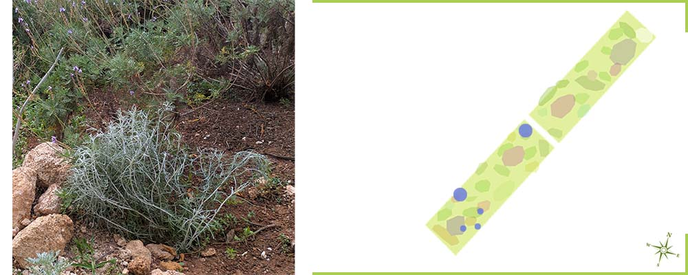

### Salado
_Schizogyne sericea_

El salado blanco, también conocido como dama en algunas islas es un endemismo macaronésico presente en el Archipiélago Canario y en las islas Salvajes, al norte de Canarias. En El Hierro la única voz que se usa es _irama_, que ha dado nombre incluso a una zona de la costa del Sur de la isla, cercana a La Restinga, en plural, Iramas. El nombre le viene, evidentemente, de la abundancia de estas plantas en el lugar.

Crece en la zona litoral de las islas, sobre sustratos de rocas, laderas y enclaves arenosos, donde la influencia de la maresía generalmente está presente. También es habitual encontrar el salado blanco colonizando los caminos y bordes de carreteras, así como aquellos terrenos alterados por la acción humana. Su área de distribución abarca desde las zonas costeras o litorales hasta altitudes de más de 400 metros. Se ha utilizado en la medicina popular canaria para el tratamiento de algunas dolencias.
Estos ejemplares se han recolectado recién nacidos en la zona costera del Valle de Güímar. Se ha adaptado muy bien, y aparte de sus pequeñas flores amarillas sus hojas tienen un color verde pálido que da una buena nota de contraste.

_Schizogyne_ procede del griego _schizein_, "partir o separar" y _gyne_, "hembra", refiriéndose al estigma partido de las flores. De la misma raíz viene la palabra “esquizofrenia” (esquizo: dividir, fren:mente). _Sericea_ procede del latín sericum, "seda", por su textura sedosa al tacto.

***

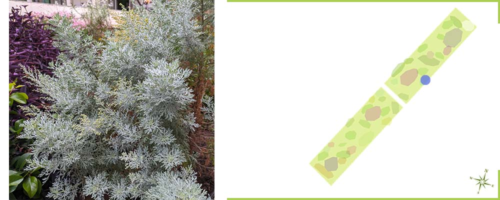

### Incienso
_Artemisia Thuscula_

Un ejemplar de esta especie apareció espontáneamente. Ha florecido varias veces de modo que quizá tenga descendencia.

Su hábitat es el tabaibal-cardonal, bosque termófilo, lavas históricas y recientes. Forma parte de los matorrales del piso basal. Con mucha frecuencia se le puede observar recolonizando bancales de cultivos abandonados, zonas roturadas y antropizadas donde puede formar amplios inciensales.

Tiene unas hojas de color blanquecino-plateado, con un olor muy fuerte y característico al rozarlas y unas inflorescencias densas y alargadas con flores muy pequeñas de color amarillo-dorado o amarillo marrón. Es una planta muy utilizada en la medicina popular y se le atribuyen numerosas propiedades medicinales.

***

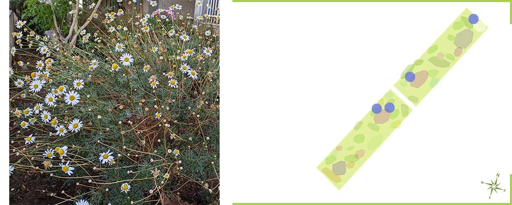

### Margarita / Magarza
_Argyranthemum frutescens_

Margarita nativa de las Islas Canarias que llegó a este jardín por sí misma, transportada por el viento o por los pájaros, y que llegó a Inglaterra, transportada por algún botánico para la colección de la reina Mary II en el [palacio de Hampton Court](https://www.hrp.org.uk/hampton-court-palace/whats-on/hampton-court-gardens/national-plant-collections/) ya en el siglo XVI, luego a Holanda, Francia etc, y desde entonces se han desarrollado (y siguen desarrollándose y patentándose) miles de cultivares con todo tipo de tamaños, colores y adaptaciones a otros climas. Su familia, las _Asteraceae_, está formada por unas 24 especies de Canarias y Madeira.

Su nombre _Argyranthemum_ procede del griego _argyros_, "plateado" y _anthemom_ "planta de flor", aludiendo a sus flores radiantes pálidas. _Frutescens_ del latín frutescere, que significa "echar o producir vástagos o renuevos" como referencia a su ramificación exuberante.

&emsp;&emsp;_Grupo de magarzas nacidas espontáneamente, marzo 2025_

***

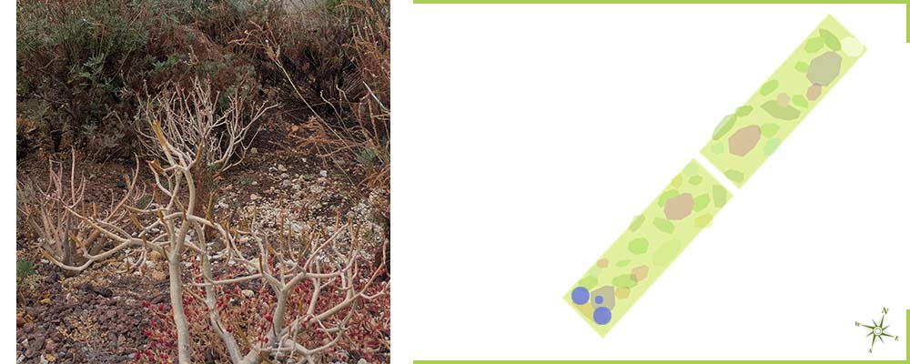

### Tabaiba dulce
_Euphorbia balsamifera_

Esta planta es de la familia de las euforbias, en Tenerife la podemos encontrar en toda la costa del sur, a veces en comunidades extensas, los tabaibales. 
Es fácil de distinguir por su forma redondeada, porte bajo, incluso se aplasta contra la tierra o la lava de los malpaíses, y color rojizo.
Se adapta muy bien a la falta de lluvia acumulando agua en sus ramas para la estación seca. En cuanto caen las primeras lluvias del invierno desarrolla rápidamente hojas, flores y frutos.

Su savia o látex no es tóxico (al contrario que la mayoría de plantas de su familia), y ha tenido diversos usos se cree que desde tiempos prehispánicos. incluso usos alimentarios, seguramente por eso se la conoce como tabaiba dulce. 

***

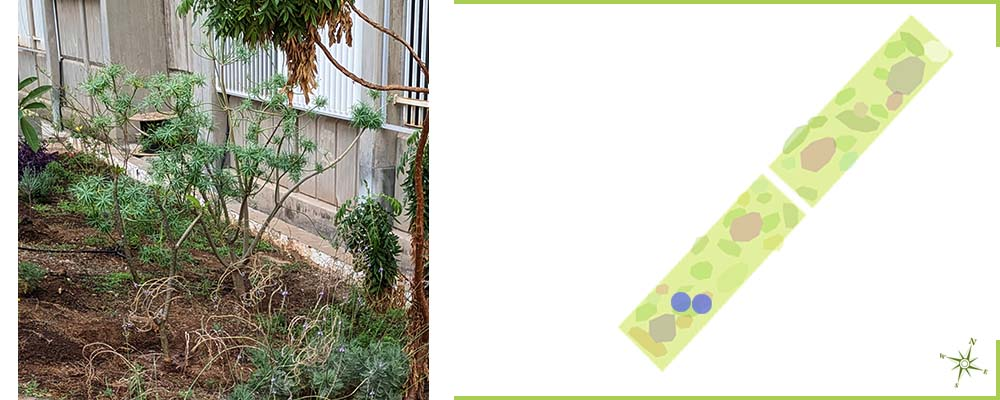

### Tabaiba amarga
_Euphorbia lamarckii_ 

Con bastantes similitudes con la tabaiba dulce, pero sus ramas son verdosas y de crecimiento vertical. En este jardín hay un ejemplar especialmente alto.
Cuidado con su látex, que es irritante para la piel y sobre todo ojos y mucosas.

Hasta hace pocos años se la llamaba _Euphorbia regis-jubae_, en honor al rey Juba de Mauritania, pero un estudio más detallado encontró algunas diferencias que hacen que la especie de Gran Canaria mantiene el nombre _regis-jubae_ y la que se encuentra en Tenerife se llame ahora _Euphorbia lamarckii_, nombre puesto en honor al naturalista francés de los siglos XVIII y XIX Jean-Baptiste Lamarck. 

***

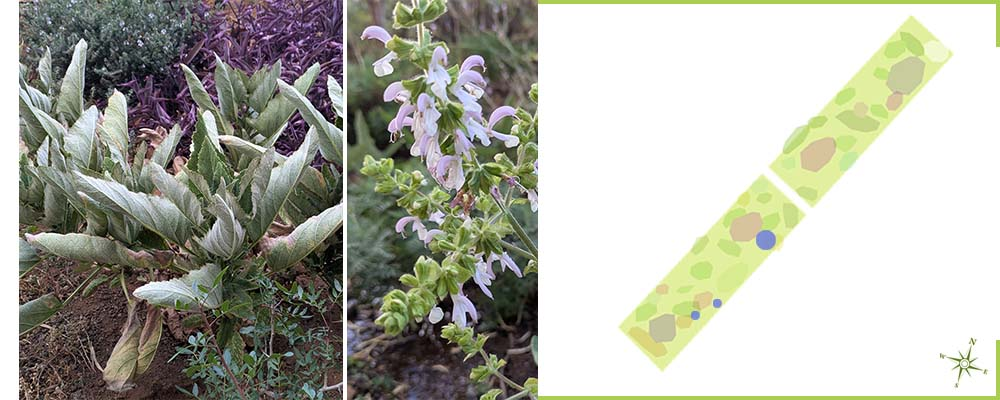
_Salvias y su floración_

### Salvia
💀 _Salvia canariensis_

Esta salvia es una especie originaria de las Islas Canarias, presente en todas las islas aunque escasa en las orientales.
Es un arbusto perenne que puede alcanzar una altura de hasta 1-2 metros, con hojas de forma ovalada cubiertas por una fina capa de pelo. 
Tiene flores de color malva-azul intenso en racimos, follaje verde y buena resistencia a condiciones adversas. Su periodo de floración es amplio, desde finales del invierno hasta comienzos del otoño siguiente, aunque lo más común es entre los meses de febrero y agosto.
En teoría atrae a polinizadores como abejas y mariposas, aunque hasta ahora no lo he observado. Por todo esto, se emplea habitualmente en jardinería.

Sin embargo, tras un ciclo  de dos años, las plantas han muerto sin dejar descendencia.

***

_Ejemplares de guaydil recién trasplantados, noviembre 2024_

### Guaydil
_Convolvulus floridus_

Es una  planta presente en todas las islas del archipiélago canario (aunque rara en Lanzarote y Fuerteventura). Es una endémica de carácter heliófilo y xerófilo (o sea, le gusta el sol y está adaptada a medios secos), característica de los bosques termófilos y de las zonas altas del cardonal-tabaibal. Su hábitat está entre 200 y 700 metros de altitud en riscos, laderas y barrancos. 

Tenemos dos ejemplares de guaydil, una planta nativa de Canarias, a las que les ha costado adaptarse y han crecido muy lentamente, aunque en teoría aquí tiene buenas condiciones. En unos años, si siguen progresando, serán arbustos grandes con flores blancas muy vistosas. Por su floración y su resistencia a condiciones adversas es una planta que se usa frecuentemente en jardinería pública de carreteras en Canarias.

_Convolvulus_ viene del latín _convolvere_ (enredar). _Floridus_ por su abundante y llamativa floración.
El nombre _guaydil_ se considera una palabra indígena, aunque no se ha podido precisar su significado. La especie fue descrita por Carlos Linneo el Joven (hijo de Linneo)

***

 

### Bencomia
💀 _Bencomia caudata_

Esta planta ya estaba en el jardín, plantada por varias profesoras que tuvieron una iniciativa de introducir flora canaria, vía el vivero del Cabildo. La bencomia prosperó y alcanzó 3-4 metros de altura. 

En verano de 2025, tras una floración, ha ido en retroceso hasta secarse por completo. 

_Bencomia_ es un género de plantas perteneciente a la familia de las rosáceas.
La bencomia de monte (_Bencomia caudata_) es un endemismo macaronésico presente en Madeira y en Canarias (Tenerife, La Palma y Gran Canaria). Es un arbusto o arbolito de 2 a 4 metros de altura, con una copa amplia y llamativa de color verde oscuro que contrasta con el color marrón o pardo de la corteza.
En Canarias existen 4 especies de Bencomia, tres ellas endémicas del archipiélago (_Bencomia brachystachya_, _Bencomia extipulata_ y _Bencomia sphaerocarpa_), y _Bencomia caudata_, endémica de la Macaronesia.
_Bencomia caudata_ fue descrita por Aiton, Webb et Berth y publicado en [Histoire Naturelle des Îles Canaries](https://bibdigital.rjb.csic.es/idurl/1/9789) en 1846.

_Bencomia_: género dedicado a Bencomo, uno de los menceyes guanches de Tenerife en la época de la Conquista de las islas. _caudata_ del latín cauda, que significa cola, por la apariencia de sus inflorescencias colgantes. Se recoge también el nombre popular zumaquero.

**Otras bencomias: La Bencomia exstipulata**
Esta especie de Bencomia es una de las plantas endémicas en peligro de extinción que se está recuperando en el Jardín Botánico del Parque Nacional del Teide, ubicado en El Portillo. Allí se han reproducido ejemplares que en principio garantizan que no desaparezca. Si vamos al P.N. del Teide, es muy recomendable parar un rato en El Portillo y visitar este jardín botánico, especialmente a partir de marzo, cuando las plantas empiezan a despertar del invierno.

***

### Cardoncillo
_Ceropegia fusca_

Aunque se llame cardoncillo es una especie totalmente diferente al cardón.
En los jardines del patio he introducido en marzo 2025 la especie de las zonas más áridas (_Ceropegia fusca_). Suele encontrarse en la misma zona que las tabaibas o el cardón, en comunidades de tabaibal-cardonal, aunque mucho más escasa que estos.

***

### Palo sangre
_Marcetella moquiniana_

Es un árbol o arbusto que puede llegar a tener 4 m de altura,
En las ramas superiores tienen unos pelos rojos glandulares, que dan a los tallos un color rojo-sangre característico, al que alude su nombre vulgar: palo de sangre. este color rojizo y sus delicadas ramas le dan un alto valor ornamental, así que esperemos que los dos ejemplares que ha cedido el Vivero de El Cabildo se adapten bien.

_Marcetella_ es un género exclusivo de la Macaronesia: _Marcetella moquiniana_ se encuentra en el archipiélago canario, mientras que _Marcetella maderensis_ se encuentra en Madeira, tratándose de un claro ejemplo de especiación por separación geográfica. En Canarias es endémica de las isla de Tenerife, La Gomera y Gran Canaria. En Tenerife habita en  paredes rocosas de los barrancos profundos del sur y del oeste desde Güímar hasta Teno, destaca su presencia en Arona, barranco del Infierno, Masca, Los Silos (barranco Cuevas Negras) etc. También en la vertiente norte presenta algunas poblaciones, aunque es más escasa (Ladera de Tigaiga). Asimismo, se encuentra en el macizo de Anaga siendo muy abundante en el barranco del Tomadero tanto en las laderas como en el fondo del barranco. Generalmente se sitúa en la franja entre los 200 y 1000 metros de altitud. En Gran Canaria se encuentra en los riscos de Guayadeque a 1000 metros de altitud con pocos ejemplares. En La Gomera hay varias poblaciones en la zona del barranco de Santiago caserío de Imada y Risco de Santiago

_Marcetella_: género dedicado a Adeodato F.Marcet (1875-1964), monje del Monasterio de Monserrat, amigo del botánico sueco Sventenius, autor que describió este género.
_moquiniana_: especie dedicada a Moquin-Tandon (1804-1863), botánico francés.

***

### Orijama
_Cneorum pulverulentum_

Arbusto bastante común en las comunidades de Euphorbia, leñoso y ramificado, que puede llegar a medir más de un metro de altura, de hojas lanceoladas, duras y  cubiertas de pelos cortos y grisáceos, como en las ramas jóvenes, lo que le da a la planta un aspecto ceniciento. Flores amarillas muy vistosas y frutos casi esféricos y poco carnosos. Es endémica de las Islas de Tenerife, Gran Canaria, La Gomera y El Hierro.

Nombres comunes: leña buena, leña blanca, leña santa u orijama. Orijama u orihama proviene del vocablo aborigen _Ori-ahoram_ que significa leña buena o leña santa. Según Berthelot.

Hay una interrelación entre la leña buena y los reptiles del género _Gallotia_, o sea los lagartos canarios, desde los tizones hasta los lagartos gigantes: la planta es básica en la alimentación de los lagartos, que a su vez dispersan sus semillas. Se cree que la disminución de las poblaciones de lagartos es uno de los factores que afecta a las poblaciones de la planta. Otro factor en su contra fue su uso como leña: en el matorral costero era el mejor combustible. Ha terminado por ser una planta escasa.

Tiene propiedades antibacterianas y analgésicas, con un uso medicinal tradicional importante. También tuvo usos en la fabricación de agujas, lanzaderas para telares y utensilios de pequeño tamaño, al ser su madera dura y perdurable.

***

### Cerrajilla
_Sonchus tenerrimus_

Cerrajilla menuda o cerrajilla, en principio se puede considerar una mala hierba, o planta adventicia: nadie la ha sembrado, nadie decidió dónde y por qué utilizarla, pero no deja de ser una planta interesante por su floración espectacular y también por otros motivos: destaca por su capacidad de colonización de terrenos empobrecidos o alterados por la actividad humana. Es frecuente en bordes de caminos, zonas urbanas degradadas, huertos, márgenes de campo e incluso ambientes salinos cercanos a la costa. En los xerojardines, el _Sonchus tenerrimus_ surge de forma espontánea y tiene múltiples ventajas ecológicas: protege el suelo de la erosión, fomenta la biodiversidad al atraer insectos polinizadores y sirve de alimento para aves y otros animales. Es verdad que hay que controlar que no invada sario controlar su expansión, ya que puede brotar entre las juntas del pavimento o sitios poco deseados, pero su mantenimiento es mínimo y su valor ecológico notable.

Es una nativa de Canarias, no endémica ya que se extiende por todo el Mediterráneo, parte de África y hasta Pakistán.

_Sonchus tenerrimus_ fue descrita por Carlos Linneo y publicado ya en _Species Plantarum_, y utilizó nombres muy antiguos:
_Sonchus_ viene del nombre griego de estas plantas, y ya aparece en la _Historia Naturalis_ de Plinio el Viejo.
_tenerrimus_: del latín tenerrimus: tierno, delicado, por sus hojas fina y estrechamente lobuladas. Ya en Ovidio en _Ars Amandi_ usa este nombre.

&emsp;&emsp;_Cerrajilla mezclada de forma natural con magarzas y lavandas. primavera 2026_

# Parterres de poniente

En el parterre suroeste hay una línea de grandes acalifas, con algunas nativas canarias: quedan un rosalito, una gran bencomia y un jazmín silvestre.  Las acalifas deberían podarse a un tamaño menos y con una forma coherente entre ellas, evitando su envejecimiento. En 2026, con el [proyecto2026](https://jardinedu.github.io/cifpcm/proyecto2026) se van a incluir más nativas entre las acalifas.

&emsp;&emsp;_Fila de acalifas con una primera poda. Abajo: bencomia y jazmín silvestre_

**Introducción a los parterres**

El extremo de estos parterres, que hace de introducción a ellos, es un sitio de paso inevitable y el punto donde después de atravesar la zona administrativa se tiene la sensación de _entrar_ de verdad en el CIFP. Así pues se le ha dado un tratamiento especial, con vegetación más baja, que permita una vista panorámica del patio. Ya llevo años haciendo un trabajo lento: se trasladaron las plantas en mal estado (casi todas) a otros parterres más adecuados a sus necesidades, uní grupos de tradescantia y planté unas pocas especies, en gama de violetas y lilas principalmente (colores asociados a la imagen de marca del CIFP), resistentes a la sequía y la insolación. También se ha organizado una mini-rocalla de piedra volcánica, a juego con el _mulch_ de picón rojizo que se ha mantenido.

&emsp;&emsp;_Parterre recién plantado, agosto 2025_

- Una mancha de _Tradescantia pallida_, tapizante.
- Una _Duranta_, de flores violeta, que se ha de mantener en un tamaño mediano mediante podas.
- Un grupo  de _Gauras_ de color fucsia intenso, que  deberían formar una masa de tallos medianos muy móviles, con floración prolongada.
- Un grupo de _Lavandula_ de dos variedades de diferente altura junto a la esquina más transitada, con el objetivo de que dispersen su aroma.
- Un grupo de rhoeo (_Tradescantia spathacea_) en diálogo con la tradescantia tapizante.
- Una abelia /_Abelia grandiflora_) para una nota de color más claro.
- Y por último he recuperado un tartaguero (_Ricinus communis_) que ya utilicé en el primer jardín para rellenar espacios de forma rápida y provisional. En Canarias está asociado a lugares en abandono y descuido, pero en Europa se sigue usando en jardinería. Esto es un intento de dignificación de esta espeie, con texturas y colores que pueden ser muy interesantes.

&emsp;&emsp;_Parterre en noviembre 2026. Las gauras vuelven a florecer y a oscilar con el viento_

[INICIO](https://jardinedu.github.io/cifpcm/inicio) | [ÍNDICE DE JARDINES](https://jardinedu.github.io/cifpcm/jardines) | [BIBLIO.-REFER.-APÉND.](https://jardinedu.github.io/cifpcm/biblio) | [PROYECTO2026](https://jardinedu.github.io/cifpcm/proyecto2026) | [VISUAL](https://jardinedu.github.io/cifpcm/visual) | [NOTAS](https://jardinedu.github.io/cifpcm/notas)

