# 3. Jardín de los filodendros

Continuando los parterres del Patio central, entre el Pabellón 1 y el Aula ATECA hay unos parterres alargados con unas condiciones de semisombra y humedad que crean un ambiente diferente. Jardín de los filodendros por un gigantesco filodendro, acompañado de otras especies de la misma familia hasta tener 5 especies en la actualidad (octubre 2026).

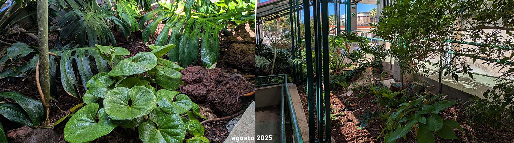

Busco una combinación de plantas interesantes que vivan bien en esas condiciones y que ofrezcan una variante respecto a los otros jardines, creando un pequeño espacio un poco selvático y refrescante, y si es posible con algo del espíritu de la jardinería tradicional canaria de patios interiores en sombra.

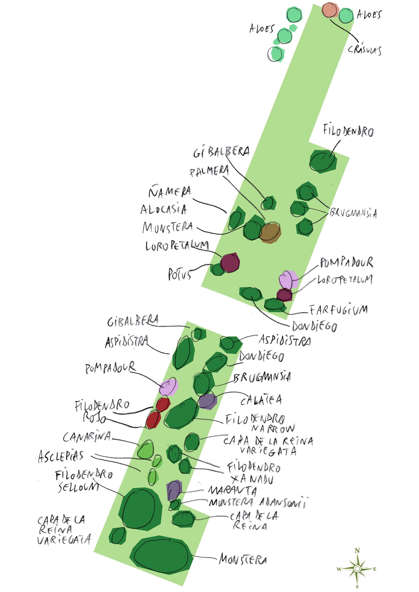

## ESPECIES NO NATIVAS

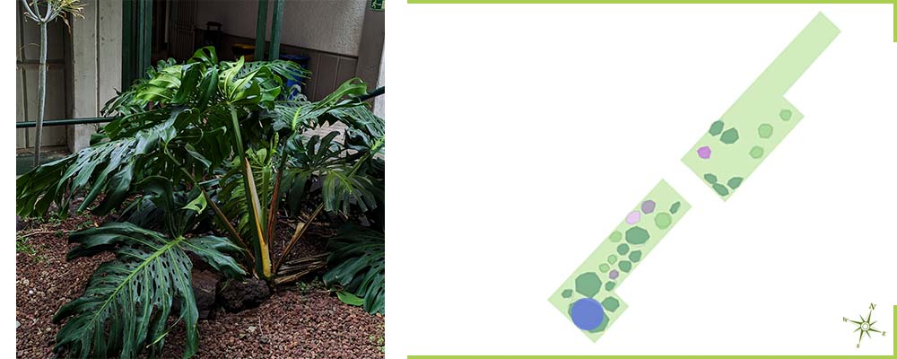

### Costilla de Adán (esqueleto, o en Sudamérica _cerimán_)
_Monstera deliciosa_

Este ejemplar lo trasladó el personal de limpieza (desde aquí, gracias por su ánimo constante en el trabajo en estos jardines) desde otra ubicación menos favorable. y aquí, se ha ido dividiendo por esquejes. 

La _Monstera deliciosa_ es nativa de las selvas tropicales de América Central, desde el sur de México hasta Panamá. En su entorno natural, crece en suelos húmedos y en la sombra de árboles altos, trepando por sus troncos gracias a sus raíces aéreas. Este ambiente selvático proporciona temperaturas cálidas, alta humedad y luz indirecta, factores esenciales para su desarrollo. Muy reconocible por sus grandes hojas agujereadas .
La _Monstera deliciosa_ ha sido introducida en muchas otras partes del mundo como planta ornamental, tanto en jardines tropicales como en interiores. Comparte hábitat con otras especies tropicales como las _Philodendron_ y las _Calathea_, que requieren condiciones similares de luz, humedad y temperatura. En este jardín la he acompañado de esas mismas especies. En algunos países con climas cálidos se ha vuelto invasora debido a su rápido crecimiento. Es una planta muy presente en la jardinería popular en Canarias

_Monstera_: viene de la palabra latina para "fuera de lo normal", ya que el género se distingue por sus hojas inusuales con agujeros naturales. _deliciosa_ "deliciosa", ya que el fruto es comestible siempre que esté bien maduro, con un sabor similar a la piña. El consumo de la fruta inmadura con las pepitas firmes, expone la garganta a concentraciones elevadas de ácido oxálico, muy irritante y hasta peligroso.

***

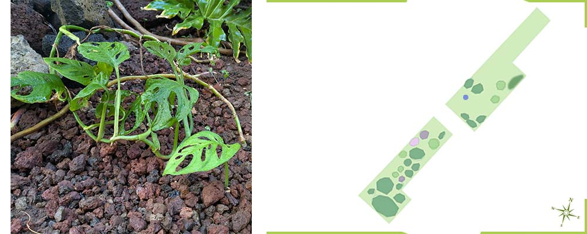

### Planta “queso suizo” 
_Monstera adansonii_

La _Monstera adansonii_ procede de las selvas de América Central e Indias Occidentales, con una característica poco habitual: sus hojas en forma de corazón están llenas de orificios. Es parecida a la Monstera deliciosa, pero en tamaño reducido.
Necesita calor, humedad y poca insolación (reproduciendo las condiciones de una selva tropical). Se cree que los agujeros son un mecanismo para permitir que pase luz y agua a las partes bajas de la planta. 

Se la ha cambiado de ubicación ya dos veces, buscando un lugar donde se desarrolle de forma óptima.

***

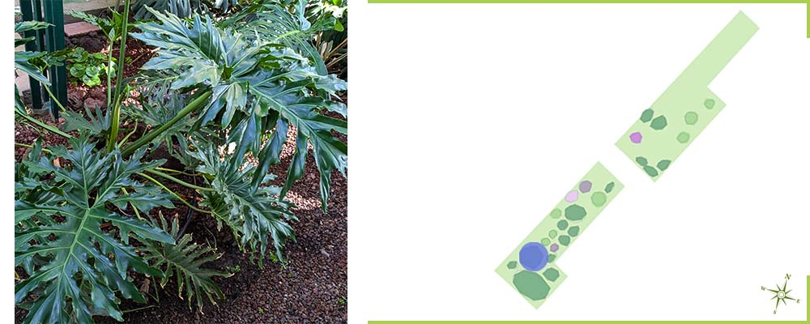

### Filodendro selloum y Filodendro xanadu
_Thaumatophyllum bipinnatifidum_ y _Thaumatophyllum xanadu_

Hoy hay aceptadas más de 600 especies de filodendros. En este jardín tenemos 4 de ellas. 
Estos populares filodendros, nativos de Brasil, Bolivia, Argentina y Paraguay se han extendido en paisajismo y jardinería en todo el mundo.  En América se le conoce como -güembé_.

Hay dos especies muy similares usadas en jardinería: el _selloum_, de mayor desarrollo, y el filodendro _xanadu_. Los _xanadu_ se han plantado en febrero 2025. Estos ejemplares fueron donaciones de una asociación cultural y un amigo.

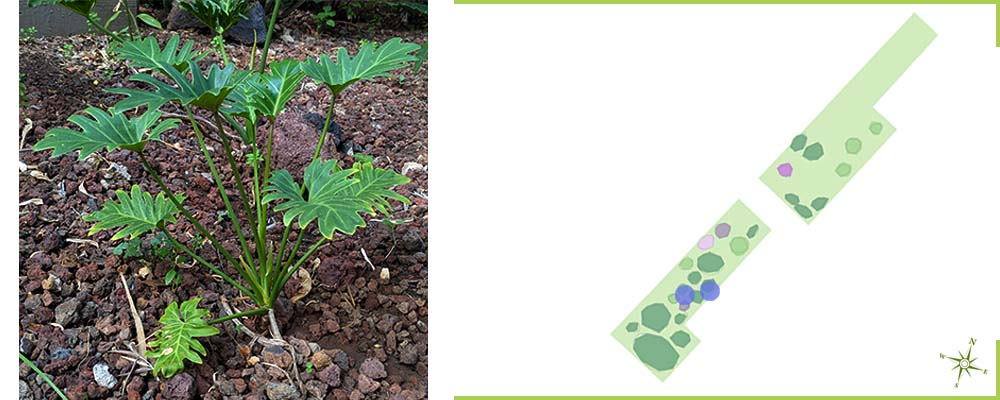
_P. xanadu_

***

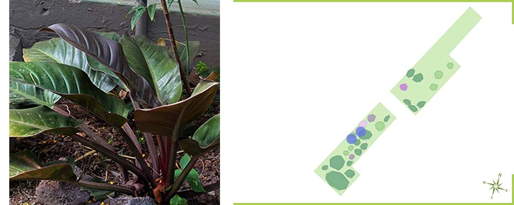

### Filodendro rojo
_Philodendron erubescens_

El filodendro _erubescens_ se caracteriza por sus grandes hojas en forma de flecha y su pecíolo de coloración rojiza, y ese es su interés en jardinería, ya que sus flores son muy discretas.

Es un filodendro trepador, originario de las selvas de Colombia. Según va creciendo su tallo se alarga creando raíces aéreas que se introducen en los distintos soportes, dando rigidez a la planta en la búsqueda continua de la luz dentro del sotobosque tropical húmedo de donde es originaria. Las nuevas hojas son de color verde brillante, pero al madurar adquieren tonalidades de verde más oscuro.

Hay más de una docena de cultivares comerciales. Los de este jardín quizá sean _Imperial red_ y no trepadores.

***

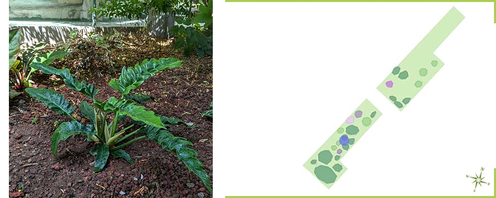

### Filodendro narrow
_Philodendron bipinnatifidum_

Filodendro "narrow" es un cultivar de la especie _bipinnatifidum_. Se caracteriza por sus hojas simples, estrechas grandes, profundamente lobuladas, generalmente colgantes y elegantes. Puede ser epífita o terrestre.
Puede cultivarse a pleno sol, y tolera y se adapta a la sombra profunda. Crece mejor en suelos ricos y con buena retención de humedad, que pueden ser ligeramente alcalinos. Sin embargo, no tolera altas concentraciones de sal. Es capaz de sostenerse a grandes alturas gracias a sus bases arbóreas. Sin embargo, exhibirá características epífitas si se le da la oportunidad de adherirse a un árbol cercano y trepar por él. El tronco de esta planta puede desarrollar numerosas raíces aéreas fuertes que no solo dan soporte a la masa vegetal, sino que también sirven para absorber agua y nutrientes del suelo. 

Su nombre local común es _güembé_ (al igual que otras especies). De la familia _Araceae_, es nativa del este de América del Sur: Brasil, Bolivia, Argentina y Paraguay y se cultiva como planta ornamental en muchos países tropicales, subtropicales y templados cálidos, incluyendo Filipinas, en toda Australia, la costa del Golfo y la costa este de Estados Unidos, incluyendo Florida y California, y en Sudáfrica y el norte de Nueva Zelanda. Se cultiva como planta de interior en regiones templadas frías. Ha recibido el Premio al Mérito en Jardinería de la Royal Horticultural Society.

**La estrategia de producir calor*
Un dato muy curioso es su polinización: es realizada por especies de escarabajos _Erioscelis_ y _Cyclocephala_, y las flores masculinas estériles producen y mantienen una temperatura constante de 34°C, pudiendo llegar a más de 40°C. Durante los dos días que toda la estructura de la flor está abierta quemando tejido graso almacenado, comparable a la producción metabólica de un gato pequeño. _P. bipinnatifidum_ metaboliza grasa, en lugar de carbohidratos, para impulsar este proceso. Esta característica indica una posible convergencia evolutiva donde esta especie vegetal y la especie animal derivaron mecanismos similares para utilizar las reservas de grasa para el consumo de energía. La razón principal para elevar y mantener la temperatura de la flor es para volatilizar y dispersar olores que atraen a los insectos. La producción constante de calor aumenta la distancia a la que el escarabajo puede percibir el aroma y aumenta la probabilidad de polinización. Además, el calor crea un clima acogedor que estimula la actividad del escarabajo una vez dentro de la flor y lo induce a aparearse. Esto también aumenta la probabilidad de polinización al permanecer en ella.

***

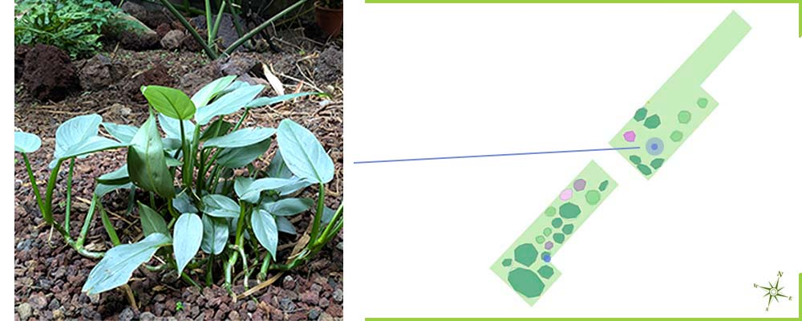

### Filodendro silver sword
_Philodendron hastatum_

Es una especie de planta con flores de la familia Araceae. Su nombre común "espada de plata", viene de la forma y color de sus hojas, sobre todo las juveniles. Conocida anteriormente por otros sinónimos, una confusión agravada por el alto grado de variación morfológica tanto en esta especie como en otras similares del género _Philodendron_.

En un [artículo de 2005](https://www.scielo.br/j/rod/a/s9Gmhz63GWzSsnfktgnYDky/?format=pdf&lang=en&ilang=es), de Cássia Sakuragui (Univ.Maringá, Brasil) y Simon J. Mayo (RBG Kew)encuentro una aclaración detallada la taxonomía y la nomenclatura de _Philodendron hastatum_ para aclarar otros nombres que se han usado con frecuencia para designar especímenes con una forma de limbo foliar similar. La fecha de publicación de la descripción original de P. hastatum es entre 1854-1855. El material tipo debió de provenir de una planta cultivada en el Jardín Botánico de Berlín, del que posiblemente se sacaron esquejes que se cultivaron en Viena, del que llegaron unas hojas al herbario de Kew. Hay una historia de pliegos, etiquetas impresas y manuscritas, nombres tachados, y confusiones por la diferente forma de las hojas juveniles y adultas. Se mezclan nombres: _P. simsii hort_, _P. hastifolium elongatum_, _P. hastatum_. Me pierdo en la terminología, pero veo lo minucioso del trabajo de identificación precisa de una especie.

El autor y la autora trabajan con material de herbario, y citan un "ejemplar 12228" en una fotografía de la colección del Chicago Field Museum, que "podría corresponder al material tipo" es decir al que sirvió originalmente para identificar la especie. El espécimen original probablemente fue destruido durante la Segunda Guerra Mundial, pero queda, al menos, esta fotografía, donde se pueden leer etiquetas, anotaciones y ver formas. También se habla en el artículo del pliego de Kew (las hojas provenientes de Viena). Maravillas de internet: podemos acceder a las fotografías de estos dos pliegos:

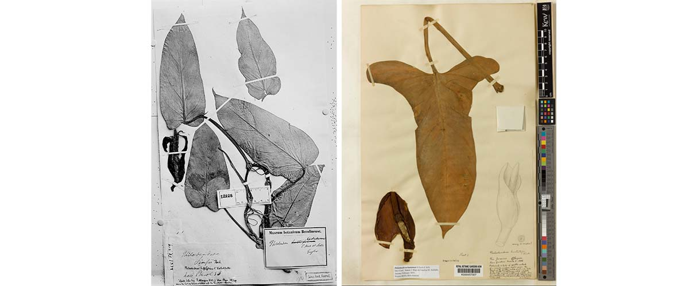
&emsp;&emsp;_[Pliego de Chicago](https://collections-botany.fieldmuseum.org/catalogue/229039), y [Pliego de Kew](https://powo.science.kew.org/taxon/87792-1
)._

**Nuevas especies de filodendro**

Ese artículo me lleva a su coautora, [Cassia Sakuragui](https://www.researchgate.net/profile/Cassia-Sakuragui). Profesora en la Universidad Federal de Rio de Janeiro, es autora en la identificación y nombramiento de muchas nuevas especies para la ciencia, especialmente de la familia Araceae, y del género Philodendron. Selecciono aquí tres nuevas especies de filodendro en cuya identificación ha participado: _Philodendron luanae_ (2026), _Philodendron quartziticola_ (2025) y _Philodendron angelicanum_ (2026).

◾ _Philodendron luanae_, del Bosque Atlántico del estado de Espírito Santo, en el sureste de Brasil.

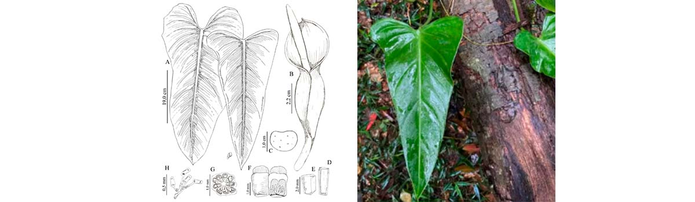

Esta especie fue descubierta [durante la observación de aves](https://g1.globo.com/es/espirito-santo/sul-es/noticia/2026/08/13/nova-especie-de-planta-e-descoberta-em-fotografias-de-observacao-de-aves-no-es.ghtml):

> **Descubren una nueva especie de planta en fotografías de observación de aves en Espírito Santo**

> Un investigador identificó una nueva planta a través de fotos de aves tomadas en una reserva situada en la Región Serrana de Espírito Santo. Bautizada como Philodendron luanae, la especie fue hallada principalmente en dos lugares: uno en Alfredo Chaves y otro en Castelo. El descubrimiento, realizado por Alexandre Magno —investigador del Jardín Botánico de Río de Janeiro y colaborador del Herbario Vies de la Universidad Federal de Espírito Santo, se publicó en julio en la revista científica internacional Phytotaxa.

> En sus redes sociales, Alexandre Magno, investigador del Jardín Botánico de Río de Janeiro, relató que notó las características distintivas de la planta en fotografías compartidas por el biólogo Rogério Truglio en la plataforma iNaturalist, registradas durante una jornada de observación de aves en la reserva. Dicha plataforma funciona como una red social de ciencia ciudadana y permite compartir registros realizados en la naturaleza, ayudando así a científicos y entusiastas a conocer y mapear especies de plantas, animales y hongos. El nombre Philodendron luanae fue elegido en honor a la bióloga Luana Silva Braucks Calazans, quien trabaja junto a Magno en el herbario de la Ufes y es especialista en la familia Araceae. En sus redes sociales, Alexandre celebró el descubrimiento: "Es un recordatorio de que la ciencia se construye con muchas manos: por investigadores, naturalistas, horticultores y personas curiosas que observan la naturaleza y comparten lo que encuentran".

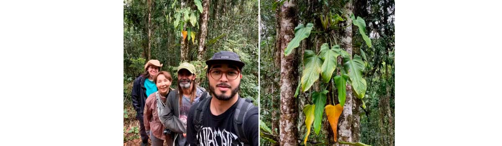
&emsp;&emsp;_En la foto, dos de los autores del paper definitivo: Alexandre Magno (con una camiseta [ANTHURIUM](https://tropicsnarcotics.com/products/anthurium-metal-family-black-unisex-t-shirt)) y Cassia Sakuragui, y en último término, la bióloga Luana Silva Braucks Calazans, que le dio el nombre._

◾ _Philodendron quartziticola_, del Bosque Atlántico de Espírito Santo, en el sureste de Brasil.

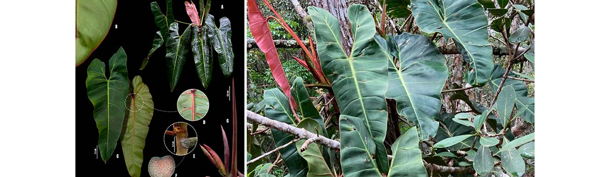
&emsp;&emsp;_La imagen de la izquierda es del paper de 2025, por João Paulo Medeiros. La foto de la derecha es de de Alexandre Magno._

Asociada con sustratos cuarcíticos, descubierto en la Reserva Ambiental Águia Branca, en las montañas de Espírito Santo, reconocidas como centros de biodiversidad y endemismo dentro de la Mata Atlántica. _Philodendron quartziticola_ se caracteriza por sus hojas largas y estrechas, así como por detalles únicos en su estructura reproductiva y vive en suelos cuarcíticos, predominantemente arenosos y de drenaje rápido, los "Morros de Sal", entornos geológicos poco comunes y vulnerables a la degradación, causada por la minería o las plantaciones de eucalipto. Asimismo, participa en interacciones ecológicas significativas, como la polinización llevada a cabo por escarabajos del género _Cyclocephala_, lo que subraya la complejidad de los ecosistemas locales. Inicialmente fue observada por Alexandre Magno. Alexandre tiene una cuenta de instagram, [@araceologo](https://www.instagram.com/araceologo/) que es un paraíso de los filodendros, llena de amor por estas especies.

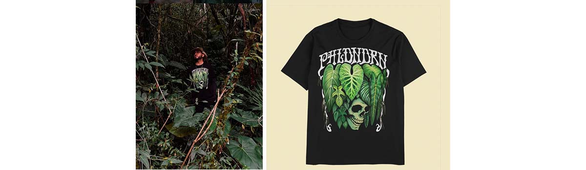
&emsp;&emsp;_Alexandre, felizmente rodeado de Philodendron cordatum en una imagen de su cuenta de Instagram, con su camiseta molona de Tropics Narcotics [PHLDNDRN](https://tropicsnarcotics.com/products/philodendron-phldndrn-black-unisex-t-shirt), inspirada en el black metal_

◾ _Philodendron angelicanum_ de Cachoeiras de Macacu, en Río de Janeiro.

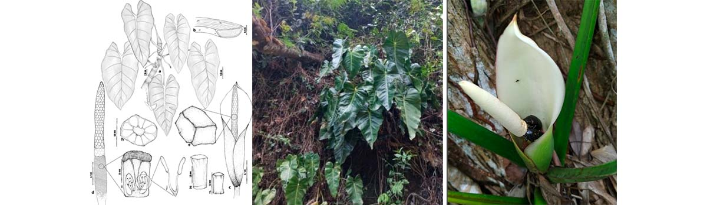

La planta fue identificada por un equipo de investigadores brasileños pertenecientes a la Universidad del Estado de Río de Janeiro y al Instituto de Investigaciones del Jardín Botánico de Río de Janeiro. El espécimen tipo (holotipo) fue recolectado en octubre de 2024 en el Monumento Natural Municipal de la Serra do Soarinho. Su área y extensión de presencia son limitadas, con subpoblaciones restringidas a un pequeño fragmento de bosque, por lo que se clasifica como "En peligro".

El epíteto específico _angelicanum_ recibe su nombre en honor a la botánica brasileña Prof. Dra. Ana Angélica Monteiro de Barros, en reconocimiento a su valiosa contribución al estudio y la conservación de la biodiversidad. Además, los autores mencionaron que el epíteto hace un juego de palabras, ya que alude de igual forma a los márgenes ondulados de sus hojas, los cuales asemejan a unas alas (característica que facilitó su identificación como nueva especie).

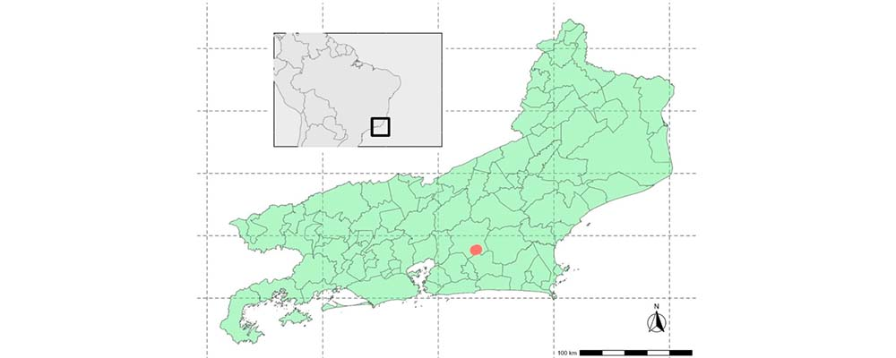
&emsp;&emsp;_Ubicación del P. angelicanum._

***

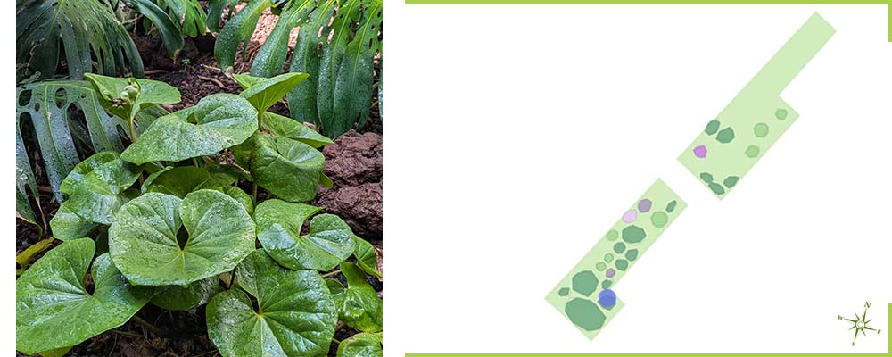
_Capa de la reina en febrero 2025_

### Capa de la reina
_Farfugium japonicum_

Es una planta perenne rizomatosa que crece en matas sueltas de unos 60 cm de alto y ancho, con hojas grandes, redondas o arriñonadas, de textura ligeramente carnosa. Muy presente en jardinería popular en Canarias, en Santa Cruz de Tenerife se la encuentra en jardines públicos como el Parque García Sanabria, Plaza Weyler, etc. Es una planta nativa de acantilados rocosos costeros de Japón, Corea y Taiwán (de ahí su nombre científico).
_Farfugium japonicum_ (sinónimo _Ligularia tussilaginea_) se conoce como _capa de la reina_ o en inglés _leopard plant_, _green leopard plant_ or _tractor seat plant_ . En Japón, se le llama tsuwabuki.

_El espectáculo diario de las capas de la reina en la Plaza Weyler_

Además de sus espectaculares hojas de forma redondeada tiene una floración interesante, con tallos largos y flores de amarillo intenso semejantes a las margaritas. Se han introducido también dos ejemplares de un cultivar de capa de la reina variegada.

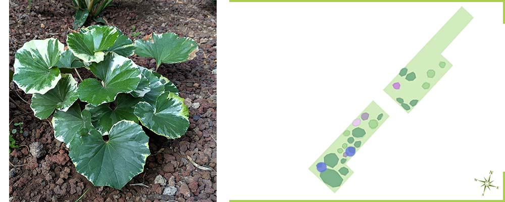
_Capa de la reina variegada_

***

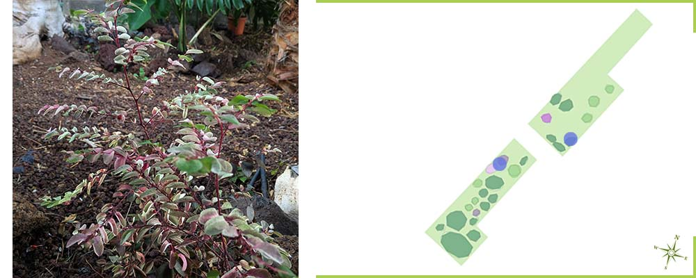

### Pompadour
_Breynia dischita_

_Breynia_ es un género de plantas con flores perteneciente a la familia _Phyllanthaceae_. Tiene 35 especies de arbustos originarios del sudeste asiático y Australia. 
Es conocida por los nombres vulgares de Árbol de nieve, breina, breinia o en inglés _snowbush_. En Canarias se usa en jardinería tradicional, con el nombre popular de Pompadour, desconozco el motivo, ya que _pompadour_ también se encuentra como nombre vulgar de los cóleos (_Coleus_, planta ornamental muy utilizada, casi 300 especies) o de la planta africana _Flueggea virosa_.

Es un arbusto de finos tallos rojos que puede alcanzar los 2 metros de altura. Hojas de forma oval rosadas cuando la planta es joven y color crema o verde claro en los ejemplares adultos. Las flores no son interesantes ornamentalmente al ser muy pequeñas y sin pétalos, pero el arbusto en sí es una explosión espectacular de hojas rosa, rosa pálidos, rojos. Una planta muy interesante porque aporta un color distinto y un toque de luz entre plantas de hoja ancha y un ambiente más sombrío. 

***

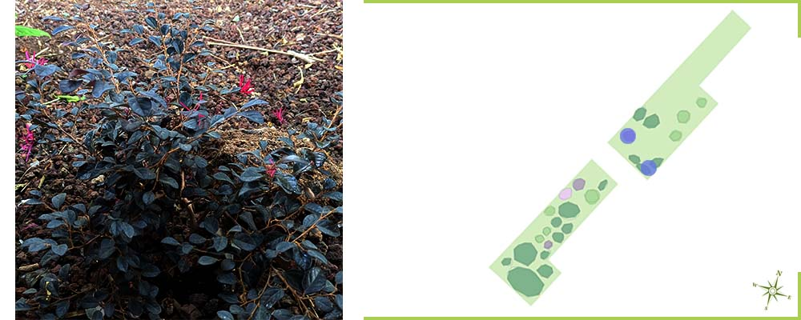

### Loropetalum
_Loropetalum chinense_

_Loropetalum_ es un género de arbustos nativo de Japón y sudeste de Asia. También se le conoce como como flor de fleco china, flor de correa, chinese fringe flower, strap flower, jìmù, afajimu, zhimu, o zhimofa. El nombre _Loropetalum deriva del griego_ y se refiere a sus flores con forma de cinta o correa: _loron_ significa "correa" y _petalon_  "pétalo". 

Además de su color rojizo, que aporta contraste con el resto de plantas verdes, destaca por su resistencia, su escaso mantenimiento y su espectacular efecto ornamental durante todo el año.

Las hojas, flores y raíces de _L. chinense_ se utilizan en la medicina tradicional china.

***

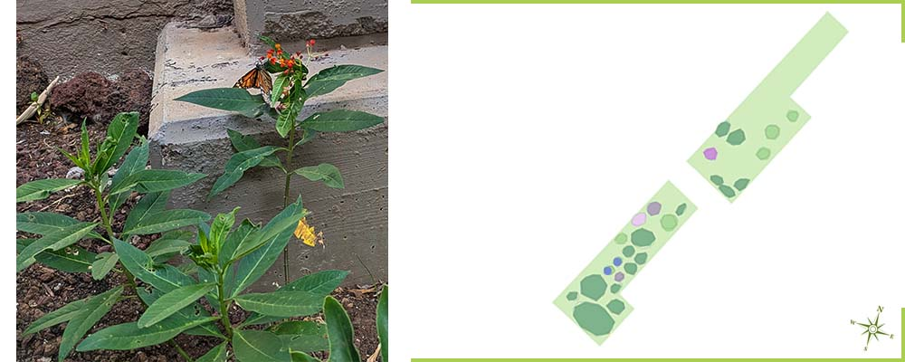
_Asclepias asediadas por las mariposas monarca, verano 2025_

### Asclepias
_Asclepias curassavica_

Las condiciones de luz y humedad en esta zona parecen serle más favorables a las asclepias. Ya han sufrido ataques de los gusanos de la mariposa Monarca dejándolas sin una sola hoja, para recuperarse rápidamente.

_Orugas devorando la planta a mediados de abril 2026_

Esta planta, con muchos nombres populares como: algodoncillo, venenillo, bandera española, mata ganado, etc. es una especie perenne del género _Asclepias_, en la familia _Apocynaceae_. Es nativa de la América tropical, y naturalizada en muchas otras partes del mundo. Se cultiva como planta ornamental de jardín y como fuente de alimento para las mariposas, en los jardines de mariposas. En este jardín estoy intentando aclimatarla por ese motivo: para que lo visiten las mariposas. 

&emsp;&emsp;_Asclepias con su mariposa. Grabado coloreado a mano por John Abbot. [The natural history of the rarer lepidopterous insects of Georgia, volume 1 (1797)](https://www.biodiversitylibrary.org/item/5968#page/50/mode/2up)_

_Asclepias_ por Asklepios, dios de la Medicina en la mitología griega. _curassavica_ por la isla de Curaçao, en el Caribe.

&emsp;&emsp;_Diciembre 2024. Apenas dos semanas después de plantar las Asclepias las mariposas ya localizaron  las plantas, pusieron sus huevos y nacieron orugas que empezaron a devorar  las hojas._

**La mariposa monarca**

Esta planta atrae la mariposa monarca, Danaus plexippus, un espectacular insecto, de alas color naranja con líneas negras, fácilmente reconocible.
La Asclepia es una planta hospedera para esta mariposa: los adultos visitan las flores, posteriormente los gusanos se alimentan de sus hojas y ponen huevos en la planta, reiniciando su ciclo.

**Mariposas, orugas y el veneno de la asclepias**

Las _Asclepias_ son plantas tóxicas. Los colores llamativos amarillo y negro de la oruga y naranja y negro de la mariposa adulta son un aviso (aposematismo o coloración de aviso) de que son tóxicos para la mayoría de los depredadores. Esta estrategia funciona porque la mayoría de los depredadores asocia colores chillones (especialmente naranja, amarillo y negro), con veneno y otras propiedades desagradables.
La mariposa monarca contiene glucósidos cardíacos en su cuerpo, como resultado de que las orugas comen asclepias; las integran en sus tejidos y son tóxicas, así evitan a sus depredadores. 

Es uno de los pocos insectos que logra realizar travesías transatlánticas. Unas cuantas mariposas monarca llegan al suroeste de Gran Bretaña y a España en los años de vientos favorables, e incluso se han instalado de forma permanente en las Islas Canarias desde 1804, en Tenerife. Reside en las Islas Canarias, Azores, Madeira y Andalucía.

**La migración de la Monarca**

Una de las subespecies de la Monarca es especialmente conocida por su larga migración anual, desde Canadá a México.
La migración de las mariposas monarca americanas (_D. plexippus plexippus_) es la más evolucionada de todas las especies conocidas de su tipo: vuelan hasta 5.000 km desde Estados Unidos y Canadá, donde se reproducen, hasta los bosques del centro de México, donde hibernan. Esta gran migración está bajo amenaza. El cambio climático, tanto en las áreas de hibernación en México como en las áreas de reproducción de verano en Estados Unidos, causa impacto en la migración de la monarca. La deforestación en los bosques mexicanos, la conversión de pastizales en tierras de cultivo, el uso de herbicidas y pesticidas y la reducción de las poblaciones de _Asclepia_ en sus rutas, son factores que se suman creando una tormenta perfecta para estas pequeñas criaturas.
En julio de 2022, la Unión Internacional para la Conservación de la Naturaleza (UNIC) declaró a la mariposa monarca como una especie en peligro de extinción.

Hay una historia fabulosa sobre las investigaciones sobre las migraciones de las monarcas: 

El zoólogo canadiense Fred Urquhart y su esposa Nora R. Urquhart trabajaron desde 1937 hasta 1975 buscando dónde hibernan las mariposas en México.
Durante décadas Fred y Nora Urquhart coordinaron a miles de voluntarios para poner minúsculas etiquetas de papel en las alas de las mariposas monarca y así poder documentar su ruta migratoria. La película _Flight of the Butterflies_, de 2012, cuenta esta historia. Ken Brugger y su esposa Catalina Aguado, de Ciudad de México, se unieron al proyecto y encontraron el lugar de hibernación en 1975 en los bosques de Cerro Pelón.

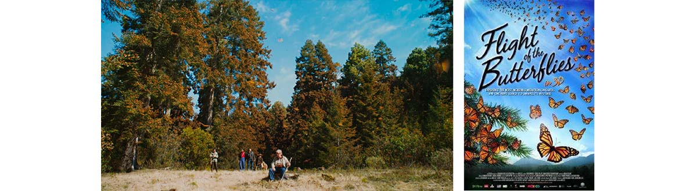

***

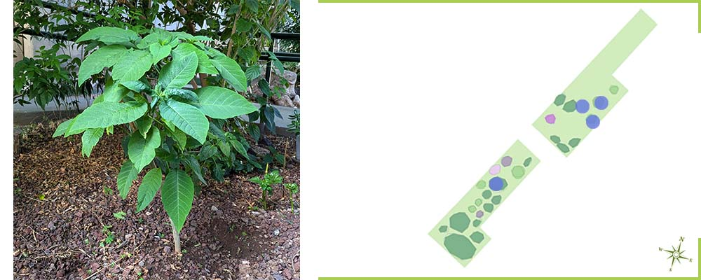

### Santas noches
_Brugmansia suaveolens_

Una planta de uso en la jardinería popular y tradicional de Canarias. Nativa de Perú, es cultivada en todo el mundo por sus espectaculares flores en forma de trompeta, blancas o rosáceas. 

Estos esquejes vienen de la zona de los volcanes de San Antonio, en la zona alta de La Matanza. Tiene numerosos nombres populares, entre ellos: trompetero, floripondio, etc. o en Canarias santas noches.

***

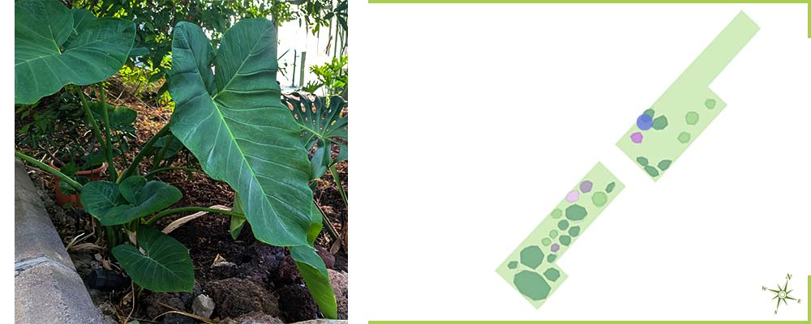

### Ñamera
_Colocasia esculenta_

Planta de la familia de las _aráceas_ cuya raíz es el _ñame_. Las ñameras necesitan terrenos muy húmedos. En algunas zonas de Canarias se conoce también con el nombre de ñamero. Tiene muchos nombres, como quiscamote, taro, uncucha, pituca, papa china, malanga, ñampí, yautía coco, y gabi en el español filipino. En Canarias se llama ñamera a la _Colocasia esculenta_, que es conocida en el mundo como _taro_; mientras que por ñame en el resto del mundo se conoce otra planta de la familia de las Dioscoreáceas, que aún teniendo hojas acorazonadas es muy distinta del ñame canario.

Parece ser originaria de una amplia zona desde el nordeste de la India al Sureste de Asia, según otros autores se extiende también hasta Australia, Nueva Guinea, Islas Marshall. Se cultiva desde hace miles de años en las montañas de Papúa Nueva Guinea, doinde se la conoce como _taro_. Puede vegetar en arrozales o en tierras altas donde el agua es suministrada constantemente por lluvia o irrigación. Algunas variedades crecen también fuera de los trópicos, en lugares como Galicia, Corea y Japón.

Es un alimento tradicional en muchas áreas tropicales del mundo y la base para hacer el _poi_ en Hawái. La planta es indigerible si se come cruda (cruda es, de hecho, tóxica). Cocinada es rica en vitaminas y minerales y fuente de fibra. Se consume como acompañamiento de platos de carne, pollo o pescado o bien formando parte del popular sancocho (principalmente en Venezuela, Colombia, República Dominicana y Panamá). En Canarias se suele usar como parte de la cocina tradicional (el ñame cocido es una comida asociada a las celebraciones navideñas), siendo uno de tantos vínculos canarios con Cuba y el Caribe también. 
Aún hay algunos cultivos en los barrancos de Anaga y sobre todo en La Palma y La Gomera, aunque se considera un cultivo en vías de extinción.

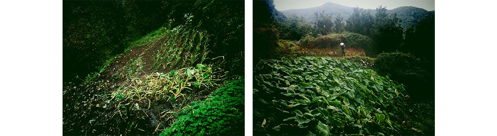
&emsp;&emsp;_Cultivos de Ñamera en el Macizo de Anaga, Tenerife. Típica plaza en Canarias con ñameras en una fuente_

***

### Hoja de salón / Aspidistra
_Aspidistra elatior_

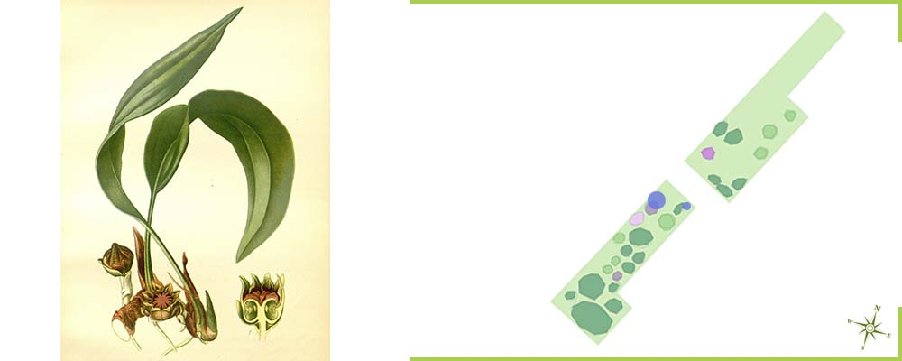
_Aspidistra en [Favourite flowers of garden and greenhouse 1897. Edward Step](https://archive.org/details/mobot31753000580800)_

La _Aspidistra_ tiene como nombres comunes pilistra, orejas de burro o en Canarias a veces hoja de salón. En inglés _cast-iron-plant_ o _bar-room plant_, planta de hierro (por su gran resistencia a todo tipo de condiciones adversas) o planta de los bares (por usarse en el siglo XIX para interiores de bares en Inglaterra porque resistía el humo de los fumadores).

Plantas perennes y muy longeva (hasta más de 100 años) de raíces rizomatosas con tallos subterráneos  de los que brotan hojas grandes en forma de lanza de color verde oscuro. Las hojas pueden estar veteadas en blanco en las especies variegadas, otras moteadas, etc. Es originaria de China, Himalaya, Vietnam y Japón, donde brota silvestre en zonas más umbrías. El género tiene alrededor de 100 especies, casi todas descibertas recientemente. En la década de 1970 se describían entre 8 a 10 especies, pero hacia 1980 se describieron 30 nuevas especies en China, sobre todo en la provincia de Guangxi. Aún se están encontrado nuevas y el foco de diversidad se ha trasladado a Vietnam donde se han descrito 28 y se sabe que existen muchas más. 

Muy del gusto de la era victoriana, causó sensación en el Reino Unido durante el siglo XIX como planta de interior de las casas acomodadas. 

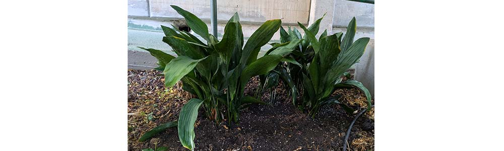

En este jardín de sombra he plantado dos grupos, la variedad tradicional y otra variegada de hoja más pequeña y color más claro.

***

## GRUPO DE HELECHOS

A lo largo de 2026 intenté crear una pequeña colección de Calateas y Marantas, situada en un sitio muy de paso donde la altura del parterre permite verlas muy de cerca. La zona es sombría y relativamente húmeda. Todas son plantas exóticas, de selvas de América Central y Sur, diversificadas en muchos cultivares espectaculares al gusto de un público aficionado a jardinería de interior, supongo. Finalmente han desaparecido dos de las Calateas y una de las Marantas, y estoy intentando (noviembre 2026) trabajar con algunos helechos de tamaño pequeño. En proyecto está combinar estas plantas con algún ejemplos de planta de laurisilva.

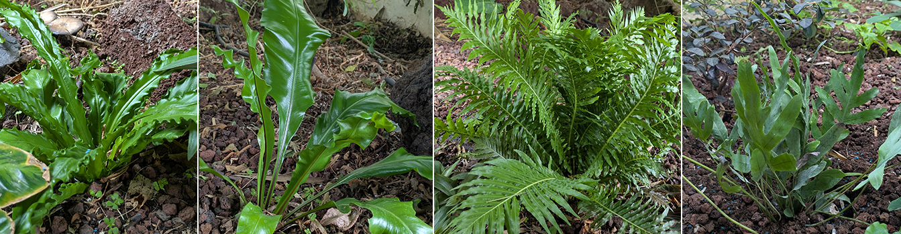
&emsp;&emsp;_Asplenium antiquum "osaka" | Asplenium nidus | Oceaniopteris gibba | Pheblodium._

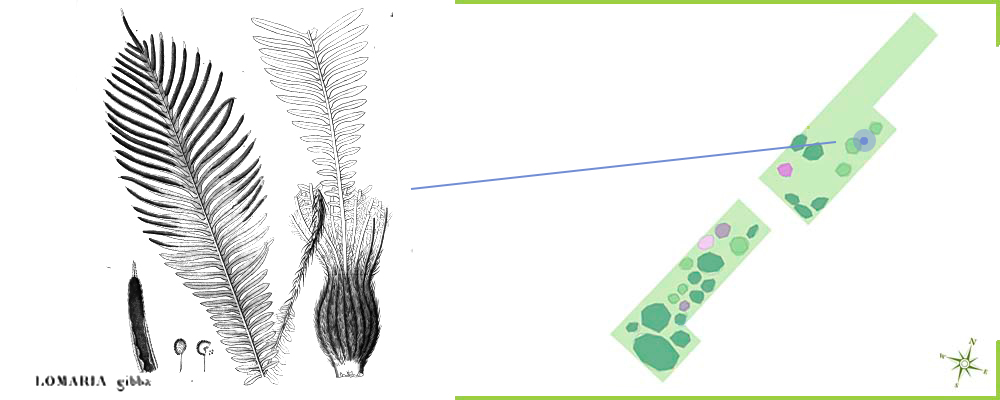
&emsp;&emsp;_Ilustración del libro de Labillardière._

### Helecho enano
_Oceaniopteris gibba_

Es nativo de Nueva Caledonia. Puede crecer más de 1 metro, con un falso tronco que en realidad es un rizoma. Prefiere suelos ácidos y semisombra y es muy poco tolerante a temperaturas por debajo de 15 °C. Fue descubierto por el botánico francés Jacques-Julien Houtou de Labillardière en Nueva Caledonia durante una expedición francesa que buscaba el paradero del explorador perdido Jean-François de La Pérouse. 
Tras regresar a Europa, Labillardière publicó la descripción oficial de la planta en 1824 dentro de [Sertum Austro-Caledonicum](https://archive.org/details/LaBillardiereSertumAustroCaledonicumImages), dedicada a la flora de Nueva Caledonia.

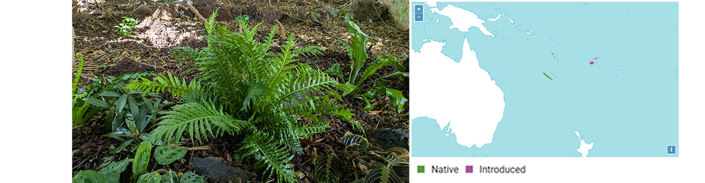
&emsp;&emsp;_Helecho en el jardín y su distribución mundial._

A lo largo de dos siglos, la clasificación botánica de este helecho fue cambiando a medida que avanzaron los estudios genéticos y morfológicos.

• _Lomaria gibba_ (1824). Nombre original asignado por Labillardière. _gibba_ (jorobada o abultada) por la forma de sus estructuras reproductivas o frondes.
• _Blechnum gibbum_ (1856). El botánico alemán Georg Heinrich Mettenius lo transfirió al género Blechnum, denominación con la que se hizo mundialmente famoso en viveros y jardines botánicos.
• _Struthiopteris gibba_ (1940). El pteridólogo chino Ren-Chang Ching propuso brevemente su inclusión en este género.
• _Oceaniopteris gibba_ (2016). Los botánicos André Luís de Gasper y Alexandre Salino crearon el género Oceaniopteris tras análisis filogenéticos de la familia _Blechnaceae_. 

Según la denominación actual _Oceaniopteris_ por su origen en Oceanía, y _gibba_ manteniendo el mismo primer epíteto de Labillardière. Este nombre actual destaca su origen geográfico en las islas de Oceanía.

La **Pteridomanía**, la fiebre victoriana por los helechos. 

A mediados del siglo XIX, la especie llegó a los invernaderos europeos en pleno auge de la pteridomanía o fiebre victoriana por los helechos. El uso de las cajas de Ward permitió transportar ejemplares vivos desde el Pacífico sin que murieran durante las largas travesías marítimas. La demanda fue tan extrema que los recolectores comerciales arrasaron poblaciones enteras de helechos silvestres en el campo británico. Algunas especies raras fueron llevadas casi al borde de la extinción local. La _woodsia oblonga_, la _woodsia alpina_, el helecho de Killarney, estuvieron a punto de extinguirse. Uno de los libros más conocidos que manejaban los cazadores de helechos [The Ferns of Great Britain and Ireland](https://archive.org/details/mobot31753002807086) con 51 placas impresas con un peculiar método: los helechos se impresionaron sobre planchas de plomo blando y fueron electrochapadas para convertirse en la placa de impresión, los detalles de las hojas y el tallo, coloreadas a mano. Hacia finales del siglo XIX, el interés por los helechos fue perdiendo fuerza frente a nuevas obsesiones botánicas.

&emsp;&emsp;_Woodsia alpina, casi desaparecida, en el libro The Ferns of..._

La Pteridomanía no hubiera sido posible sin la **Wardian case**, que además propició episodios de extractivismo colonialista que cambiaron la historia de regiones enteras del planeta.

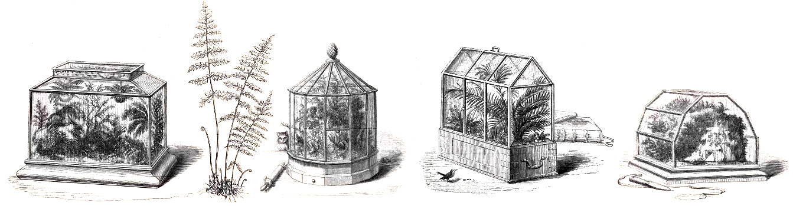
&emsp;&emsp;_Dibujos de cajas de Ward de su propio libro._

**La caja de Ward**. Nathaniel Ward era un médico apasionado por la botánica. Los helechos en su jardín de Londres estaban siendo envenenados por la contaminación del aire de Londres (humo de carbón y ácido sulfúrico). Fue un invento casual: Ward guardó capullos de polillas y similares en botellas de vidrio selladas. En una encontró que en su interior habían germinado y estaban creciendo una espora de helecho y una hoja de hierba. Dejó intacto el sello durante 4 años, y notó que había florecido. Al comprender las posibilidades, hizo que un carpintero le construyera una caja de madera con cristales completamente hermética, y descubrió que los helechos crecían perfectamente en su interior, convertido en una especie de minibiosfera. 

Una caja de Ward era un contenedor protector, para plantas, completamente sellado (un tipo primitivo de terrarium). En el siglo XIX obtuvo gran uso, para proteger plantas exóticas importadas a Europa desde países remotos, la mayoría de las cuales, en intentos anteriores, había muerto, debido a los largos viajes por mar. La caja de Ward fue precursora directa del moderno terrario y del vivarium. Su libro, de apenas 170 páginas sería una herramienta fundamental en los colonialismos extractivistas del siglo XIX.  [On the Growth of Plants in Closely Glazed Cases](https://archive.org/details/ongrowthplantsc00ward/page/ii/mode/2up) se puede consultar directamente en archive.org.

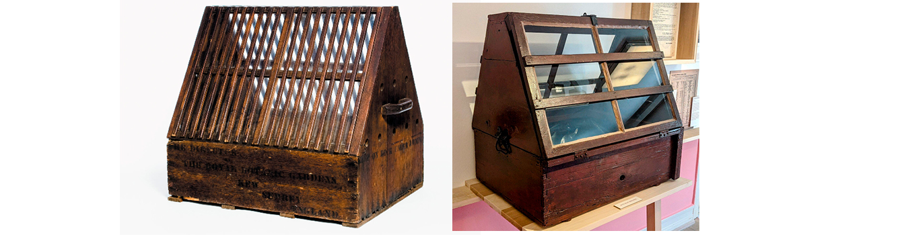
&emsp;&emsp;_Cajas de Ward supervivientes de los viajes en velero, de Reino Unido y Alemania._

Desde finales del siglo XVI, los botánicos y comerciantes ingleses habían estado explorando el mundo en busca de nuevas plantas, pero debían transportar solamente sus semillas, o cormos, o rizomas o raíces secas. La falta de agua no salobre, luz, aire fresco y cuidado suficiente, así como el aire salado, a menudo destruían todas o casi todas las plantas. Con las nuevas cajas de Ward, las plantas jóvenes tiernas podían colocarse en la cubierta para beneficiarse de la luz del día. Al mismo tiempo, la humedad condensada dentro de la caja las mantenía irrigadas, pero protegidas del rocío salado del mar. 

Las cajas de Ward tuvieron un papel fundamental en varios hitos del pillaje colonial de los recursos de otros paises: 

- En 1848, Robert Fortune —cazador de plantas y miembro de la Sociedad de Horticultura de Londres—, disfrazado de comerciante chino, sacó de contrabando de China hacia la India cerca de 20 000 plántulas y plantas de té, valiéndose para ello de cajas Ward, rompiendo el monopolio mundial de China sobre el té y sentando las bases de la industria del té en la India, uno de los actos de espionaje botánico más famosos de la historia.
- En 1876, el explorador Henry Wickham sacó de contrabando del Amazonas hacia Londres cerca de 70 000 semillas del árbol del caucho, _Hevea brasiliensis_. Tras ser cultivadas y transportadas en cajas Ward estas semillas sirvieron de base para la industria del caucho en Asia.
- Expediciones británicas y holandesas usaron las cajas de Ward para trasladar árboles de quina (_Cinchona_) desde los Andes sudamericanos hasta la India y Java. La producción masiva de quinina permitió a los ejércitos y colonos europeos sobrevivir a la malaria, facilitando la expansión imperial en África y Asia.

Artículo interesante: [The Wardian Case: How a Simple Box Moved the Plant Kingdom. 2017](https://arboretum.harvard.edu/arnoldia-stories/the-wardian-case-how-a-simple-box-moved-the-plant-kingdom/)

***

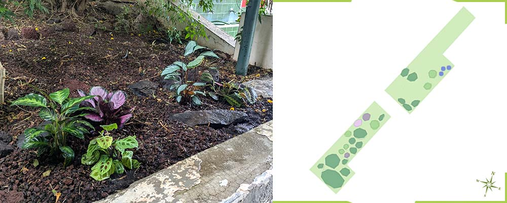
&emsp;&emsp;_Colección inicial de Calateas y Marantas._

### Marantas
_Maranta leuconeura_  y _Maranta leuconeura_ variegata (tricolor) 

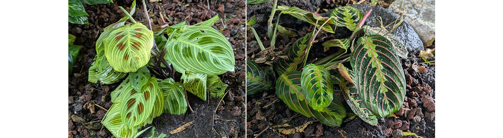
&emsp;&emsp;__Marantas_

La _Maranta_, originaria de las selvas tropicales de América Central y del Sur, es una planta exótica conocida por sus llamativas hojas decoradas con patrones únicos.
El nombre específico _leuconeura_ significa "de nervaduras blancas", en referencia a las hojas. Estas hojas permanecen extendidas durante el día y se pliegan hacia arriba por la noche, como si rezaran, de ahí su nombre común de "planta de la oración". Este comportamiento es un ejemplo de ritmo circadiano. Sus flores son pequeñas, de color blanco a púrpura, no tan llamativas como el follaje. Los dibujos de sus hojas son el motivo de su uso en jardinería.

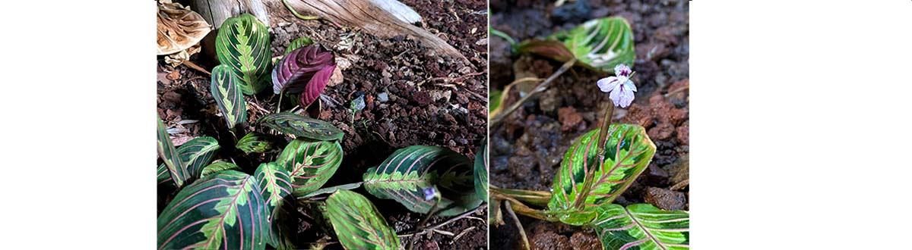
&emsp;&emsp;__Maranta al anochecer, elevando sus hojas. Diminuta flor de la maranta_

Linneo la nombró en homenaje al botánico italiano Bartolomeo Maranta (ca. 1500 - 1571) fue un médico, botánico, y teórico literario italiano. De 1554 a 1556, trabajó en el Jardín Botánico de Nápoles, que Gian Vincenzo Pinelli había fundado, y hacia 1568 había ayudado a desarrollar un incipiente jardín botánico en Roma.

&emsp;&emsp;_Cultivares de maranta_

### Calateas
_Goeppertia louisae_, 💀 _Calathea Roseopicta_ Crimson y 💀 _Goeppertia picturata_ Argentea.

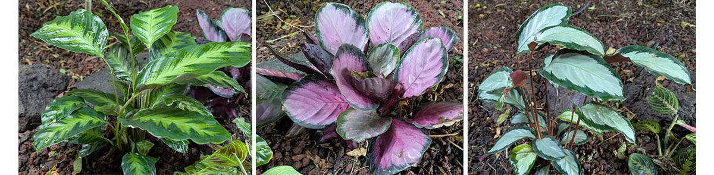

_Calathea_ es un género de plantas con flores perteneciente a la familia _Marantaceae_, con alrededor de 60 especies. Originarias de las Américas tropicales, muchas de estas especies son populares como plantas de maceta. Las hojas de _Calathea_ suelen ser grandes y con patrones coloridos con colores como rosa, naranja, rojo y blanco, y envés suele ser morado.

Este género prefiere luz baja o media, y necesitan una humedad alta para imitar su hábitat natural. La especie se introdujo por primera vez como planta de interior en las décadas de 1970 y 1980. Con el paso de los años, las Calateas se han convertido en una planta de interior popular gracias a sus atractivas hojas. Debido a la destrucción del hábitat, varias especies están en peligro de extinción. De las tres Calateas que intenté arraigar solo queda una. 

***

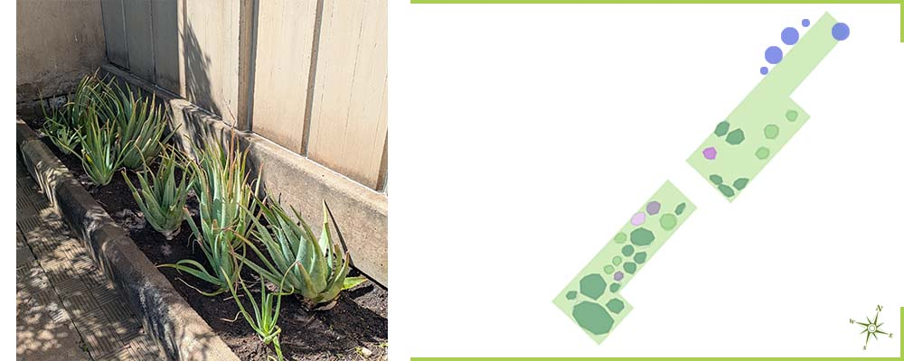

### Aloe
_Aloe vera_

Hasta el siglo XIX, su nombre más popular era _acíbar_, también se le conoce como aloe, aloe vera, zábila, penca zábila o aloe de Barbados, entre otros, es una especie suculenta de la familia _Asphodelaceae_. Con unas quinientas especies, el aloe está muy distribuido y se considera una especie invasora en muchas regiones del mundo. 
Es una planta de hoja perenne, probablemente se originó en la Península Arábica, pero crece de forma silvestre en climas tropicales, subtropicales y áridos de todo el mundo. El aloe vera ha sido ampliamente cultivado como planta ornamental por sus llamativas flores amarillas y por su forma. Los pájaros silvestres beben el néctar de sus flores, los puedes ver por las tardes en este mismo jardín. Acumula agua en sus hojas, lo que le permite sobrevivir en áreas de poca lluvia, lo que la hace ideal para rocallas y jardines de bajo consumo de agua.

Se usa como planta medicinal para la piel, en muchos productos: lociones para la piel, cosméticos, pomadas o gel para quemaduras menores y quemaduras solares, incluso en bebidas, aunque hay evidencias contradictorias sobre si el _Aloe vera_ es tan efectivo.

El nombre botánico deriva del latín, _aloe_, del griego sal que designaba tanto a la planta como a su jugo, debido a su sabor, que recuerda al agua del mar. _Vera_ por verdadero en latín.

***

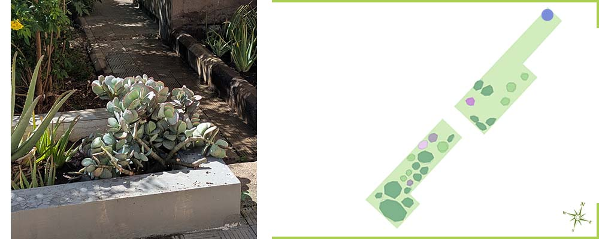

### Suculenta
_Crassula arborescens_

El género _Crassula pertenece_ a la familia de las _Crassulaceas_ y engloba unas 200 especies.
Las variedades más cultivadas y apreciadas por los amantes de las suculentas, provienen todas ellas de la Provincia Cabo Oriental en Sudáfrica. Además de las variedades naturales, existen numerosos híbridos.

Su nombre _Crassula_ proviene de la palabra latina _crassus_ que significa gruesa en referencia en abultadas hojas llenas de agua.

La Crassula arborescens es una de las más grandes del género, con una altura que va desde los 60 centímetros hasta el metro y medio. Es endémica de El Cabo, en Sudáfrica, y presenta hojas blanquecinas con el margen rojo.

***

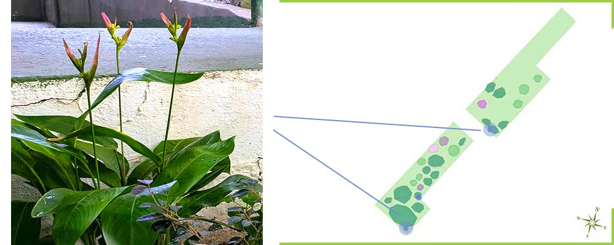

### Heliconia
_Heliconia psittacorum_

Es una planta de la familia Heliconiaceae con varios nombres comunes (platanillo, ave del paríso (nombre confuso pues también se da a las strelitzias), pico de loro, flor de periquito, flor de loro, plátano de loro, etc.),El hábitat natural de _Heliconia psittacorum_ se encuentra en América del Sur, extendiéndose por países como Brasil, Venezuela, Colombia y las Guayanas, así como en algunas islas del Caribe. Es ampliamente cultivada como planta ornamental en regiones fuera de su rango nativo. Su crecimiento a partir de rizomas le permite una rápida colonización de áreas perturbadas en su hábitat natural y una fácil propagación en cultivo.

**Etimología**: _heliconia_, nombre genérico dado por Linneo que hace referencia a la montaña griega Helicón, lugar sagrado donde se reunían las Musas. _psittacorum_ hace referencia a la similitud de sus brácteas florales con las plumas de un loro, de la palabra loro: _psittacus_ en latín, _psittakos_ en griego.

Un aspecto interesante de _Heliconia psittacorum_ (y de muchas otras especies del género) es su adaptación a la polinización. Las flores tubulares, protegidas por las brácteas, están adaptadas para ser polinizadas por colibríes, que son atraídos por el néctar y los colores brillantes de la inflorescencia. Las brácteas no solo protegen las flores sino que también actúan como "banderas" para atraer a los polinizadores. 

Estudios recientes han investigado la interacción entre las plantas y los colibríes que la polinizan:

> «La flor solo se activa cuando es visitada por el tipo de colibrí adecuado». Los investigadores trataron de averiguar cómo la planta distingue entre los colibríes conocidos como «ermitaño verde» (*Phaethornis guy*) y «colibrí ala de sable violeta» (*Campylopterus hemileucurus*) —sus polinizadores preferidos— y el resto de los visitantes, ya sean otros colibríes o seres humanos. Descubrieron que estas dos especies particulares poseen picos largos y curvados, capaces de penetrar profundamente en las flores y extraer una mayor cantidad de néctar que otras especies. ¿Podría ser esta la forma en que las flores las identifican? Para poner a prueba esta hipótesis, los investigadores utilizaron una pipeta larga para extraer néctar mientras polinizaban manualmente las plantas. Efectivamente, las flores resultaron fecundadas. Los investigadores consideran que, para las plantas, resulta ventajoso seleccionar el polen proveniente exclusivamente de sus colibríes predilectos. Estas especies suelen transportar polen desde distancias mayores que otros tipos de colibríes, lo que reduce la probabilidad de endogamia y da lugar a una descendencia más sana.

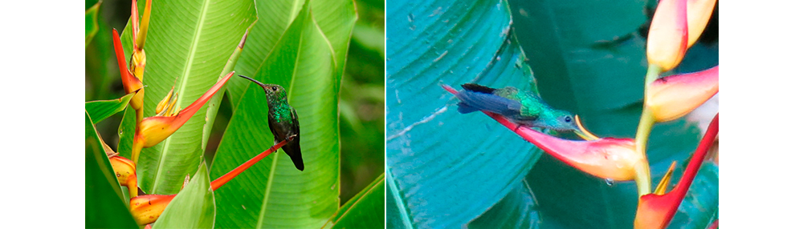
&emsp;&emsp;___Colibrís y heliconias. Fotos: mbakok (licencia CCBy) y plantpollinator (licencia CCByNcSa), ambos en Flickr._

***
***

## PLANTAS NATIVAS DE CANARIAS

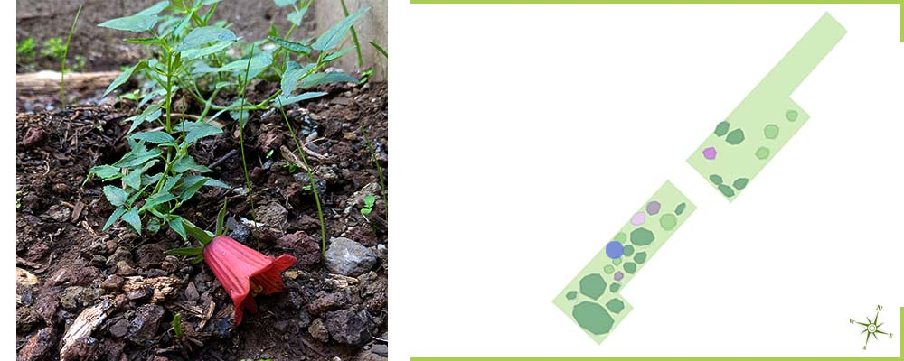
_Canarinas en su primera floración, en 2025_

### Bicácaro
_ Canarina canariensis_

El vivero del Cabildo cedió tres ejemplares de canarina, trasplantadas en noviembre.
Su hábitat principal son los bosques de laurisilva del archipiélago. Es una de las especies vegetales más emblemáticas de Canarias, considerada por algunos autores como la _flor nacional_ de las Islas. Tiene largos tallos trepadores, colgantes, o rastreros de hasta tres metros de longitud, y unas características flores, pedunculadas, de color anaranjado a rojo, en forma de campanilla, de  entre 3 y 6 cm. Su floración tiene lugar entre los meses de noviembre y mayo. Puede darse entre los 300 y los 1000 metros de altitud, en lugares sombríos y húmedos, en las islas de Tenerife, Gran Canaria, La Gomera, La Palma y El Hierro.

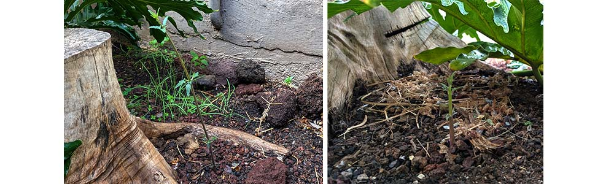

Tras florecer, las tres plantas desaparecieron en verano de 2025, siguiendo su ciclo natural y empiezan a rebrotar de sus rizomas en otoño.

La _Canarina_ fue uno de los primeros endemismos canarios reconocido como tal por Linneo, descrito en su obra [Hortus Cliffortianus](https://bibdigital.rjb.csic.es/idurl/1/11198) en 1738.

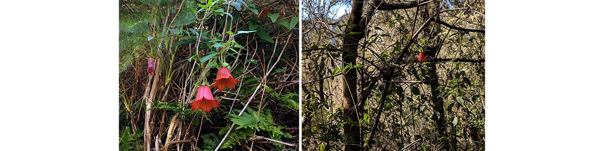
&emsp;&emsp;_Canarinas silvestres en el Monte del Agua. Los Silos, Tenerife._

**Historia del género Canarina**

En las _XXVII Jornadas Forestales de Gran Canaria_ celebradas en 2020 Mario Mairal dio una interesante charla online donde desarrolló una tesis sobre el uso de la _Canarina_ como especie central para un plan de protección y recuperación de la laurisilva en una zona de protección que incluya a las tres paleoislas de Tenerife. Desarrolló la historia de la especie, desde sus inicios en Asia hasta su expansión en África septentrional, actual Sahara, para luego retroceder hasta enclaves en la periferia de esa gran distribución.

Recomendable ver la ponencia: [Mario Mairal Pisa – El Ocaso invisible de la laurisilva](https://youtu.be/z4OBsSvbLX8?si=heW8fnri1-bbs37E)

***

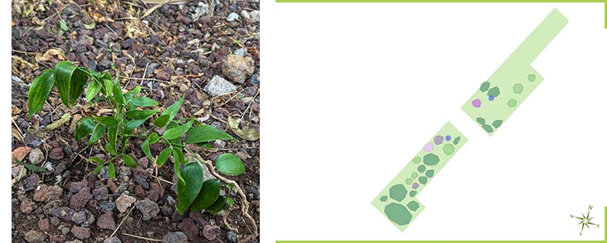
_Gibalberas cedidas por el Vivero la Tahonilla, recién plantadas en octubre 2025_

### Gibalbera
_Semele androgina_

La gibalbera es un endemismo macaronésico presente en Madeira y en las islas centrales y occidentales de Canarias.

Es una especie trepadora que puede llegar a alcanzar los 8 metros de largo. Con sus tallos largos, delgados, flexibles y nudosos se abraza a los troncos y ramas de los árboles más altos para llegar a sus copas y captar mejor los rayos solares. La gibalbera o alicacán es una de las especies trepadoras presentes en Canarias. Es frecuente formando parte del sotobosque de la laurisilva en las islas centrales y occidentales de nuestro archipiélago. En Gran Canaria hay otra especie de gibalbera (_Semele gayae_) endémica de esta isla. Una de las curiosidades de la gibalbera es que lo que generalmente vemos como hojas son en realidad tallos transformados que reciben el nombre de cladodios laminares, que hacen el papel de una hoja verdadera con función clorofílica. Los frutos son bayas globulares muy llamativas al madurar pues se vuelven de un rojo intenso.

Su nombre genérico deriva de la mitología griega, de Semele hija de Cadmo, fundador de Tebas y madre de Bacchus. El epíteto procede de _andros_ que significa masculino y _gyne_ que significa femenino, por las flores hermafroditas de la planta.

La gibalbera era empleada tradicionalmente en las fiestas de muchos pueblos, tanto para adornar las entradas a las plazas y los balcones de las viviendas como las carrozas en las populares romerías, este uso se debe a que la gibalbera conservaba durante mucho tiempo las falsas hojas y los tallos con una coloración verde, como si estuviera recién cogida. 

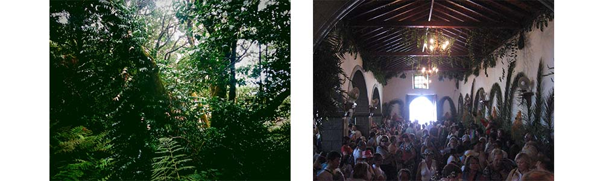
&emsp;&emsp;_Gibalberas en los bosques del Macizo de Anaga. | Decoración tradicional con gibalberas en la Ermita de El Socorro, Güímar, en 2007 con motivo de la Bajada anual de la Virgen_

***

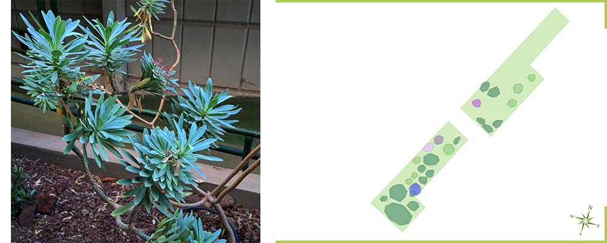

### Tabaiba roja
_Euphorbia atropurpurea_

Tabaiba roja, o tabaiba mejorera o más comúnmente tabaiba majorera. A pesar de su nombre vulgar tabaiba majorera, nada tiene que ver con la isla de Fuerteventura, y quizá proviene de una confusión con mejorera, que puede tener su origen en la creencia de mejoraba la leche de las cabras que la consumían. Es endémica de la isla de Tenerife. Se desarrolla entre los 300 a 1100 msnm en el sur y oeste de la isla, desde el valle de Güímar hasta el macizo de Teno, creciendo en barrancos y laderas. Sus flores son llamativas inflorescencias de color rojo-púrpura. En este jardín tiene un crecimiento muy lento.

Al igual que otras especies del género _Euphorbia_, toda la planta tiene un látex de color blanco, pegajoso y tóxico.

Ocasionalmente se hibrida con _Euphorbia lamarckii_, dando lugar a un híbrido denominado _Euphorbia x navae_, y con _Euphorbia aphylla_, generando el híbrido llamado _Euphorbia x petterssonii_. También se ha citado su hibridación con _Euphorbia bourgeana_ en la Ladera de Güímar.
Este caso es un buen ejemplo de por qué en jardinería con plantas nativas es recomendable usar especies que estén dentro de su área de distribución natural, dado el peligro de contaminación genética que supone el ponerlas en contacto con poblaciones de otras especies de su mismo género. Por ejemplo, ¿qué pasaría si usaras tajinaste rojo, especie de Tenerife, especialmente Las Cañadas del Teide y La Palma (_Echium Wildpretii_) en jardines en la zona del campus de Tafira, en Gran Canaria? ¿Afectaría a las poblaciones endémicas de tajinaste blanco (_Echium decaisnei_). De hecho, ya se considera una especie traslocada a la isla de Gran Canaria, escapada de su uso en jardinería, lo que quizá no haya sucedido aún es esa contaminación genética.

***

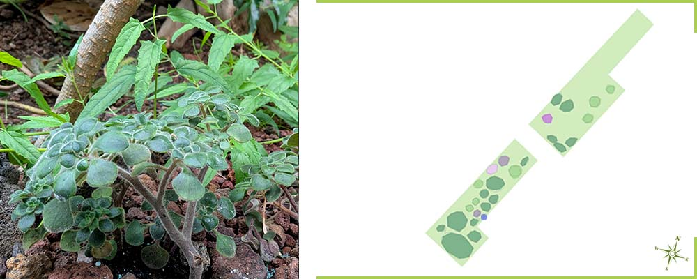
_Aichryson en enero 2026_

### Gongarillo
_Aichryson laxum_

_Aichryson_ es un género con unas 15 especies de plantas suculentas nativas de regiones subtropicales, principalmente de las Islas Canarias, con algunas en Azores, Madeira y Marruecos, y una en Portugal.
_Aichryson_ está estrechamente relacionado con _Monanthes_ y _Aeonium_ (ambos géneros también endémicos de las Islas Canarias).

_Aichryson laxum_ (_gongarillo canario, oreja de ratón, campanilla, melosilla_) es una especie tropical con hojas suculentas de la familia de las crasuláceas. Está en todas las Islas canarias, excepto en Lanzarote. Pertenece al grupo de especies herbáceas vellosas. Es una pequeña planta, anual o bianual, que crece en el suelo pero también en paredes, muros de fincas, incluso sobre árboles. De aspecto delicado y ramas frágiles la coloración de toda la planta puede variar desde el rojo al verde, según la insolación que reciba, tiene bellas flores amarillas en forma de estrella.

Los ejemplares de este jardín se recolectaron de muros de fincas de viñedo en la zona alta de La Matanza, en los volcanes de San Antonio.

_Aichryson_: del griego: aei, que significa "siempre" y chrysos, que significa "oro", por el color de las flores, persistentes durante mucho tiempo.
_laxum_: del latín "laxo, flojo, poco apretado", aludiendo a las hojas blandas de esta planta.

Sobre el nombre común _gongarillo_, el [Diccionario de guanchismos de la ULPGC dice](https://guanchismos.ulpgc.es/item/12623):

>El nombre de Góngora es topónimo de Gran Canaria que recibe una punta del pequeño tramo de costa perteneciente al municipio de Artenara, un poco antes de llegar a la zona de la plataforma conocida por Las Arenas, entre Los Picachos y el Andén Verde. Es posible que este nombre de Góngora, que es el que nosotros hemos recogido de la tradición oral (La toponimia de Gran Canaria 1997: CDRom), sea deformación de la voz góngaro, como así recoge el GAC (172 A1 y A2), quien no solo cita la Punta de Góngaro sino además un Morro de Góngaro y una zona de costa con el simple nombre de Góngaro, de donde lo toman la punta y el morro. Si esto fuera así, parece evidente que Góngora es una interpretación por etimología popular desde el raro y casi desconocido góngaro.

Es interesante el artículo [Notas taxonómicas y de nomenclatura sobre las Crassulaceae de las Islas Canarias, España](https://www.researchgate.net/publication/233493330_Taxonomic_and_nomenclatural_notes_on_Crassulaceae_of_the_Canary_Islands_Spain), publicado en Willdenowia 38, diciembre 2008 (Bañares Baudet, Á., Marrero Gómez, M. V. & Scholz, S.), donde se actualizan estudios sobre las crasuláceas canarias: _Aeonium_, _Monanthes_ y _Aichryson_. En él se confirma y describe el _Aichryson laxum_ var. _latipetalum_ en el Barranco de Añavingo, entre 800 y 1000msnm, ya mencionada por Praeger en 1929. En el municipio de Arafo, es un barranco muy profundo y aislado. El incendio de los montes de Tenerife de 2023 afectó también a la cuenca de este barranco.

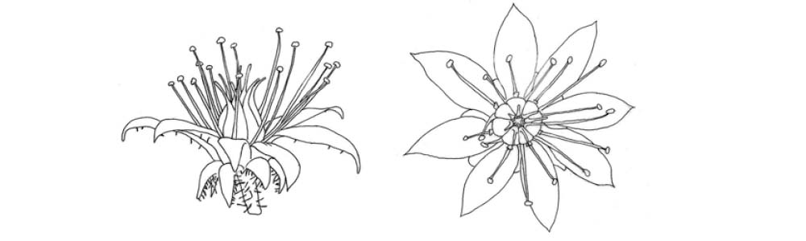
&emsp;&emsp;_Flores de _Aichryson laxum_ var. _latipetalum_. Dibujos de Carlos M Rodríguez Hernández_

Robert Lloyd Praeger, botánico irlandés y experto en la familia de las _Crasuláceas_ visitó Canarias en 1924 y 1926 para llevar a cabo una revisión sistemática de los géneros _Greenovia_, _Aeonium_, _Monanthes_ y _Aichryson_. Entre 1926 y 1930 publica una serie de artículos científicos sobre este grupo de plantas y en 1932 su libro _An Account of the Sempervivum Group_ fue publicado por The Royal Horticultural Society London. En el libro Praeger cataloga 62 especies en los cuatro géneros en Macaronesia y también comenta la existencia de numerosos híbridos naturales. Su monografía es una de las publicaciones más interesantes sobre la flora canaria del siglo XX. 

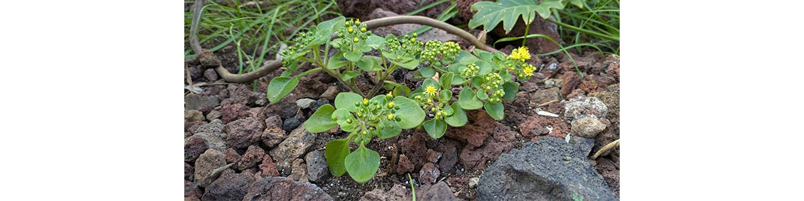
&emsp;&emsp;_Floración en primavera 2026_

[INICIO](https://jardinedu.github.io/cifpcm/inicio) | [ÍNDICE DE JARDINES](https://jardinedu.github.io/cifpcm/jardines) | [BIBLIOGRAFÍA-REFERENCIAS-APÉNDICES](https://jardinedu.github.io/cifpcm/biblio) | [PROYECTO2026](https://jardinedu.github.io/cifpcm/proyecto2026) | [VISUAL](https://jardinedu.github.io/cifpcm/visual) | [NOTAS](https://jardinedu.github.io/cifpcm/notas)

contacto: correoprofe@proton.me / [bio](https://jardinedu.github.io/cifpcm/about) 

