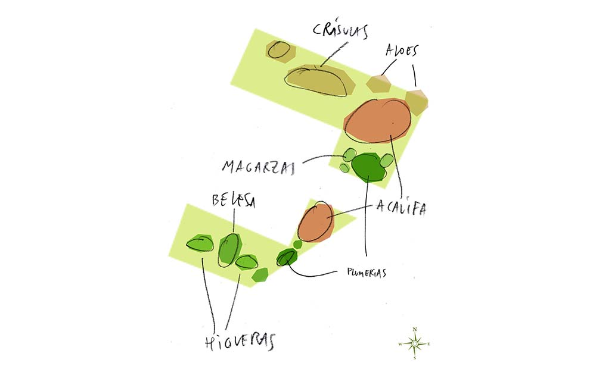
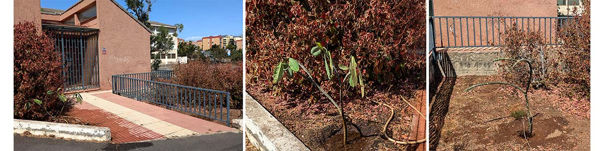
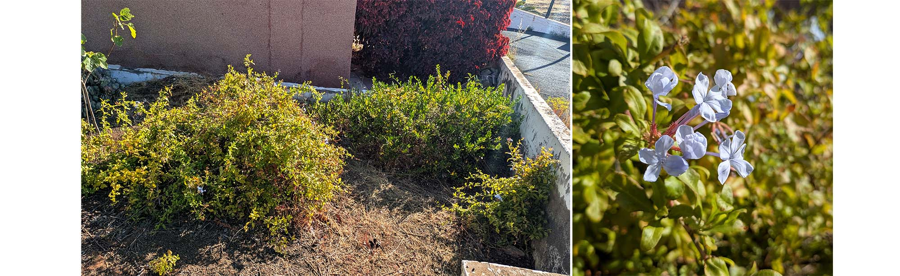

# 4. Jardines de las belesas

Octubre 2024 
Se empezaron a reacondicionar varios parterres alrededor de la Casita de Sonido.
De momento se han plantado ejemplares de _Plumeria rubra_, recogidos de la tala de un antiguo ejemplar en la calle Heliodoro Rguez. Glez. de Santa Cruz.

En proyecto está controlar el excesivo crecimiento de las parchas, reorganizar los aloes y crasas, mantener magarzas que están brotando de forma natural, limpiar las belesas, plantar unos ejemplares de higuera, y poco a poco plantear un ajardinamiento.

&emsp;&emsp;_Plumerias recién plantadas, octubre 2024_

Junio 2026 
Tras el invierno 2025/2026, unas belesas que ya estaban aquí se están recuperando, y aparecen algunas más brotando por rizoma, junto a u cornical que ha crecido bastante. En lygar de intervenir más, por ahora creo que es mejor cuidar estos ejemplares y darle unas buenas condiciones. 
El cornical es una planta nativa, interesante por su bajo mantenimiento. La belesa es una planta muy presente en la jardinería tradicional en Canarias, con una historia interesante, especialmente alrededor de su etimología:

### Belesa
_Plumbago auriculata_ (_Plumbago capensis_)

El jazmín azul (_Plumbago auriculata_) es una especie de planta herbácea de la familia _Plumbaginaceae_, es endémica de Sudáfrica. Nombres comunes: altabaca, belesa, dentalaria, hierba de San Antonio, hierba matapeces, matapeces, plumbago, malacara, plumbago azul, plumbago de El Cabo.

&emsp;&emsp;_Belesas y cornical, junio 2026_

Flores celestes a azules. Es una planta trepadora excelente para cubrir muros, celosías y verjas, pero también como cobertora del suelo. Puede cultivarse en maceta, formando una esfera de flores azules muy bonita. El plumbago quiere calor y resiste largos periodos de sequía. Planta perenne de hábito arbustivo o trepador, crecimiento rápido e inflorescencias azules que produce casi todo el año. Es una planta de alto valor ornamental. 

Su nombre deriva del latín _plumbum_, que significa plomo. Se cree que la planta se utilizaba en la antigüedad para elaborar una cura para la intoxicación por plomo.

La planta se usa en Canarias y Cuba como ornamental. En Canarias se conoce como _belesa_, en Cuba se cultiva desde el siglo XIX y se la conoce como embeleso, belesa, embeleso, azulejo, celest(e).

Un embeleso es un sueño corto y ligero, aunque en Canarias (y Andalucía) embeleso se usa como adormecimiento. A la _belesa_ se le atribuyen virtudes narcóticas. 
El uso de la palabra embeleso como sueño ligero y breve pasa a la _belesa_ por ser planta que se emplea para emborrachar los peces y pescarlos. _Embelesar_ tiene la acepción etimológica de _aturdir_. En portugués significa "quedar aturdido de resultas de un golpe".

Las plantas llegadas a Canarias desde América traían habitualmente consigo los nombres del otro lado del Atlántico; por otra parte, muchas de las plantas que se cultivaban en América, se trajeron a Europa pasando por las Islas, donde tras un periodo de aclimatación, sobre todo en el Jardín de Aclimatación de La Orotava, se llevaban luego a la Península. Es difícil determinar por qué vía llegó la _Belesa capensis_ a América o a España, perp se puede suponer que el fitónimo _belesa_ llegó a Canarias desde Cuba.

Es llamativa la relación de embeleso con el efecto que produce la belesa precisamente en los peces y no en los humanos, lo que haría suponer que la práctica de esta modalidad de pesca fue algo tan frecuente como para dar lugar al nacimiento de un sentido figurado. Con esta finalidad fueron usadas otras plantas además de la belesa. De forma paralela a embelesar, embarbascar además de intoxicar a los peces con esta hierba, ha desarrollado en El Salvador y Venezuela el sentido figurado ‘enamorar ciegamente’, paralelo al de embelesar, lo que apoyaría la idea de que las acepciones modernas se desarrollaron a partir del uso de la planta en la pesca.

En lugar de _embelesar_ en Casnarias se usó la expresión _embarbascar_ (o envarbascar): Envenenar el agua con verbasco u otra sustancia análoga como método de pesca para aturdir a los peces. Viera y Clavijo, en su Historia de Canarias, escribe que los primitivos isleños usaban una técnica de pesca consistente en envenenar con leche de cardón o euforbia (tabaiba amarga) grandes charcos donde después de la marea quedaban atrapados los peces, de modo que aturdidos se pueden coger con las manos. Esta práctica se siguió realizando, al menos en Fuerteventura, hasta casi el siglo XX.

Datos extraídos del muy interesante trabajo: [Etimología e historia de un fitónimo canario y cubano. Embeleso: ‘belesa’](https://riull.ull.es/xmlui/bitstream/handle/915/16342/RF_25_%282007%29_15.pdf)

[INICIO](https://jardinedu.github.io/cifpcm/inicio) | [ÍNDICE DE JARDINES](https://jardinedu.github.io/cifpcm/jardines) | [BIBLIOGRAFÍA-REFERENCIAS-APÉNDICES](https://jardinedu.github.io/cifpcm/biblio) | [PROYECTO2026](https://jardinedu.github.io/cifpcm/proyecto2026) | [VISUAL](https://jardinedu.github.io/cifpcm/visual) | [NOTAS](https://jardinedu.github.io/cifpcm/notas)

contacto: correoprofe@proton.me / [bio](https://jardinedu.github.io/cifpcm/about) 

