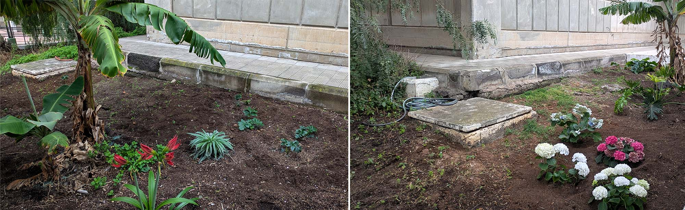
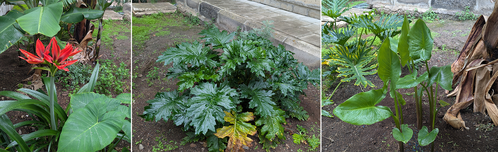
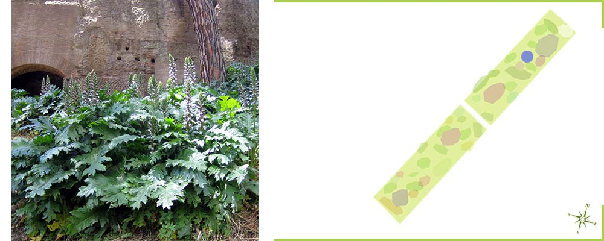
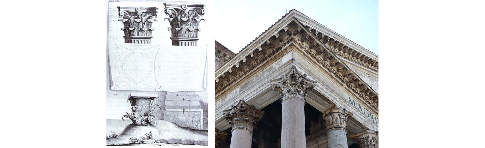

# 5. Jardín de la platanera

Este jardín está en proceso, sin prisa. He respetado una platanera ornamental presente con anterioridad, y en la limpieza del parterre he rescatado diversos bulbos de azucenas, agapanto, etc. incluso unas calas.
Estoy probando con un grupo de acantos y un filodendro, junto a unas hortensias, con la esperanza de que les sea favorable el suelo acidificado por los _Schinus molle_. 

&emsp;&emsp;_Noviembre 2026_

***

_Acantos asilvestrados en el Palatino, Roma. Foto: Anthony Majanlahti en Flickr. CC-By_

### Acanto
_Acanthus mollis_

Es un arbusto de grandes hojas brillantes y espinosas y con una floración muy elegante en espiga, de altas flores blancas y lilas.
Las tres especies de acanto son nativas del centro y este de la región mediterránea, adaptada desde la antigüedad en el cultivo de jardines, y ahora naturalizada y cultivada prácticamente en todo el mundo.
Se describió y publicó por vez primera en Species Plantarum, en 1753 por Carlos Linneo.

Tiene usos medicinales pero sobre todo, presencia en el arte. El motivo de la hoja de acanto como elemento decorativo se remonta a la antigua Grecia y Roma. Según el arquitecto romano Vitruvio, un escultor griego llamado Calímaco (siglo V a.C.) lo inventó para el capitel de estilo corintio tras ver crecer una planta de acanto a través de una cesta colocada sobre la tumba de una niña, copiando esa forma para crear un nuevo tipo de capitel. A lo largo de los siglos, este elegante diseño de hojas apareció en capiteles de columnas corintias, frisos, tallas de madera y otros elementos. Con múltiples variantes se utiliza en las épocas griega, romana, bizantina, y en toda la historia de la arquitectura hasta los neoclasicismos, el _nouveau_ y _deco_, etc. 
La revista Espores dedicó un artículo al [acanto en el arte](https://espores.org/es/es-plantas/el-acanto-en-el-arte/)

&emsp;&emsp;_El mito de la creación del orden corintio, según un dibujo de la traducción francesa de Vitruvio por Claude Perrault en 1689. Columnas corintias con capiteles de hoja de acanto en el Panteón de Roma. Foto: Carole Raddato CC-By-Sa_

[INICIO](https://jardinedu.github.io/cifpcm/inicio) | [ÍNDICE DE JARDINES](https://jardinedu.github.io/cifpcm/jardines) | [BIBLIOGRAFÍA-REFERENCIAS-APÉNDICES](https://jardinedu.github.io/cifpcm/biblio) | [PROYECTO2026](https://jardinedu.github.io/cifpcm/proyecto2026) | [VISUAL](https://jardinedu.github.io/cifpcm/visual) | [NOTAS](https://jardinedu.github.io/cifpcm/notas)

contacto: correoprofe@proton.me / [bio](https://jardinedu.github.io/cifpcm/about) 

