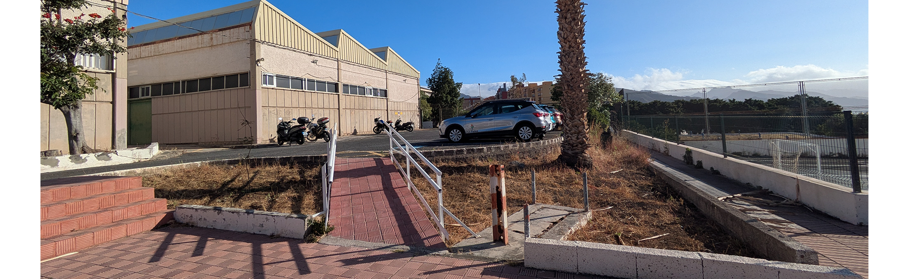
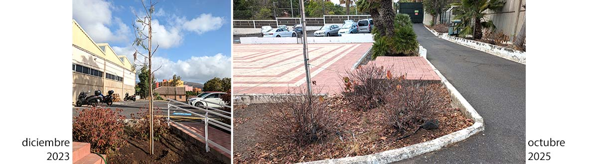
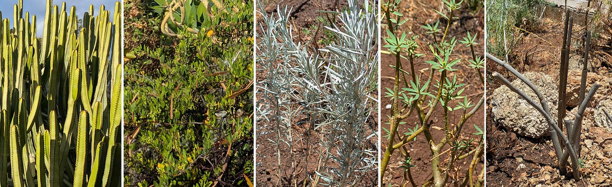

# 6. Tabaibal-Cardonal

Un proyecto para 2026-2027 es convertir una pequeña ladera en el patio del Salón de Actos en una zona de tabaibal-cardonal exclusivamente con especies nativas de Canarias. 

En 2025 una plaga arrasó unas _Acalyphas_ que llevaban años en esa zona. Es difícil saber la causa concreta: pudo ser consecuencia del cambio climático, pudo ser una debilidads previa de las acalifas, o incluso puede que la plaga viniera con árbol que se plantó en diciembre 2023, un pino de oro (_Grevillea robusta_) que llegó con las ramas de un lado dañadas (quizá por haber crecido junto a una pared), nunca tuvo buen desarrollo, estaba en la zona probable de inicio de esta plaga, y sucumbió junto a las acalifas. 

En la foto vemos lo que debió ser el inicio de la infección: el grupo de acalifas junto al pino de oro, recién plantado en diciembre 2023 y ya sin hojas y con las acalifas afectadas en octubre 2025. En segundo plano vemos otras acalifas también agonizantes. Las palmeras (_Chamaerops humilis_ y _Washingtonia filifera_) no se vieron afectadas.

El terreno ha quedado a cero. Considerando su orientación, insolación y la posibilidad de que permanezca la plaga, la idea es ubicar aquí los cardones que voy a retirar del Pabellón 4 porque tendrán unas condiciones más adecuadas a lo que necesitan. Esos cardones serán el centro de un pequeño reducto de tabaibal-cardonal: cardones, tabaibas dulces, cardoncillo, orijama, cornical, todo ello sobre una cobertura de zahorra (jable), que mantenga la humedad del suelo y evite en parte las malas hierbas y en poco tiempo haga que este conjunto de especies no necesite riegos ni más cuidados que alguna limpieza anual.

---

[INICIO](https://jardinedu.github.io/cifpcm/inicio) | [ÍNDICE DE JARDINES](https://jardinedu.github.io/cifpcm/jardines) | [BIBLIO.-REFER.-APÉND.](https://jardinedu.github.io/cifpcm/biblio) | [PROYECTO2026](https://jardinedu.github.io/cifpcm/proyecto2026) | [VISUAL](https://jardinedu.github.io/cifpcm/visual) | [NOTAS](https://jardinedu.github.io/cifpcm/notas)
