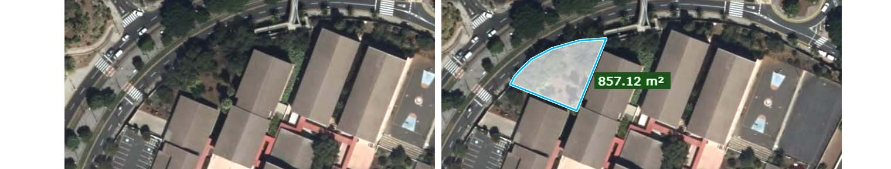
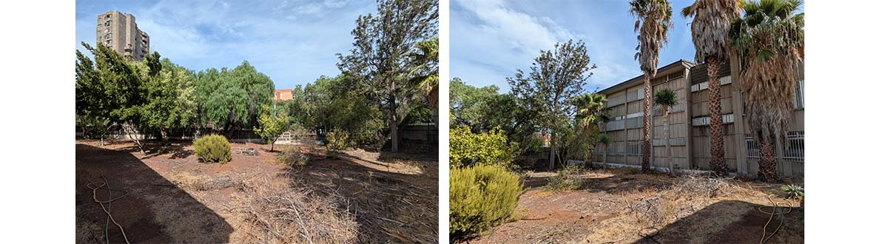
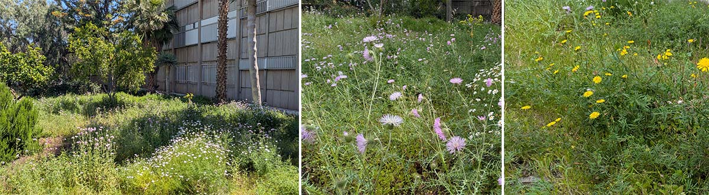
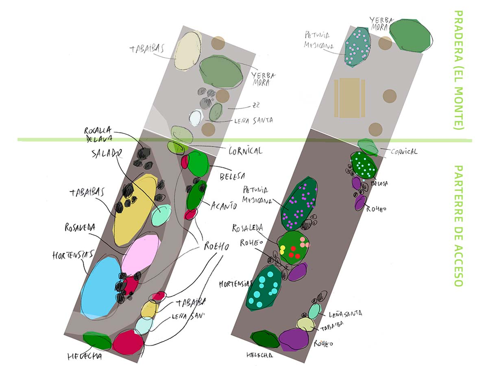
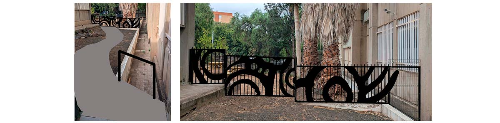
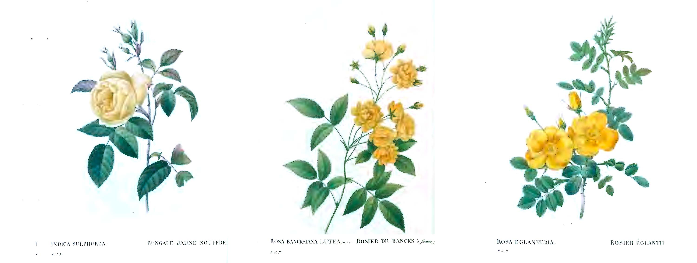

# 7. El monte

Entre el edificio de Secretaría, el Pabellón 1 y el cerramiento del recinto por el norte hay un triángulo de unos 850m². Actualmente hay una fila de pimenteros en el borde con la Avenida Príncipes de España, varias palmeras (_Washingtonia_) altas, dos dragos con desarrollo un poco desequilibrado (demasiado altos para su primera ramificación) y varios frutales: nisperero, granado, limonero, romero. También un palo blanco, dos belesas y numerosas lantanas (enfermas de mosca blanca), en medio de esa pradera de hierbas silvestres. Podríamos hablar de un estado de un cierto abandono hasta 2026. Fui eliminando lantanas, haciendo una primera limpieza de hierbas y respetando magarzas nacidas espontáneamente. 

Esta zona ya tenía el potencial de ser un lugar donde el alumnado pudiera estar, pasear, sentarse a la sombra, con pocas intervenciones de jardinería en sí, y más cerca del paisajismo, manteniendo los elementos que de sombra.

&emsp;&emsp;_Estado de la zona en octubre 2025_

Después de un invierno muy lluvioso, en primavera 2026 se convirtió en una espectacular pradera de cerrajillas y cardos, puntuada con los árboles que se empiezan a recuperar. Es un momento casi efímero que indicaba ya un potencial y una opción para tratar ese sitio, si nos atrevemos a imaginar, profundizando en las ideas del _tercer paisaje_ de Gilles Clément. 

&emsp;&emsp;_Flores silvestres en abril 2026_

Por iniciativa del equipo directivo del Centro se hizo tala controlada de los pimenteros y una limpieza de hierbas y restos por parte de una empresa especializada. Desde septiembre de 2026 esta zona ha pasado a integrarse en el [Proyecto2026](https://jardinedu.github.io/cifpcm/proyecto2026), acogiendo una serie de plantas nativas, bancos y mesas y buscando convertirse en un lugar muy utilizado por el alumnado (y profesorado).

En un futuro se maneja también la opción de ordenar de alguna forma el lugar con unos pequeños caminos, para lo cual hay algunas propuestas, como la siguiente:

Falta mucho trabajo y tener la paciencia necesaria para que la vegetación se desarrolle y ver la evolución del sitio.

***

## Acceso a El monte
En este espacio, complicado, he ido planteándome soluciones, más que proyectos en sí. Dadas las condiciones de luz, corrientes de aire, etc. he ido renunciando a algunas soluciones que difícilmente funcionarían, como estas de 2025:

&emsp;&emsp;_Proyecto del parterre en 2025, ya desechados, lo trataban como un pasillo con pequeños grupos de plantas a los lados._

Lo más adecuado para este rectángulo es que sea simplemente el acceso natural a _El monte_, con un camino, una verja de entrada y una visión clara de a dónde llegamos, con alguna planta nativa y algún recuerdo de estados anteriores de este sitio.

A la espera de concretar ideas se colocarán algunas plantas nativas y también mantengo unas hortensias ya existentes y a distancia media una mini rosaleda. 

**Los rosales**
Los rosales son una memoria del pasado de este parterre, no sé quién plantó los primeros pero quienes llevan años trabajando en este Centro siempre los recuerdan. También, para mí son un pequeño homenaje a mi madre, que es una gran amante de las rosas, y cuidó una pequeña rosaleda en su jardín trasero. Compraba rosales por correo en Barcelona, mediante un catálogo, y le gustan especialmante las rosas amarillas, y aquí intento aclimatar tres variedades de ese color. Las tres son variedades comerciales: Friesia, Michelangelo y Oriental Peace. 

La historia de las rosas, su popularización a partir del jardín de La Malmaison de la Emperatriz Josefina Beauharnais, las ilustraciones de variedades de rosas de Redouté... hay todo un tema enorme y troncal en la historia de la jardinería de los dos últimos siglos. 

&emsp;&emsp;_Tres rosas amarillas ca.1817-1824, ilustraciones de Pierre-Joseph Redouté, en les Roses ([I](https://archive.org/details/CAT30984991_01)) ([II](https://archive.org/details/CAT30984991_02)) ([III](https://archive.org/details/CAT30984991_03))_

[INICIO](https://jardinedu.github.io/cifpcm/inicio) | [ÍNDICE DE JARDINES](https://jardinedu.github.io/cifpcm/jardines) | [BIBLIOGRAFÍA-REFERENCIAS-APÉNDICES](https://jardinedu.github.io/cifpcm/biblio) | [PROYECTO2026](https://jardinedu.github.io/cifpcm/proyecto2026) | [VISUAL](https://jardinedu.github.io/cifpcm/visual) | [NOTAS](https://jardinedu.github.io/cifpcm/notas)

contacto: correoprofe@proton.me / [bio](https://jardinedu.github.io/cifpcm/about) 

