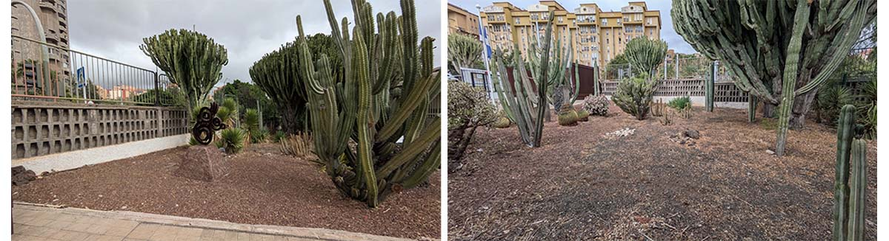
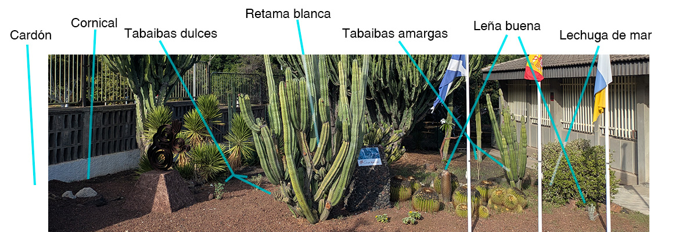
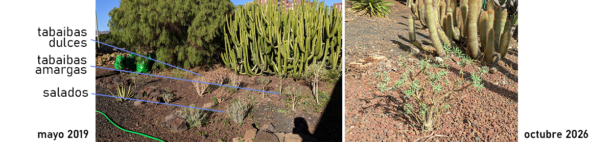

# 8. Jardín de cactus

&emsp;&emsp;_Vistas del jardín de cactus, octubre 2026_.

Este jardín de cactus, a la entrada del Centro, tiene la posibilidad de abrir un diálogo entre el uso de cactáceas y euforbiáceas exóticas y plantas nativas. Repito aquí mis reflexiones sobre este espacio que ioncluyo en el [proyecto2026](https://jardinedu.github.io/cifpcm/proyecto2026).

> Este espacio actualmente (septiembre 2026) se organiza como una colección de cactáceas. Aquí se ubican las banderas del Centro y dos tótem, uno con el logotipo del CIFP y otro con un mosaico (renovado este curso) con una imagen del artista lanzaroteño César Manrique, que da nombre al CIFP. Se reúnen, pues, elementos de identidad del Centro.

> Este jardín, tal como lo vemos en su estado actual, es claramente una referencia a la obra de César Manrique, quizá inspirado en una de sus obras más conocidas, el Jardín de Cactus de Guatiza, en Lanzarote. Lo dominan dos grandes cactus candelabro (Euphorbia candelabrum), rodeadas de diversas cactáceas: cereus y stenocereus, echinocactus, myrtillocactus, etc. así como crasuláceas y yucas, con nula presencia de flora nativa, todo ello sobre una base de picón rojo.

> En este primer jardín de entrada al Centro, propongo establecer un diálogo entre ese cliché _"a la César Manrique"_ con los criterios actuales de uso de flora nativa. Sin pretender un análisis crítico de los trabajos paisajísticos de César Manrique y sus conceptos en el uso de flora, podemos infiltrarnos en este grupo de cactáceas y esbozar otras cuestiones contemporáneas necesarias: sostenibilidad, función social, qué responsabilidades afrontamos y qué ideas nuevas podemos aportar a una jardinería en nuestro territorio. Hay mucho que pensar, y el proceso no va a ser rápido, porque en este primer jardín ya no solo hablamos de plantas. Relacionado con todo esto, tengo también mis reservas sobre el uso exclusivo de flora nativa, que nos puede llevar a un extremo de fundamentalismo vegetal y a deducir de ahí un sentido de _identidad_ -ese concepto tan manejado por el Poder. Ese nunca ha sido mi proyecto, y no creo que una jardinería en Canarias se deba basar en un uso exclusivo de plantas exóticas, pero tampoco en el uso exclusivo de nativas..

&emsp;&emsp;_Primer grupo de plantas nativas recién llegadas, octubre-noviembre 2026_.

A finales de octubre y principios de noviembre de 2026 ya se han plantado los grupos de nativas que a medida que crezcan irán cambiando el carácter de este espacio. En la siguiente imagen. Algunas plantas ni siquiera se ven por su tamaño, pero están ahí, detrás. Este momento, en este espacio en concreto, me devuelve a mayo de 2019, cuando tras meses de trabajos de limpieza, planté mis primeras plantas. Resultaron ser también _Euphorbia balsamifera_ y aunque en la foto el lugar parezca una desolación, hoy en día las plantas lo han convertido en un pequeño paraíso. 

&emsp;&emsp;_Primeras plantas_.

[INICIO](https://jardinedu.github.io/cifpcm/inicio) | [ÍNDICE DE JARDINES](https://jardinedu.github.io/cifpcm/jardines) | [BIBLIOGRAFÍA-REFERENCIAS-APÉNDICES](https://jardinedu.github.io/cifpcm/biblio) | [PROYECTO2026](https://jardinedu.github.io/cifpcm/proyecto2026) | [VISUAL](https://jardinedu.github.io/cifpcm/visual) | [NOTAS](https://jardinedu.github.io/cifpcm/notas)

contacto: correoprofe@proton.me / [bio](https://jardinedu.github.io/cifpcm/about) 

