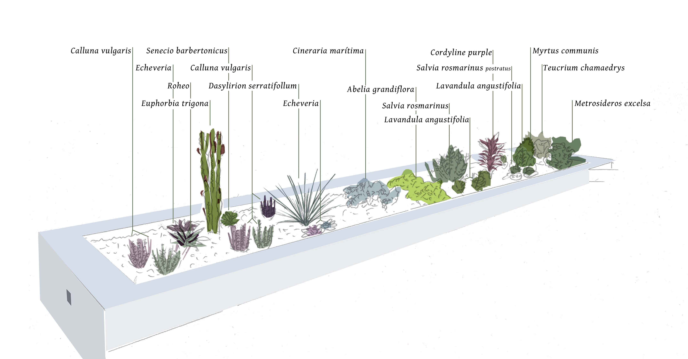
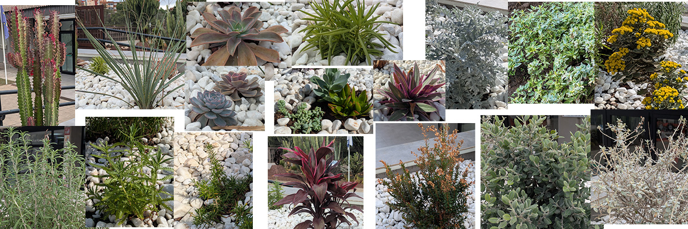

# 9. Jardín de L

Desarrollado en octubre de 2026, es una idea de Laura, fruto de la necesidad de eliminar un gigantesco ejemplar de cactus candelabro cuyas raíces habían afectado peligrosamente a un muro, a punto de caer. En su lugar se construyó un elegante parterre alargado, bien drenado. Según las sugerencias de L. se ha planteado un juego de formas, texturas y tamaños con plantas crasas, euforbias, mediterráneas, etc., todas ellas adecuadas a la xerojardinería. Es como una miniatura de jardín, de plantas exóticas que habla también de diversidad, de otros lugares. En cierto sentido me recuerda a la _orangeries_, que desde el siglo XVI se fueron poniendo de moda en Europa, y donde con grandes esfuerzos se creaban jardines de naranjos en climas en los que no deberían estar, por una pasión por lo exótico, quizá, muy humana. 

&emsp;&emsp;_Esquema inicial, octubre 2026_.

He tenido que cambiar alguna planta, por mi falta de experiencia en este tipo de soluciones pero en general el resultado es bueno y se resuelven adecuadamente la dimensión ecológica, la social y la estética. En una línea estrecha, impuesta por las proporciones del parterre. La ubicación del parterre plantea que al pasar a su lado hay un momento en que ves las plantas a nivel de tu mirada, la poca profundidad del parterre condiciona el tyamaño de las plantas, y el punto de drenaje condiciona también la ubicación de las especies según su necesidad de suelo con mayor o menor drenaje. Se empieza con una euforbia de dimensión vertical y un cactus de hojas muy delicadas y finas (ambos riman con las cactáceas y euforbias del jardín de cactus de enfrente) alrededor de los cuales hay varias crasuláceas y un rhoeo; más adelante, unas cinerarias, una abelia y una ajania marcan más o menos el centro del parterre; el tercer tramo lo componen aromáticas, muy de jardín mediterráneo: lavanda y dos tipos de romero que rodean a un cordyline; el fondo lo compone un triángulo de pequeños arbustos: mirto, teucrio y metrosideros. 

En la imagen, las plantas del parterre en noviembre 2026: **Fila superior**: _Euphorbia trigona_; _Dasylirion serratifolium_; arriba y abajo _Echeverias_; arriba _Senecio barbertonicus_; abajo un grupito formado por _Cotyledon gigantea_, _Crassula capitella_ y _Sedum burrito_; _Tradescantia spathacea_; _Cineraria maritima_; _Abelia grandiflora_; _Chrysanthemum pacificum_. **Fila inferior**: _Salvia rosmarinus_; _Lavandula angustifolia_; _Salvia rosmarinus postratus_; _Cordyline purple_; _Myrtus communis_; _Metrosideros excelsa_; _Teucrium chamaedrys_.

[INICIO](https://jardinedu.github.io/cifpcm/inicio) | [ÍNDICE DE JARDINES](https://jardinedu.github.io/cifpcm/jardines) | [BIBLIOGRAFÍA-REFERENCIAS-APÉNDICES](https://jardinedu.github.io/cifpcm/biblio) | [PROYECTO2026](https://jardinedu.github.io/cifpcm/proyecto2026) | [VISUAL](https://jardinedu.github.io/cifpcm/visual) | [NOTAS](https://jardinedu.github.io/cifpcm/notas)

contacto: correoprofe@proton.me / [bio](https://jardinedu.github.io/cifpcm/about) 

