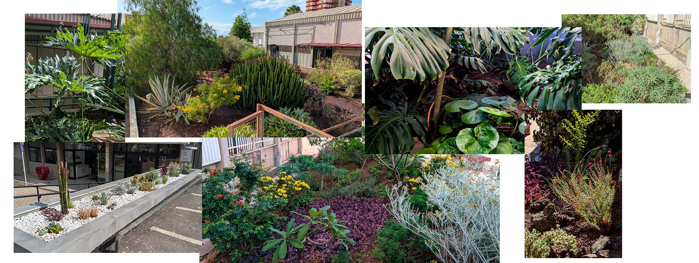
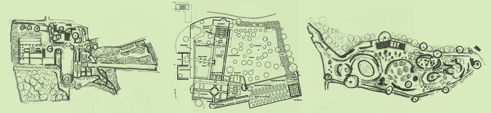

La propia dinámica de los sitios ha ido llevando este proyecto a un *jardín de jardines*. Salvando muchas distancias, como Sissinghurst, para entendernos.

##### ÍNDICE DE JARDINES. 
Visión general de cada jardín, con descripción de las especies utilizadas (generalmente ordenadas por orden de llegada) y todo dato que me parezca interesante sobre etimología de las plantas, historia de su descubrimiento, usos en jardinería y cualquier asunto relacionado que aparezca en mi camino, porque cada planta tiene una historia que contar.

1. [El primer jardín](https://github.com/jardinedu/cifpcm/blob/master/01elprimerjardin.md)
2. [Jardines de los frangipanes](https://github.com/jardinedu/cifpcm/blob/master/02jardinesdelosfrangipanes.md)
3. [Jardín de los filodendros](https://github.com/jardinedu/cifpcm/blob/master/03jardindelosfilodendros.md)
4. [Jardines de las belesas](https://github.com/jardinedu/cifpcm/blob/master/04jardindelasbelesas.md)
5. [Jardín de la platanera](https://github.com/jardinedu/cifpcm/blob/master/05jardindelaplatanera.md)
6. [Tabaibal-Cardonal](https://github.com/jardinedu/cifpcm/blob/master/06tabaibalcardonal.md)
7. [El monte](https://github.com/jardinedu/cifpcm/blob/master/07elmonte.md)
8. [Jardín de cactus](https://github.com/jardinedu/cifpcm/blob/master/08.jardindecactus.md)
9. [Jardín de L.](https://github.com/jardinedu/cifpcm/blob/master/09jardindel)
10. [Proyecto 2026]([#10-proyecto2026](https://github.com/jardinedu/cifpcm/blob/master/10proyecto2026.md))

---

&emsp;&emsp;_Hidcote Manor, Sissinghurst y LurGarden, ejemplos de "jardines de jardines". Los bocetos de izquierda y derecha son de Íñigo Segurola, creador de LurGarden._

# Lista de especies

<table>
<tr>
<th> Especies nativas de Canarias </th>
<th> Especies exóticas </th>
</tr>
<tr>
<td>
<small>
- <i>Aichryson laxum</i>. Gongarillo 
- <i>Argyranthemum frutescens</i>. Margarita/Magarza 
- <i>Artemisia Thuscula</i>. Incienso 
- <i>Bencomia caudata</i>. Bencomia 
- <i>Canarina canariensis</i>. Bicácaro 
- <i>Ceropegia dichotoma</i>. Cardoncillo 
- <i>Ceropegia fusca</i>. Cardoncillo 
- <i>Cneorum pulverulentum</i>. Orijama 
- <i>Convolvulus floridus</i>. Guaydil 
- <i>Dracaena draco</i>. Drago 

- <i>Erysimum bicolor</i>. Alhelí 
- <i>Euphorbia atropurpurea</i>. Tabaiba roja 
- <i>Euphorbia balsamifera</i>. Tabaiba dulce 
- <i>Euphorbia canariensis</i>. Cardón 
- <i>Euphorbia lamarckii</i>. Tabaiba amarga 
- <i>Hypericum canariense</i>. Granadillo 
- <i>Kleinia neriifolia</i>. Senecio/Verode 
- <i>Lavandula canariensis</i>. Lavanda/Matorrisco 
- <i>Lotus sessilifolius</i>. Corazoncillo 
- <i>Marcetella moquiniana</i>. Palo sangre 
- <i>Periploca laevigata</i>. Cornical 

- <i>Plocama pendula</i>. Balo 
- <i>Pterocephalus dumetorus</i>. Rosalito 
- <i>Rumex lunaria</i>. Vinagrera 
- <i>Schizogyne sericea</i>. Salado 

- <i>Semele androgina</i>. Gibalbera 
- <i>Sonchus tenerrimus</i>. Cerrajilla 
 
 
 
 
 
 
 
 
 
 
 
 
 
 
 
 
 
 
 
</small>
</td>

<td>
<small>
- <i>Abelia grandiflora</i>. Abelia 
- <i>Acanthus mollis</i>. Acanto 
- <i>Adenium obesum</i>. Rosa del desierto 
- <i>Agave americana</i>. Pitera 
- <i>Agave attenuata</i>. Ágave 
- <i>Aloe vera</i>. Aloe 
- <i>Asclepias curassavica</i>. Asclepias 
- <i>Aspidistra elatior</i>. Hoja de salón 
- <i>Breynia dischita</i>. Pompadour 
- <i>Brugmansia suaveolens</i>. Santas noches 
- <i>Canna indica</i>. Platanillo 

- <i>Colocasia esculenta</i>. Ñamera 
- <i>Crassula arborescens</i>. Suculenta 
- <i>Crassula argentea</i>. Suculenta 
- <i>Dimorphoteca Ecklonis</i>. Margarita del Cabo 
- <i>Duranta erecta</i>. Duranta 
- <i>Euphorbia candelabrum</i>. Candelabro 
- <i>Euryops pectinatum</i>. Margarita amarilla 
- <i>Farfugium japonicum</i>. Capa de la reina 
- <i>Ficus carica</i>. Higuera 
- <i>Goeppertia louisae</i>. Calatea 

- <i>Loropetalum chinense</i>. Loropétalo/Arbusto chino 
- <i>Maranta leuconeura</i>. Maranta 
- <i>Maranta leuconeura</i> variegata. Maranta 
- <i>Mirabilis jalapa</i>. Dondiego de noche 
- <i>Monstera adansonii</i>. Planta “queso suizo” 
- <i>Monstera deliciosa</i>. Costilla de Adán 
- <i>Nerium oleander</i>. Adelfa enana 
- <i>Oenothera lindheimeri</i>. Gaura 
- <i>Opuntia ficus-indica</i>. Penca/Tunera 

- <i>Osteospermium fruticans</i>. Margarita del Cabo 
- <i>Pallenis maritima</i>. Margarita de mar 
- <i>Philodendron bipinnatifidum</i>. Filodendro narrow 
- <i>Philodendron erubescens</i>. Filodendro rojo 
- <i>Philodendron hastatum</i>. Filodendro espada de plata 
- <i>Plumbago auriculata</i>. Belesa 
- <i>Plumeria pudica</i>. Frangipán ramo de novia 
- <i>Plumeria rubra</i>. Frangipán 
- <i>Ricinus communis</i>. Tartaguero 
- <i>Salvia rosmarinus</i>. Romero 
- <i>Schinus molle</i>. Pimentero 
- <i>Tecoma stans</i>. Tecoma 
- <i>Tecomaria capensis</i>. Tecomaria 

- <i>Thaumatophyllum bipinnatifidum</i>. Filodendro selloum 
- <i>Thaumatophyllum xanadu</i>. Filodendro xanadu 
- <i>Tradescantia pallida</i>. Tradescantia 
- <i>Tulbaghia violacea</i>. Tulbaghia 
- <i>Westringia fruticosa</i>. Romero australiano 

</small>
</td>
</tr>
</table>

***

[INICIO](https://jardinedu.github.io/cifpcm/inicio) | [ÍNDICE DE JARDINES](https://jardinedu.github.io/cifpcm/jardines) | [BIBLIO.-REFER.-APÉND.](https://jardinedu.github.io/cifpcm/biblio) | [PROYECTO2026](https://jardinedu.github.io/cifpcm/proyecto2026) | [VISUAL](https://jardinedu.github.io/cifpcm/visual) | [NOTAS](https://jardinedu.github.io/cifpcm/notas)

contacto: correoprofe@proton.me / [bio](https://jardinedu.github.io/cifpcm/about) 

***
