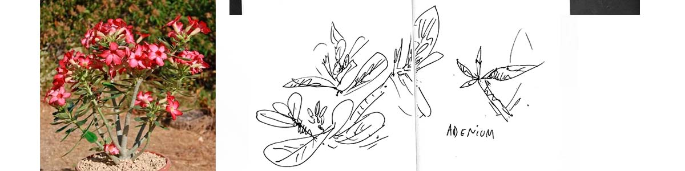

### notas_
***

##### 2026.10.01

Encontré en un vivero unos _Adenium_, no conocía ese género de suculentas en jardinería pero es muy interesante. Son 15 especies de arbustos del este y sur de África y Arabia. El _Adenium boehmianum_ (veneno del bosquimano), por ejemplo, venenosa endémica de las regiones más secas del norte de Namibia y el sur de Angola, usada por los cazadores bosquimanos para extraer de ella un veneno cardiotóxico muy potente para sus flechas, con el que pueden cazar grandes mamíferos. El A_denium socotranum_ es, como su nombre sugierte, endémico de la isla de Socotra, de los pocos sitios del planeta a donde me gustaría viajar. El que se está comercializando en viveros parece ser _Adenium obesum_, (rosa del desierto), un arbusto con unas flores que riman con las de los frangipanes en forma y color, con lo que quizá sea interesante combinarlos.

***
url: [www.jardinedu.es](https://jardinedu.github.io/cifpcm/inicio) / contacto: correoprofe@proton.me / [bio](https://jardinedu.github.io/cifpcm/about) 

***
---
